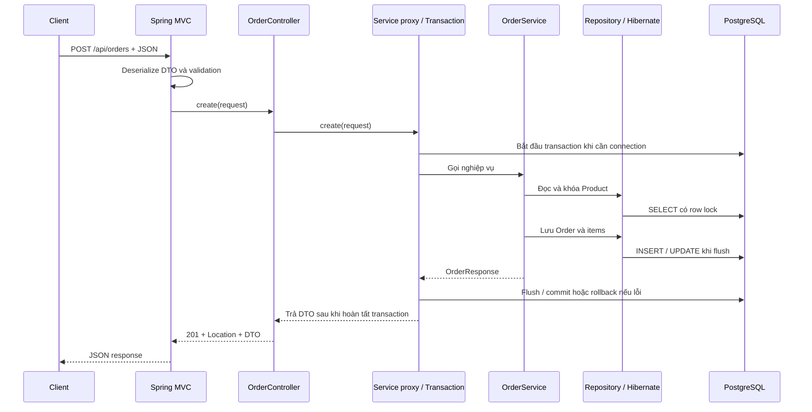

# Ôn phỏng vấn Fresher Java Backend — Order Management API

Tài liệu được cập nhật theo source ngày **17/11/2026**, bao gồm Product Search, Order Lifecycle và Inventory Movement History. Mỗi chủ đề đi từ khái niệm, ví dụ đơn giản, đến câu trả lời ngắn khi phỏng vấn. Các liên kết trỏ tới file thật; tên method giúp tìm đúng vị trí. Phân biệt kiến thức chung với tính năng đã triển khai.

Project có CRUD/tìm kiếm/lọc/phân trang Product và vòng đời Order: CREATED → CONFIRMED → SHIPPED → DELIVERED hoặc CREATED → CANCELLED. Stock trừ khi tạo, chỉ hoàn khi hủy từ CREATED. Chưa có đăng nhập, phân quyền, thanh toán, khách hàng hay idempotency key. CustomerOrder không phải entity Customer. Căn cứ: [ProductController][pc], [OrderController][oc], [OrderService][os], [OrderStatus][status], [pom.xml][pom].

Lần chạy local `clean verify -Pintegration` ngày **17/11/2026** ghi nhận **283 lượt test pass**, không failure/error/skip: 111 unit, 96 MVC slice và 76 PostgreSQL integration. Kết quả 67 test trong [REVIEW.md][review] là mốc lịch sử ngày 12/11; không dùng thay số liệu hiện tại. Không suy diễn số test thành coverage hay hiệu năng. Căn cứ: [OrderServiceTest][ost], [OrderStatusTest][statustest], [ProductServiceTest][pst], [ProductSearchQueryTest][searchquerytest], [ApiControllerTest][webtest], [OrderManagementIT][it], [ProductSearchIT][searchit], [README — Testing](README.md#testing).

## Mục lục

1. [Kiến trúc](#phan-1)
2. [Database và JPA](#phan-2)
3. [Transaction và cạnh tranh tồn kho](#phan-3)
4. [REST API](#phan-4)
5. [Testing và giải thích từng test](#phan-5)
6. [Java Core từ code thật](#phan-6)
7. [Luyện phỏng vấn](#phan-7)
8. [Trace code](#phan-8)

<a id="phan-1"></a>

## Phần 1. Kiến trúc

### 1.1. Spring Boot hoạt động thế nào?

**Nền tảng:** Spring cung cấp hạ tầng quản lý đối tượng, web và truy cập dữ liệu. Spring Boot giúp khởi tạo ứng dụng Spring với cấu hình mặc định có điều kiện. Nó xem dependency trên classpath, cấu hình và bean đã khai báo để chọn auto-configuration; không phải thấy annotation là tự sinh toàn bộ nghiệp vụ. [Tài liệu auto-configuration](https://docs.spring.io/spring-boot/3.5/reference/using/auto-configuration.html).

**Trong project:** `main()` gọi `SpringApplication.run(...)`. `@SpringBootApplication` kết hợp vai trò cấu hình, component scanning và bật auto-configuration. Class chính ở package gốc nên các controller/service trong package con được phát hiện. Starter web cung cấp hạ tầng MVC/server nhúng; starter JPA và datasource PostgreSQL cung cấp hạ tầng persistence. Flyway chạy migration, còn Hibernate được cấu hình kiểm tra schema. Căn cứ: [OrderManagementApplication][app], [pom.xml][pom], [application.yml][config], [migration V1][schema].

**Ví dụ dễ nhớ:** Boot giống bộ khung căn bếp đã lắp điện, nước và bếp. Bạn vẫn phải viết công thức nấu ăn — ở đây là `OrderService.create()` và `cancel()`. Căn cứ: [OrderService][os].

**Trả lời ngắn:** “Spring Boot khởi tạo Spring ApplicationContext, phát hiện các bean và cấu hình hạ tầng dựa trên dependency cùng properties. Trong project, em dùng starter web, JPA và validation; nghiệp vụ đặt hàng vẫn do service của em xử lý.” [Code khởi động][app], [dependencies][pom].

### 1.2. IoC Container, Bean và Dependency Injection

**Nền tảng:** IoC là chuyển quyền điều phối việc tạo và nối các đối tượng cho framework. Container, thường tiếp cận qua `ApplicationContext`, quản lý các đối tượng gọi là bean. DI là cách container cấp những dependency mà một đối tượng cần. [Tài liệu IoC và bean](https://docs.spring.io/spring-framework/reference/6.2/core/beans/introduction.html).

**Ví dụ:** Controller cần service; service cần repository. Thay vì controller tự tạo một chuỗi `new ...`, Spring cung cấp đúng đối tượng đã được cấu hình. Trong project, `OrderController` nhận `OrderService`, còn `OrderService` nhận ba repository, gồm StockMovementRepository để ghi journal cùng transaction. Repository implementation được Spring Data cung cấp qua proxy. Căn cứ: [OrderController — constructor][oc], [OrderService — constructor][os], [OrderRepository][or].

**Điểm dễ nhầm:** `Product` có `@Entity` nhưng không vì vậy trở thành Spring Bean. Các instance sản phẩm do nghiệp vụ/JPA tạo và có thể được persistence context quản lý. Singleton bean của Spring cũng không đồng nghĩa mọi request dùng chung một transaction; service hiện tại không lưu dữ liệu riêng của request vào field. Căn cứ: [Product][product], [ProductService][ps], [OrderService][os].

**Trả lời ngắn:** “IoC Container quản lý bean; DI là việc cung cấp dependency cho bean. Em để Spring tạo controller và service, sau đó inject repository qua constructor. Entity được JPA quản lý theo cơ chế khác, không phải cứ có annotation là Spring Bean.” [Controller][oc], [service][os], [entity][product].

### 1.3. `@RestController`, `@Service`, `@Repository`

| Thành phần | Ý nghĩa | Ví dụ thật |
| --- | --- | --- |
| `@RestController` | Controller web có giá trị trả về được ghi ra HTTP body qua message converter; thường là JSON trong project | [ProductController][pc], [OrderController][oc] |
| `@Service` | Bean biểu diễn tầng nghiệp vụ; annotation này tự nó không mở transaction | [ProductService][ps], [OrderService][os] |
| `@Repository` | Stereotype cho tầng persistence; tham gia cơ chế dịch exception persistence khi được cấu hình | Các interface repository trong project **không ghi annotation này trực tiếp**; chúng mở rộng `JpaRepository` và được Spring Data đăng ký: [ProductRepository][pr], [OrderRepository][or] |

**Ví dụ:** Controller nhận “mua 2 sản phẩm”, service quyết định có đủ hàng không, repository truy cập bản ghi cần khóa. Không đặt toàn bộ logic tồn kho vào controller. Căn cứ: [OrderController.create][oc], [OrderService.create][os], [ProductRepository.findByIdForUpdate][pr].

**Trả lời ngắn:** “Controller chịu trách nhiệm HTTP, service chịu trách nhiệm nghiệp vụ, repository chịu trách nhiệm persistence. Repository của em là interface Spring Data nên không cần tự viết implementation hay gắn `@Repository` vào từng interface.” [Controller][oc], [service][os], [repository][pr].

### 1.4. Constructor Injection

**Nền tảng và ví dụ:** Một máy pha cà phê cần bộ phận cấp nước ngay khi được tạo. Constructor diễn đạt dependency bắt buộc đó. `OrderService(OrderRepository, ProductRepository, StockMovementRepository)` gán ba dependency vào field `final`; class không tự tạo repository. Với một constructor, Spring không yêu cầu thêm `@Autowired` trên constructor. Căn cứ: [OrderService][os], [ProductService][ps].

**Lợi ích trong code:** Nhìn constructor biết class cần gì; có thể đưa mock vào khi unit test; các dependency không bị thay đổi tùy tiện sau khởi tạo. `final` ở đây cố định tham chiếu, không tự làm mọi đối tượng trở thành thread-safe. Căn cứ: [OrderService][os], [OrderServiceTest — @InjectMocks][ost].

**Trả lời ngắn:** “Em dùng constructor injection vì dependency được khai báo rõ và dễ test. Controller/service chỉ giữ tham chiếu final đến cộng tác viên, không tự new repository. Khi unit test, Mockito có thể cấp repository mock vào constructor.” [Service][os], [unit test][ost].

### 1.5. Một HTTP request đi qua những tầng nào?



**Giải thích:** Server nhúng nhận HTTP; Spring MVC/DispatcherServlet tìm handler, message converter đọc JSON thành DTO, validation chạy trước nghiệp vụ. Controller gọi service bean qua proxy transaction. Repository/Hibernate làm việc với DB; DTO được serialize về JSON. Nếu lỗi, exception có thể được advice chuyển thành response. Các đối tượng MVC/proxy là hạ tầng framework, không phải các class tự viết trong repository. Căn cứ: [pom.xml — web/JPA][pom], [OrderController.create][oc], [OrderService.create][os], [repositories][pr], [GlobalExceptionHandler][advice].

**Chú ý:** Service target tạo được DTO chưa có nghĩa DB đã commit. Proxy còn phải flush/commit trước khi trả quyền điều khiển cho controller; commit thất bại thì controller không tiếp tục trả `201`. Đây là điều test rollback ở DB cần kiểm chứng. Căn cứ: [OrderController.create][oc], [OrderService.create][os], [OrderManagementIT.persistenceFailureRollsBackInventoryDeduction][it].

**Trả lời ngắn:** “Request đi qua Spring MVC để bind và validate DTO, vào controller, rồi service qua proxy transaction, repository và PostgreSQL. Sau khi transaction thành công, controller trả response DTO. Exception được advice chuyển sang mã HTTP phù hợp.” [Controller][oc], [service][os], [advice][advice].

### 1.6. Vì sao tách DTO và Entity?

**Nền tảng:** Entity mô hình hóa dữ liệu được persist; DTO mô hình hóa dữ liệu đi qua API. Hai mục đích không giống nhau. Ví dụ khách mua hàng chỉ gửi productId và quantity, không được tự gửi totalAmount để server tin theo. Căn cứ: [CreateOrderRequest][oreq], [CustomerOrder][order], [OrderService.create][os].

**Trong project:** `ProductRequest` chứa validation; `ProductResponse` chỉ chứa trường công khai. `OrderResponse.from()` chuyển danh sách entity item thành danh sách DTO. Điều này cũng tránh serialize trực tiếp quan hệ JPA, proxy LAZY hoặc vòng tham chiếu order–items. `open-in-view=false` giúp việc truy cập entity nằm trong service transaction. DTO không tự bảo đảm authorization. Căn cứ: [ProductRequest][preq], [ProductResponse][presp], [OrderResponse][oresp], [application.yml][config].

**Trả lời ngắn:** “DTO giúp API có contract riêng với persistence model. Request đơn hàng chỉ nhận ID và số lượng; giá và tổng tiền do server tính. Em trả DTO để kiểm soát dữ liệu công khai và tránh serialize trực tiếp quan hệ JPA.” [Request][oreq], [response mapping][oresp], [service][os].

<a id="phan-2"></a>

## Phần 2. Database và JPA

### 2.1. Entity, Table, Primary Key, Foreign Key

**Nền tảng:** Table là cấu trúc lưu dữ liệu trong DB; mỗi row là một bản ghi. Entity là đối tượng Java được ánh xạ tới dữ liệu đó. Primary key định danh duy nhất một row. Foreign key yêu cầu giá trị tham chiếu phải trỏ đến row hợp lệ ở bảng khác. Căn cứ minh họa: [Product][product], [OrderItem][item], [schema][schema].

**Ví dụ thật:** `Product` ánh xạ `products`; `CustomerOrder` ánh xạ `customer_orders`; `OrderItem` ánh xạ `order_items`. `id` dùng `@Id` và `GenerationType.IDENTITY`, khớp cột identity trong migration. `order_items.order_id` tham chiếu đơn; `product_id` tham chiếu sản phẩm. `id` dùng `Long` nên entity mới có thể có ID null trước khi được persist. Căn cứ: [Product][product], [CustomerOrder][order], [OrderItem][item], [migration V1][schema].

**Trả lời ngắn:** “Entity là mô hình Java được JPA ánh xạ vào table. ID là khóa chính; order_id và product_id là khóa ngoại của item. Em dùng identity do PostgreSQL sinh và foreign key để tránh item tham chiếu dữ liệu không tồn tại.” [Entities][item], [schema][schema].

### 2.2. `OneToMany` và `ManyToOne`

**Ví dụ:** Một hóa đơn có nhiều dòng; mỗi dòng thuộc đúng một hóa đơn. `CustomerOrder.items` là `@OneToMany`; `OrderItem.order` là `@ManyToOne`. Nhiều item ở các đơn khác nhau cũng có thể cùng trỏ về một Product. Căn cứ: [CustomerOrder.items][order], [OrderItem.order/product][item].

**Điểm cần nói chính xác:** Product hiện không khai báo collection các order item, nên quan hệ item → product là một chiều trong mô hình Java. Order ↔ items là hai chiều. Quan hệ “có nhiều” là association, không phải class Order kế thừa class Item. Căn cứ: [Product][product], [CustomerOrder][order], [OrderItem][item].

**Trả lời ngắn:** “Order và item là một-nhiều/hai chiều; item giữ tham chiếu về order. Item với Product là nhiều-một và hiện em chỉ ánh xạ chiều item sang Product. Em không cần ManyToMany vì bảng trung gian còn có quantity và giá snapshot.” [Mapping][order], [OrderItem][item].

### 2.3. `@JoinColumn`, `mappedBy`, cascade và orphan removal

| Khái niệm | Giải thích đơn giản | Trong project |
| --- | --- | --- |
| `@JoinColumn` | Cột FK dùng để lưu liên kết | `OrderItem.order` dùng `order_id`, `product` dùng `product_id`: [OrderItem][item] |
| Owning side | Phía mapping quyết định cập nhật FK | `OrderItem.order` sở hữu quan hệ order–item vì giữ JoinColumn: [OrderItem][item] |
| `mappedBy="order"` | Phía collection nói rằng thuộc tính Java `order` ở item quản lý liên kết; đây không phải tên bảng/cột SQL | [CustomerOrder.items][order] |
| `CascadeType.ALL` | Lan truyền các thao tác lifecycle như persist/remove từ order sang item; không phải cascade mọi field update theo suy đoán | [CustomerOrder.items][order] |
| `orphanRemoval=true` | Item bị loại khỏi quan hệ với parent có thể được xóa khi flush; API hiện không có thao tác sửa/xóa item riêng | [CustomerOrder][order], [OrderController][oc] |

`CustomerOrder.addItem()` vừa thêm item vào collection, vừa truyền `this` vào constructor `OrderItem`, vì vậy cả hai phía được thiết lập. Không có cascade từ item sang Product; hủy đơn chỉ đổi trạng thái và hoàn kho, không xóa item/product. DB `ON DELETE CASCADE` của order_id là cơ chế DB riêng với JPA cascade; `ON DELETE RESTRICT` của product_id bảo vệ lịch sử. Căn cứ: [CustomerOrder.addItem][order], [OrderItem constructor][item], [OrderService.cancel][os], [schema][schema].

**Trả lời ngắn:** “JoinColumn xác định FK; mappedBy trỏ tới tên field ở owning side. Em cascade từ Order xuống items để lưu aggregate cùng nhau, nhưng không cascade sang Product. Hủy đơn không phải xóa entity nên không kích hoạt xóa cascade.” [Mapping order][order], [mapping item][item], [cancel][os].

### 2.4. JPA, Hibernate và Spring Data JPA khác nhau thế nào?

**Nền tảng:** JPA/Jakarta Persistence là đặc tả API và quy tắc ORM; Hibernate là provider thực hiện đặc tả; Spring Data JPA cung cấp abstraction repository để giảm code persistence lặp lại. Ví dụ: JPA giống hợp đồng, Hibernate là bên thực hiện, Spring Data là lớp tiện ích sử dụng hợp đồng đó. [Tài liệu Hibernate](https://docs.hibernate.org/orm/6.6/userguide/html_single/#architecture), [Spring Data query methods](https://docs.spring.io/spring-data/jpa/reference/3.5/jpa/query-methods.html).

**Code thật:** Annotation entity được import từ `jakarta.persistence`; repository mở rộng `JpaRepository`; starter JPA mang hạ tầng Hibernate vào ứng dụng. Không có một class tự viết tên `ProductRepositoryImpl` trong source. Căn cứ: [Product][product], [ProductRepository][pr], [pom.xml][pom].

**Trả lời ngắn:** “JPA là specification, Hibernate là implementation ORM, còn Spring Data JPA tạo repository abstraction ở trên JPA. Trong project em viết entity bằng annotation Jakarta và interface JpaRepository; framework cung cấp implementation để chạy persistence.” [Entity][product], [repository][pr], [dependencies][pom].

### 2.5. Persistence Context, Dirty Checking và Flush

**Nền tảng:** Persistence context giống một vùng theo dõi entity đang được quản lý. Trong một context, cùng identity thường được biểu diễn bởi cùng managed instance. Entity đọc ra trong service transaction được theo dõi; entity vừa `new` ban đầu chưa được quản lý. Đây không phải cache dùng chung toàn hệ thống. Minh họa trong code: [ProductService.update][ps], [OrderService.create/cancel][os].

**Dirty checking:** Sau khi load Product, gọi `deductStock()` làm thay đổi state. Hibernate phát hiện thay đổi của managed entity và có thể sinh UPDATE khi flush; vì vậy create/cancel không cần gọi `productRepository.save()` cho từng sản phẩm đã load. Tương tự `order.cancel()` thay đổi managed order mà không cần gọi save lại. Căn cứ: [Product.deductStock/restoreStock][product], [OrderService][os], [CustomerOrder.cancel][order].

**Flush:** Là đồng bộ các thay đổi đang chờ thành SQL trong transaction, không phải commit. Flush có thể xảy ra trước commit hoặc trước một số query. Với IDENTITY, INSERT để lấy ID có thể xảy ra ngay trong persist/save, trước các UPDATE chờ flush. Vì vậy câu “SQL chỉ chạy ở cuối method” là sai. Căn cứ áp dụng: [entity IDENTITY][order], [OrderService.create][os], [test gây lỗi khi UPDATE stock sau INSERT][it]. Tham khảo ngắn: [Hibernate flushing](https://docs.hibernate.org/orm/6.6/userguide/html_single/#flushing).

**Ví dụ:** Đổi stock 10 → 8 trong Java là sửa managed state. Flush gửi UPDATE stock=8; commit mới chốt transaction. Nếu một SQL sau đó thất bại và transaction rollback, DB không giữ kết quả stock=8. Không nên tiếp tục dùng object đang giữ ngoài transaction để kết luận DB đã đổi; đọc lại DB mới xác nhận được. Căn cứ: [rollback integration tests][it].

**Trả lời ngắn:** “Persistence context theo dõi entity; dirty checking phát hiện state thay đổi để flush thành SQL. Flush chưa phải commit. Em dựa vào cơ chế này khi trừ/hoàn kho và dùng integration test đọc lại PostgreSQL để xác nhận commit hoặc rollback.” [OrderService][os], [integration test][it].

### 2.6. Repository thực hiện query thế nào?

Project có bốn kiểu dùng repository:

1. Method có sẵn từ `JpaRepository`: `findById`, `save`, `delete`. Spring Data điều phối tới JPA; không phải mọi method đều phân tích tên để tự tạo query. Căn cứ: [ProductService][ps], [ProductRepository][pr].
2. Derived query: `existsByProductId(id)` được phân tích theo property `product.id` của OrderItem để kiểm tra tham chiếu. Đây không phải SQL viết tay và không tải toàn bộ lịch sử chỉ để đếm ở Java. Căn cứ: [OrderItemRepository][oir], [ProductService.delete][ps].
3. JPQL khai báo bằng `@Query`: `select p from Product p where p.id = :id`. `Product` là tên entity, không phải tên table `products`. `@Param` bind dữ liệu; `@Lock` bổ sung yêu cầu khóa. `findByIdForUpdate` ở đây có query tường minh, không tự thêm khóa chỉ nhờ chữ `ForUpdate` trong tên. Căn cứ: [ProductRepository][pr], [OrderRepository][or].

4. Specification: ProductRepository mở rộng JpaSpecificationExecutor. ProductSpecifications tạo điều kiện tên/giá/stock bằng Criteria API, service gọi findAll(specification, pageable) để database lọc rồi phân trang. Không lọc toàn bộ danh sách trong Java. Căn cứ: [ProductRepository][pr], [ProductSpecifications][specifications], [ProductService.findAll][ps].

**Trả lời ngắn:** “Em dùng CRUD method có sẵn, derived query existsByProductId và JPQL cho query khóa. Hibernate chuyển query về SQL phù hợp PostgreSQL. Lock đến từ annotation @Lock, không đến từ cách em đặt tên method.” [Repositories][pr], [exists query][oir].

### 2.7. Pagination hoạt động ra sao?

**Nền tảng và ví dụ:** Thay vì lấy 10.000 sản phẩm rồi cắt List, client yêu cầu một trang. `page=2,size=10` nghĩa là trang thứ ba, offset khái niệm là `2 × 10 = 20`, lấy tối đa 10 row. Đây là offset pagination, không phải cursor pagination. Căn cứ: [ProductController.findAll][pc], [ProductService.findAll][ps].

ProductSearchQuery kiểm tra filter, page/size và whitelist sort rồi tạo PageRequest; mặc định id tăng dần, sort trường khác có id làm tiêu chí phụ. Service truyền Specification và Pageable vào repository, map trang trả về sang DTO và PageResponse. Count query đếm kết quả đã lọc khi cần; không khẳng định mọi request luôn có hai SQL. Size 1–100; offset phải nằm trong giới hạn int của JPA. Căn cứ: [ProductSearchQuery][searchquery], [ProductService.findAll][ps], [PageResponse][page], [ProductSearchIT][searchit].

**Trả lời ngắn:** “Em phân trang tại database bằng Pageable, page bắt đầu từ 0 và size tối đa 100. Kết quả Page được map sang DTO cùng metadata. Sort theo ID giúp thứ tự ổn định, nhưng khi dữ liệu thay đổi giữa các request thì offset pagination vẫn có giới hạn.” [Service][ps], [DTO phân trang][page].

### 2.8. LAZY, transaction và dữ liệu snapshot

**Ví dụ:** Mở danh sách đơn chưa chắc cần tải mọi item. LAZY trì hoãn việc tải quan hệ đến khi cần; nó không có nghĩa quan hệ không tồn tại. OrderItem dùng LAZY cho cả order/product; OneToMany items mặc định LAZY. `OrderResponse.from()` chạy trong service transaction nên có thể đọc items an toàn. Không cần load tên Product để trả productId; truy cập ID của proxy thường không cần initialize toàn bộ entity. Căn cứ: [OrderItem][item], [CustomerOrder][order], [OrderService.getById][os], [OrderResponse.from][oresp].

**Trả lời ngắn:** “Em dùng LAZY và tắt open-in-view. Service đọc entity và map sang DTO khi persistence context còn hoạt động. Cách này kiểm soát ranh giới dữ liệu; nếu sau này thêm danh sách nhiều đơn thì em sẽ kiểm tra N+1 thay vì mặc định chuyển mọi quan hệ sang EAGER.” [Mapping][item], [config][config], [mapping DTO][oresp].

<a id="phan-3"></a>

## Phần 3. Transaction và cạnh tranh tồn kho

### 3.1. `@Transactional` là gì?

**Nền tảng:** Transaction gom các thao tác DB thành một đơn vị công việc. Có thể nhớ ACID: atomicity là cùng thành công/thất bại; consistency bảo toàn ràng buộc; isolation điều khiển tương tác giữa transaction; durability giữ dữ liệu đã commit. Transaction không có nghĩa “mọi request tự chạy lần lượt”. Ví dụ liên quan: [OrderService.create][os], [ràng buộc DB][schema].

**Trong code:** `@Transactional` là annotation của Spring. Cơ chế mặc định dùng proxy quanh bean; interceptor mở hoặc tham gia transaction, gọi target, rồi commit/rollback. Propagation mặc định REQUIRED: có transaction phù hợp thì tham gia, chưa có thì tạo. Method create/cancel ghi đè mặc định `readOnly=true` đặt trên class. `readOnly` là gợi ý tối ưu, không phải cơ chế authorization hoặc lời bảo đảm DB tuyệt đối cấm mọi write. Căn cứ: [OrderService][os], [ProductService][ps]. Tham khảo: [Spring transaction annotations](https://docs.spring.io/spring-framework/reference/6.2/data-access/transaction/declarative/annotations.html).

**Bẫy self-invocation:** `this.create(...)` từ bên trong cùng object thường không đi qua proxy, nên annotation trên method được gọi không tạo một interception mới. Project gọi service từ controller; `lockProducts()` là private helper nằm trong transaction đã mở, không cần một transaction riêng. Căn cứ: [OrderController][oc], [OrderService.lockProducts][os].

**Trả lời ngắn:** “@Transactional khai báo ranh giới giao dịch do Spring quản lý qua proxy. Em đặt tại service vì một nghiệp vụ gọi nhiều repository. create và cancel dùng transaction ghi, còn các method đọc thừa hưởng readOnly ở class.” [Service][os], [controller gọi bean][oc].

### 3.2. Vì sao tạo Order cần transaction?

**Ví dụ:** Mua hai món A và B, nếu trừ kho A thành công nhưng lưu đơn thất bại thì mất tồn kho mà không có đơn. Ngược lại, lưu đơn mà không trừ kho cũng sai. Order, các item và thay đổi stock phải được chốt cùng nhau. Căn cứ: [OrderService.create][os], [CustomerOrder.addItem][order], [Product.deductStock][product].

**Trong code:** Sau khi kiểm tra input, service khóa sản phẩm, kiểm tra toàn bộ số lượng, tạo order, trừ kho và thêm item, rồi lưu order theo cascade. Những entity Product đã load được dirty checking; không có commit riêng cho từng sản phẩm. Căn cứ: [OrderService.create][os], [CustomerOrder.items cascade][order].

**Trả lời ngắn:** “Tạo Order là một nghiệp vụ gồm nhiều write: đơn, item và tồn kho. Transaction bảo đảm lỗi ở bất kỳ write nào cũng không để lại đơn hoặc stock dở dang. Em có test PostgreSQL chủ động gây lỗi UPDATE tồn kho để kiểm tra điều đó.” [Service][os], [rollback test][it].

### 3.3. Lỗi được rollback như thế nào?

**Nền tảng:** Trong cấu hình mặc định Spring đang dùng, exception không bị nuốt và đi qua transaction interceptor sẽ được xét rule rollback. `RuntimeException` và `Error` mặc định gây rollback; checked exception không mặc định giống vậy, có thể cấu hình `rollbackFor` khi cần. Project chưa thêm rule rollback tùy chỉnh. [Tài liệu rollback Spring](https://docs.spring.io/spring-framework/reference/6.2/data-access/transaction/declarative/rolling-back.html), [annotation hiện tại][os].

`ConflictException`, `BadRequestException`, `ResourceNotFoundException` đều là runtime exception. Lỗi SQL được Spring dịch, chẳng hạn thành `DataIntegrityViolationException`, cũng có thể làm transaction thất bại tại flush/commit. Advice chạy ở tầng HTTP để đổi exception thành response; nó không tự thực hiện rollback và không nằm giữa các bước để tự bù stock. Căn cứ: [ConflictException][conflict], [BadRequestException][bad], [ResourceNotFoundException][notfound], [GlobalExceptionHandler][advice], [integration test][it].

**Phân biệt hai tình huống:** Thiếu hàng ở sản phẩm thứ hai được phát hiện trước vòng trừ kho nên không có thay đổi stock để “hoàn tác” trong code hiện tại. Test trigger SQL mới kiểm tra rollback sau khi INSERT đơn/items đã xảy ra. Rollback DB cũng không đặt lại sequence ID như chưa từng cấp và không tự hoàn tác email/API ngoài DB; project không có gửi email/thanh toán. Căn cứ: [OrderService.create — hai vòng kiểm tra/mutate][os], [IDENTITY trong schema][schema], [test persistenceFailureRollsBackInventoryDeduction][it].

**Trả lời ngắn:** “Runtime exception thoát ra qua Spring proxy làm transaction rollback theo rule mặc định. Em không catch rồi bỏ qua lỗi trong service. Thiếu hàng được chặn trước khi mutate; ngoài ra test SQL failure chứng minh các write đã thực hiện cũng bị rollback.” [Service][os], [exception][conflict], [test DB][it].

### 3.4. Lost Update có thể xảy ra không?

**Nền tảng:** Lost update là một lần ghi đè mất kết quả của lần ghi khác. Ví dụ stock=10, A và B cùng đọc 10 rồi cùng ghi 9 sau khi mua 1; thực tế bán 2 nhưng stock còn 9. Chỉ thêm transaction chưa chắc loại bỏ lỗi đọc–sửa–ghi này. Đây là ví dụ giả định khi bỏ khóa, không phải kết quả đã quan sát thấy ở API hiện tại. Điểm bảo vệ thực tế: [ProductRepository.findByIdForUpdate][pr], [OrderService.create][os].

**Trong project:** Create/cancel/restock lấy write lock trước khi đọc và thay đổi stock. PUT Product giữ nguyên stock hiện tại; payload có stock khác nhận 409 trước khi sửa metadata, nên không ghi đè stock từ dữ liệu cũ. Metadata như tên/giá vẫn chưa có @Version hoặc If-Match để phát hiện mọi stale payload. Căn cứ: [ProductService.update/restock][ps], [OrderService.create/cancel][os], [Product][product].

**Trả lời ngắn:** “Transaction không tự ngăn lost update. Em khóa product trước khi mua, hủy hoặc restock; ghi movement cùng transaction. PUT chỉ sửa metadata khi stock gửi lên trùng current stock đã khóa. Em chưa dùng @Version cho metadata, nên không nhận đã giải quyết mọi kiểu stale update.” [ProductService][ps], [OrderService][os], [StockMovement][movement].

### 3.5. `PESSIMISTIC_WRITE` hoạt động thế nào?

**Nền tảng và ví dụ:** Giống lấy quyền sửa một dòng sổ kho trước khi kiểm tra và cập nhật. DB giữ khóa xung đột đến khi transaction kết thúc. Transaction khác muốn lấy write lock xung đột trên cùng row sẽ đợi hoặc gặp timeout. SELECT thông thường theo MVCC không nhất thiết bị chặn; không nên nói khóa này chặn tất cả mọi người đọc. [PostgreSQL row locking](https://www.postgresql.org/docs/17/explicit-locking.html#LOCKING-ROWS).

**Trong project:** `@Lock(LockModeType.PESSIMISTIC_WRITE)` đi cùng JPQL của ProductRepository và OrderRepository. Hibernate chọn SQL theo dialect; có thể thấy dạng `FOR NO KEY UPDATE` trên PostgreSQL, không nên học thuộc rằng chuỗi SQL luôn đúng là `FOR UPDATE`. Connection init đặt `lock_timeout='5s'`; advice xử lý lock conflict thành 409. Căn cứ: [ProductRepository][pr], [OrderRepository][or], [application.yml][config], [GlobalExceptionHandler.handleLockConflict][advice].

**Trả lời ngắn:** “Em dùng pessimistic write lock tại DB để khóa bản ghi trước khi kiểm tra stock. Khóa giữ đến khi transaction kết thúc; request ghi xung đột phải chờ. Đây là khóa database, không phải synchronized trong một JVM.” [Repository][pr], [transaction service][os].

### 3.6. Nếu hai người cùng mua sản phẩm cuối cùng?

| Bước | Request A | Request B |
| --- | --- | --- |
| 1 | Lấy write lock khi stock=1 | Muốn cùng khóa nên phải chờ |
| 2 | Kiểm tra đủ hàng, trừ về 0, lưu đơn | Chưa được đi tiếp qua query khóa |
| 3 | Commit, giải phóng khóa | Lấy khóa, đọc stock đã commit là 0 |
| 4 | Nhận thành công | `ensureStockAvailable(1)` ném ConflictException → 409 |

Đây là kịch bản A commit và B chưa vượt lock timeout; nếu A rollback thì B có thể mua thành công, nếu B timeout thì nhận lock conflict. Test hiện tại giữ transaction A, quan sát B thực sự chờ khóa rồi cho A commit, sau đó kiểm tra chỉ một đơn và stock=0. Căn cứ: [OrderService.create][os], [Product.ensureStockAvailable][product], [OrderManagementIT.concurrentOrdersCannotOversellLastUnit][it].

**Trả lời ngắn:** “Người lấy khóa trước kiểm tra stock và giữ khóa đến commit. Người sau phải đọc lại state sau khi được cấp khóa; nếu hàng đã hết thì nhận 409. Em có integration test dùng PostgreSQL và quan sát trạng thái chờ khóa, thay vì chỉ mock repository.” [Lock query][pr], [test concurrency][it].

### 3.7. Vì sao khóa theo thứ tự nhất quán?

**Ví dụ:** A giữ sản phẩm 1, chờ 2; B giữ 2, chờ 1 — tạo vòng chờ deadlock. Nếu cả hai đều khóa 1 rồi 2 thì tránh được kiểu vòng chờ này. Điều đó giảm nguy cơ deadlock cho các luồng hiện tại, không chứng minh mọi kiểu deadlock trong hệ thống đều bất khả thi. Căn cứ: [OrderService.lockProducts][os], [PostgreSQL deadlocks](https://www.postgresql.org/docs/17/explicit-locking.html#LOCKING-DEADLOCKS).

`TreeMap<Long,Integer>` sắp key tăng dần, `lockProducts()` duyệt theo thứ tự đó. `cancel()` khóa order trước rồi khóa product theo cùng quy tắc. Helper `lockProducts(Map<...>)` không tự sort mọi Map bất kỳ; tính đúng hiện tại dựa vào các caller đều truyền TreeMap. Căn cứ: [OrderService.create/cancel/lockProducts][os].

**Trả lời ngắn:** “Em sắp ID tăng dần bằng TreeMap trước khi lấy lock. Hai đơn gửi sản phẩm theo thứ tự trái ngược vẫn lấy khóa theo cùng một thứ tự, giảm deadlock do vòng chờ. Test reversed-items kiểm tra một tình huống cụ thể, không phải bằng chứng toán học không còn deadlock.” [Service][os], [concurrentOrdersWithReversedItemsFinishWithoutDeadlock][it].

### 3.8. State machine và transaction đổi trạng thái

**Nền tảng:** State là tình trạng hiện tại; transition là thao tác được phép đưa sang trạng thái khác. Ví dụ kiện hàng chưa bàn giao không thể báo giao thành công. Enum liệt kê giá trị hợp lệ; rule transition còn cần kiểm tra cặp trạng thái, không chỉ kiểm tra enum có tồn tại. Căn cứ: [OrderStatus.canTransitionTo][status], [CustomerOrder.ensureTransitionAllowed][order].

| Trước | Thao tác | Sau | Stock |
| --- | --- | --- | --- |
| CREATED | confirm | CONFIRMED | Giữ nguyên lượng đã trừ khi create |
| CONFIRMED | ship | SHIPPED | Giữ nguyên |
| SHIPPED | deliver | DELIVERED | Giữ nguyên |
| CREATED | cancel | CANCELLED | Hoàn quantity một lần |

CANCELLED và DELIVERED kết thúc luồng; mọi cặp khác, kể cả lặp cùng trạng thái hoặc SHIPPED → CREATED, đều không hợp lệ. API không có setter trạng thái tùy ý. Rule nằm ở OrderStatus và được CustomerOrder gọi trước khi sửa state. Căn cứ: [enum][status], [CustomerOrder.confirm/ship/deliver/cancel][order], [controller][oc], [ma trận 25 cặp][statustest].

**Transaction:** confirm, ship, deliver, cancel là public method có @Transactional ghi. Controller gọi service bean nên Spring proxy mở transaction; helper private findForUpdate không tự mở giao dịch mà chạy bên trong giao dịch đó. Helper lấy PESSIMISTIC_WRITE trên order rồi domain kiểm tra trạng thái. Dirty checking/flush ghi status; lỗi runtime/persistence làm rollback. Ba hành động fulfillment không gọi productRepository. Cancel khóa order, kiểm tra CREATED, rồi khóa products theo ID tăng dần; create khóa products theo ID rồi INSERT order mới, không quay lại khóa một order đã có. Căn cứ: [OrderService][os], [OrderRepository.findByIdForUpdate][or], [unit verifyNoInteractions][ost], [failedLifecycleWriteRollsBackAndCanBeRetried][it].

**Ví dụ cạnh tranh:** Confirm giữ lock trước và commit thì cancel sau đọc CONFIRMED và nhận 409, stock vẫn đã trừ. Cancel commit trước thì confirm đọc CANCELLED và nhận 409, stock đã hoàn đúng một lần. Hai confirm trùng nhau chỉ một thành công. Confirm trước rồi ship chờ có thể cùng thành công vì sau khi lấy được lock, ship thấy CONFIRMED. Nếu ship chạy trước lúc CREATED thì nhận 409. Không suy ra hai request đồng thời luôn có đúng một success: phải xét chúng là cùng thao tác, hai nhánh cạnh tranh hay hai bước liên tiếp. Căn cứ: [concurrentConfirmAndCancelRespectTheCommittedWinner][it], [concurrentDuplicateLifecycleActionsHaveOneSuccessAndOneConflict][it], [concurrentAdjacentActionsCanBothSucceedInValidSerialOrder][it]; nền tảng [READ COMMITTED PostgreSQL](https://www.postgresql.org/docs/17/transaction-iso.html).

**Schema:** V3 thay CHECK constraint để nhận năm tên trạng thái, giữ nguyên VARCHAR và EnumType.STRING, không sửa V1/V2 hoặc đổi stock cũ. CHECK chỉ kiểm tra tập giá trị, không ngăn trực tiếp một UPDATE SQL từ DELIVERED về CREATED; ứng dụng bảo vệ transition qua domain/service. Căn cứ: [V3][schemalifecycle], [CustomerOrder][order], [lifecycleMigrationUpgradesV2WithoutChangingExistingOrdersOrInventory][it].

**Trả lời ngắn:** “Em định nghĩa bốn cạnh chuyển trạng thái trong enum, entity bảo vệ rule và service xử lý transaction/locking. Mỗi action khóa order trước khi đọc state. Confirm/ship/deliver không trừ thêm stock; cancel chỉ hoàn từ CREATED. PostgreSQL IT quan sát request chờ lock để kiểm tra duplicate, confirm–cancel và hai bước liền nhau; không dùng Mockito để kết luận khóa DB.” [OrderStatus][status], [OrderService][os], [OrderManagementIT][it].

### 3.9. Tồn kho và journal phải cùng transaction

**Nền tảng:** Stock là số hiện tại; movement là sự kiện giải thích số đó thay đổi thế nào. Ví dụ tồn 10, nhập 5 → 15, bán 3 → 12, hủy 3 → 15. Mỗi movement giữ delta, before/after riêng, không đọc lại stock hiện tại để giả làm snapshot cũ. Căn cứ: [StockMovement][movement], [commitsAllFourMovementTypesWithStockAndReferences][inventoryit].

ProductService.create ghi INITIAL_STOCK với before=0, delta=stock ban đầu, kể cả 0. OrderService.create khóa products theo ID, kiểm tra đủ tất cả, nhớ before, trừ stock/tạo item, persist order để có ID rồi INSERT ORDER_DEDUCTION cho mỗi product. Cancel khóa order, kiểm tra CREATED, khóa products theo ID, kiểm tra overflow cho tất cả rồi hoàn từng stock và INSERT ORDER_CANCELLATION. Restock khóa một product, đọc before, cộng quantity dương an toàn và INSERT MANUAL_RESTOCK có reason. Tất cả dùng cùng transaction/datasource; không REQUIRES_NEW, không writer bất đồng bộ. Căn cứ: [ProductService][ps], [OrderService][os], [StockMovementRepository][movementrepo].

**Vì sao không ghi journal sau commit?** Nếu stock đã commit mà INSERT journal thất bại, lịch sử bị mất. Nếu journal dùng transaction riêng và commit trước, rollback order có thể để lại sự kiện chưa xảy ra. Ở đây lỗi INSERT movement hoặc UPDATE stock đều thoát public transactional service, khiến cả giao dịch rollback. Test đa product còn làm movement thứ hai lỗi sau khi movement đầu đã INSERT để chứng minh không có lịch sử một phần. Căn cứ: [movementInsertFailureRollsBackStockProductAndOrder][inventoryit], [stockUpdateFailureRollsBackMovementInserts][inventoryit], [secondProductMovementFailureRollsBackEveryProductAndEarlierMovement][inventoryit].

**Thiết kế database:** product_id luôn có; reference_order_id chỉ có cho deduction/cancellation. FK ON DELETE RESTRICT giữ tham chiếu, không cascade xóa lịch sử. CHECK yêu cầu before/after không âm, before + delta = after bằng BIGINT để tránh overflow khi kiểm tra; sign/order/reason khớp type. Partial unique indexes giới hạn một INITIAL_STOCK/product và một deduction/cancellation/order/product/type. Index (product_id, created_at DESC, id DESC) phục vụ lịch sử theo product, tie ID và hai hướng thời gian. Đây là journal trong một DB, không Kafka hoặc microservices. Căn cứ: [V4][inventoryschema], [StockMovement][movement], [databaseRejectsUnbalancedWrongSignMissingReferenceAndDuplicateMovements][inventoryit].

**Contract đã đổi từ V4:** PUT phải giữ stock bằng current value đã khóa, nếu khác trả 409; dùng POST /api/products/{id}/restock với quantity và reason để nhập thêm. DELETE bị từ chối khi có movement, kể cả opening stock 0. Product legacy chưa có order/movement vẫn xóa được. API không có điều chỉnh âm thủ công. Restock thành công lặp lại sẽ tăng thêm lần nữa vì chưa có idempotency key. Căn cứ: [ProductService.update/delete/restock][ps], [RestockRequest][restockrequest], [ProductController][pc], [README](README.md#stock-adjustment-and-inventory-history).

**Không backfill:** V4 không tái dựng giao dịch cũ. Product legacy có thể bắt đầu lịch sử bằng cancellation hoặc deduction; before là số thực lúc thao tác. Không được lấy tổng delta làm stock tuyệt đối nếu thiếu opening entry. createdAt là thời gian tạo movement sau khi lấy stock lock, không phải commit timestamp. Entity @Immutable, không setter/API sửa/xóa; đây không phải ledger chống sửa bằng quyền SQL quản trị. Căn cứ: [StockMovement][movement], [V4][inventoryschema], [legacyOrdersCanCancelWithoutInventingPastMovements][inventoryit], [migrationAddsEmptyJournalWithoutBackfillingV3Data][inventoryit].

**Trả lời ngắn:** “Em coi stock và movement là hai phần của cùng một giao dịch. Service khóa product trước khi chụp before, thay đổi stock và ghi delta/snapshot; create/cancel còn cùng giao dịch với order. PostgreSQL IT gây lỗi ở hai phía và ở sản phẩm thứ hai để kiểm tra rollback. Journal chỉ bắt đầu từ V4, không giả lịch sử cũ; PUT/xóa product được siết để không bypass hoặc mất audit.” [ProductService][ps], [OrderService][os], [InventoryManagementIT][inventoryit].

<a id="phan-4"></a>

## Phần 4. REST API

### 4.1. GET, POST, PUT và DELETE

| Method | Nền tảng và ví dụ | Trong project |
| --- | --- | --- |
| GET | Đọc resource, không chủ đích thay đổi nghiệp vụ | `GET /api/products`, `/api/orders/{id}`: [controllers][pc], [order controller][oc] |
| POST | Tạo resource hoặc thực hiện một action; không mặc định idempotent | Create product/order và `POST /api/orders/{id}/cancel`: [controllers][oc], [products][pc] |
| PUT | Gửi state thay thế cho các trường editable theo contract resource | `PUT /api/products/{id}` nhận name/price/stock, description tùy chọn: [controller][pc], [request][preq] |
| DELETE | Xóa resource nếu được phép; idempotent xét tác động, không bắt buộc các lần trả cùng status | Xóa sản phẩm chưa có lịch sử đơn; lần sau có thể 404: [ProductService.delete][ps] |

**Trả lời ngắn:** “Em dùng GET để đọc, POST để tạo đơn và thực hiện confirm/ship/deliver/cancel, PUT để thay các trường product, DELETE để xóa product chưa có tham chiếu. Các action đổi trạng thái trả DTO 200; sai trạng thái trả 409. Hủy không xóa order.” [ProductController][pc], [OrderController][oc], [OrderService][os].

### 4.2. HTTP status code

| Mã | Khi nào trong code? | Nguồn |
| --- | --- | --- |
| 201 | Tạo Product/Order thành công, có Location | [ProductController.create][pc], [OrderController.create][oc] |
| 200 | Đọc/cập nhật product, đọc order và action lifecycle hợp lệ | [Controllers][pc], [OrderController][oc] |
| 204 | Xóa Product thành công, không có body | [ProductController.delete][pc] |
| 400 | Input, JSON, quantity, ID, pagination hoặc duplicate product sai | [DTO][oreq], [OrderService.create][os], [advice][advice] |
| 404 | Không tìm thấy resource được yêu cầu | [ResourceNotFoundException][notfound], [advice][advice] |
| 409 | Chuyển trạng thái sai/lặp, thiếu hàng, xóa product có lịch sử, lock/DB conflict, overflow hoàn stock | [Product][product], [CustomerOrder][order], [ProductService][ps], [advice][advice] |
| 500 | Lỗi không dự kiến; message chung, log nội bộ giữ exception | [GlobalExceptionHandler.handleUnexpected][advice] |

**Trả lời ngắn:** “Em phân biệt lỗi request 400, resource không tồn tại 404 và xung đột với state hiện tại như thiếu stock là 409. Thành công tạo mới trả 201 và Location, còn xóa thành công trả 204. Lỗi bất ngờ trả 500 nhưng không đưa stack trace ra client.” [Controllers][pc], [advice][advice].

### 4.3. `@RequestBody`, `@PathVariable`, `@RequestParam`

**Nền tảng và ví dụ:** Body là nội dung thư, path định danh resource, query parameter là tùy chọn khi hỏi. Trong `POST /api/orders`, `@RequestBody` bind JSON vào CreateOrderRequest. Trong `/api/products/7`, `@PathVariable Long id` nhận 7. Trong `?page=0&size=20`, `@RequestParam` nhận tham số phân trang và giá trị mặc định. Căn cứ: [OrderController.create][oc], [ProductController.getById/findAll][pc].

**Trả lời ngắn:** “RequestBody dùng cho JSON payload, PathVariable lấy ID trong URL, RequestParam lấy query parameter như page/size. Spring chuyển kiểu; nếu client gửi ID không chuyển được sang Long thì request bị từ chối, không nên để xuống repository.” [ProductController][pc], [ApiControllerTest.invalidPaginationOrIdReturns400][webtest].

### 4.4. `@Valid` và Bean Validation

**Nền tảng:** Constraint như NotNull/Positive/Digits mô tả điều kiện hợp lệ; validation là bước kiểm tra các điều kiện đó. `@Valid` cho phép validate object và quan hệ lồng nhau ở điểm tích hợp MVC; tự thêm annotation vào DTO không có nghĩa mọi lệnh `new DTO(...)` trong Java đều được kiểm tra. Căn cứ: [ProductRequest][preq], [CreateOrderRequest][oreq], [controllers][oc].

**Trong code:** Order có `@NotEmpty`, `@Size(max=100)`, phần tử `@NotNull @Valid`, productId dương, quantity dương và tối đa một triệu. Product price dùng DecimalMin/Digits. Controller có `@Validated` cho constraint method parameter; advice xử lý ConstraintViolationException. Service create còn kiểm tra thủ công để bảo vệ cả caller ngoài MVC. JSON unknown field/fractional integer bị từ chối bởi Jackson config, không phải do `@Positive` tự làm việc đó. Căn cứ: [CreateOrderRequest][oreq], [ProductRequest][preq], [ProductController][pc], [OrderService.create][os], [config][config], [advice][advice].

**Trả lời ngắn:** “Em dùng Bean Validation ở DTO và @Valid tại controller, có @Valid cho item lồng nhau. Validation chặn quantity sai trước nghiệp vụ; tồn kho phải kiểm tra bằng dữ liệu DB trong transaction. Service vẫn kiểm tra input khi được gọi trực tiếp.” [DTO][oreq], [service][os], [tests][ost].

### 4.5. `@RestControllerAdvice`

**Nền tảng và ví dụ:** Thay vì mỗi controller tự viết cùng một try/catch, advice tập trung chuyển exception thành response. Trong project, ResourceNotFoundException → 404; ConflictException → 409; lỗi validation → 400; lỗi bất ngờ → 500. `ApiError` có timestamp, status, error, message, path và fieldErrors. Căn cứ: [GlobalExceptionHandler][advice], [ApiError][apierror].

Handler còn kế thừa ResponseEntityExceptionHandler và override xử lý lỗi MVC. Không phải mọi IllegalArgumentException đều được map thành 400; exception không thuộc handler cụ thể có thể đi vào nhánh 500. Giữ nguyên exception trong service là điều quan trọng để proxy còn xử lý rollback. Căn cứ: [GlobalExceptionHandler][advice], [Product.update][product], [OrderService][os].

**Trả lời ngắn:** “Em dùng RestControllerAdvice để contract lỗi nhất quán và controller gọn. Advice chỉ ánh xạ lỗi HTTP; transaction rollback thuộc Spring transaction interceptor. Response 500 dùng thông báo chung, còn chi tiết lỗi được log phía server.” [Advice][advice], [service][os].

### 4.6. Authentication và Authorization — kiến thức, chưa triển khai

**Nền tảng:** Authentication xác minh “bạn là ai”, chẳng hạn đăng nhập bằng tài khoản. Authorization quyết định “bạn được làm gì”, chẳng hạn chỉ chủ đơn được xem đơn hoặc admin được sửa catalog. JWT là một lựa chọn biểu diễn token, không đồng nghĩa với toàn bộ hai cơ chế này.

**Ranh giới thực tế:** Project không có Spring Security starter, JWT filter, user, role hoặc ownership của order. Do đó không được nói endpoint đang yêu cầu đăng nhập hoặc đã chống truy cập đơn của người khác. Dữ liệu đầu vào hợp lệ không thay cho quyền truy cập. Căn cứ: [pom.xml][pom], [OrderController][oc], [CustomerOrder][order].

**Trả lời ngắn:** “Authentication xác minh danh tính, authorization kiểm tra quyền. Project này chưa triển khai cả hai; em tập trung transaction và tồn kho. Nếu phát triển tiếp, em cần mô hình user cùng kiểm tra quyền đối với resource, không chỉ thêm một token.” [Dependencies hiện có][pom], [model đơn hiện có][order].

<a id="phan-5"></a>

## Phần 5. Testing và giải thích từng test

### 5.1. JUnit 5, Mockito và cách đọc một test

**JUnit 5** cung cấp hạ tầng để khai báo và chạy test: `@Test`, `@BeforeEach`, `@ParameterizedTest`, extension. **Mockito** tạo đối tượng thay thế dependency, quy định chúng trả gì/ném gì và kiểm tra tương tác. Những lệnh `assertThat(...)` trong project thuộc **AssertJ**, không phải Mockito và cũng không phải assertion API của JUnit. Căn cứ: [imports và annotations trong OrderServiceTest][ost], [dependencies test][pom].

**Ví dụ dễ hiểu:** Để kiểm tra thu ngân tính tiền, bạn có thể thay kho thật bằng một kho giả luôn báo “còn 10”. Test đó kiểm tra quyết định của thu ngân, chưa kiểm tra khóa cửa kho thật. `when(repository.findByIdForUpdate(...)).thenReturn(Optional.of(product))` chính là thiết lập dependency giả; từ `ForUpdate` trong mock không tạo bất kỳ khóa DB nào. Căn cứ: [OrderServiceTest.createsMultipleItemsUsingExactMoneyAndOrderedLocks][ost].

Một test thường có ba bước: **Arrange** tạo dữ liệu và stub dependency; **Act** gọi method; **Assert** kiểm tra kết quả/state/exception và các tương tác quan trọng. Với trường hợp đủ hàng, test có giá `0.10`, quantity 3 và giá `19.99`, quantity 2; gọi service; assert tổng `40.28`, stock còn 7/3 và thứ tự gọi khóa ID 1 rồi 2. Căn cứ: [test tạo đơn thành công][ost].

**Trả lời ngắn:** “JUnit tổ chức và chạy test, Mockito thay dependency để cô lập nghiệp vụ, AssertJ giúp viết assertion dễ đọc. Em dùng Arrange–Act–Assert và phân biệt việc kiểm tra tương tác với mock với việc kiểm chứng dữ liệu thật trong PostgreSQL.” [OrderServiceTest][ost], [OrderManagementIT][it].

### 5.2. `@Mock`, `@InjectMocks`, `@MockitoBean`

| Annotation/cơ chế | Ý nghĩa trong project | Điều không được suy ra |
| --- | --- | --- |
| `@Mock` | Tạo OrderRepository/ProductRepository mock | Không có PostgreSQL hoặc Hibernate query chạy: [OrderServiceTest][ost] |
| `@InjectMocks` | Tạo subject cần test và đưa mock vào; constructor hiện tại phù hợp để inject | Không mở Spring context, không tạo transaction proxy: [OrderServiceTest][ost] |
| `MockitoExtension` | Quản lý Mockito cho JUnit Jupiter | Không tương đương `@SpringBootTest`: [unit test][ost] |
| `@MockitoBean` | Thay service bean bằng mock trong Spring test context của MVC slice | HTTP test không đi vào service nghiệp vụ/DB thật: [ApiControllerTest][webtest] |
| `@Autowired` ở integration test | Lấy service/repository thực từ Spring context | Chỉ khi đọc cấu hình test mới biết dependency nào là thật; class IT này không khai báo repository mock: [OrderManagementIT][it] |

**Trả lời ngắn:** “@Mock tạo dependency giả; @InjectMocks tạo service cần kiểm thử và inject các mock. Đây là cơ chế Mockito, không phải Spring DI. Trong MVC test em thay service bằng @MockitoBean; trong integration test em inject service thật và kết nối PostgreSQL.” [Unit][ost], [MVC slice][webtest], [integration][it].

### 5.3. Unit Test và Integration Test

| Nhóm | Có Spring? | Có DB thật? | Chứng minh gì? |
| --- | --- | --- | --- |
| Service unit test | Không cần | Không | Logic nghiệp vụ, giá trị trả về, state của object Java, thứ tự tương tác mock: [OrderServiceTest][ost], [ProductServiceTest][pst] |
| Controller slice test | Có phần MVC | Không | Bind/serialize, validation, status/header, advice; service bị mock: [ApiControllerTest][webtest] |
| Integration test | Full context | PostgreSQL Testcontainers | Mapping/schema, SQL, transaction, locking, và HTTP pipeline qua MockMvc với backend thật: [OrderManagementIT][it] |

MockMvc không gửi HTTP qua một socket như trình duyệt/curl; nó gọi hạ tầng MVC trong test. IT vẫn kiểm tra tích hợp controller/service/repository/DB nhưng không kiểm tra port, reverse proxy hoặc mạng triển khai. Các test không dùng H2 để suy ra hành vi khóa PostgreSQL. Căn cứ: [annotations và container trong OrderManagementIT][it].

**Trả lời ngắn:** “Unit test nhanh và cô lập bằng mock, integration test kiểm tra các thành phần thật phối hợp. MockMvc slice của em có service mock; MockMvc trong IT dùng toàn bộ backend và PostgreSQL thật. Chỉ nhóm IT mới hỗ trợ kết luận về transaction và row lock.” [MVC test][webtest], [IT][it].

### 5.4. Đọc toàn bộ `OrderServiceTest`

Class dùng MockitoExtension, ba repository mock và service được InjectMocks. Có **13 test method / 33 lượt**: quantity chạy 5 case, fulfillment hợp lệ 3 case, transition sai 15 case. Assert kiểm tra object/mocks, không query DB và không chứng minh transaction thật. Căn cứ: [OrderServiceTest][ost].

| Method | Dữ liệu → hành động → kiểm tra |
| --- | --- |
| [createsMultipleItemsUsingExactMoneyAndOrderedLocks][ost] | Product 1 giá 0.10/stock 10, Product 2 giá 19.99/stock 5; gửi ID 2 trước ID 1. Mock save gán orderId=10. Assert tổng 40.28, subtotal 0.30, state CREATED, createdAt tồn tại, stock 7/3 và repository được gọi khóa 1 rồi 2. **Chỉ chứng minh thứ tự call mock**, không chứng minh lock DB. |
| [insufficientStockDoesNotChangeOtherProducts][ost] | Món đầu đủ, món sau stock 1 nhưng mua 2. Assert ConflictException, cả hai stock không đổi và không save order. Đây là bằng chứng kiểm tra trước mutate trong Java, chưa là rollback DB. |
| [missingProductDoesNotChangeStock][ost] | Repository trả Product 1 nhưng Optional.empty cho Product 2. Assert ResourceNotFoundException, stock đầu giữ nguyên và không gọi orderRepository. |
| [rejectsDuplicateProductsBeforeAccessingDatabase][ost] | Cùng productId xuất hiện hai lần. Assert BadRequestException chứa Duplicate productId và không tương tác các repository liên quan. |
| [rejectsInvalidQuantityBeforeAccessingDatabase][ost] | 5 case: null, -1, 0, 1,000,001 và Integer.MAX_VALUE. Assert BadRequestException chứa quantity; không truy cập repository. Đây là test service guard, khác validation MVC. |
| [rejectsEmptyOrderBeforeAccessingDatabase][ost] | List items rỗng. Assert BadRequestException và không gọi repository, tránh tạo đơn không có item. |
| [cancelsAndRestoresEveryProductOnceInOrder][ost] | Order có hai item; stub order và product bị khóa. Cancel chuyển state CANCELLED, giữ tổng 31.00, stock về 10/10, gọi khóa order rồi product 1/2. Gọi cancel lần nữa phải ném conflict và stock vẫn 10/10. Chưa mô phỏng hai transaction thật. |
| [alreadyCancelledOrderDoesNotLockOrRestoreProducts][ost] | Order đã CANCELLED trước act. Assert conflict và không gọi productRepository, tức dừng trước hoàn kho. |
| [cancelRejectsStockOverflowBeforeRestoringAnyProduct][ost] | Một product có stock=Integer.MAX_VALUE cần hoàn thêm 1. Assert conflict, mọi stock còn nguyên và order vẫn CREATED. Xác nhận kiểm tra overflow trước vòng restore. |
| [missingOrderReturnsNotFoundForReadAndCancel][ost] | Cả query đọc thường và query khóa trả empty. Assert getById/cancel/confirm/ship/deliver đều ném ResourceNotFoundException. |
| [orderRetainsPriceSnapshotAfterProductPriceChanges][ost] | Thêm 3 item giá 9.99 vào order rồi đổi giá Product thành 100.00. Read DTO vẫn có unitPrice 9.99 và total 29.97. Không phải test round-trip PostgreSQL. |

Các test lifecycle mới trong cùng class:

| Method | Dữ liệu → hành động → kiểm tra |
| --- | --- |
| [advancesLockedOrderWithoutChangingStockOrFinancialSnapshot][ost] | 3 cạnh fulfillment hợp lệ; assert status mới, stock và snapshot tiền/createdAt giữ nguyên, khóa order và không tương tác productRepository. |
| [invalidTransitionLeavesStatusAndStockUnchanged][ost] | 15 cạnh sai qua service; assert ConflictException, state/stock cũ, không gọi productRepository. Hủy CANCELLED đã có test riêng ở trên. |

Helper `product()` dùng `ReflectionTestUtils` gán ID vì không có DB sinh ID; helper `item()` và `request()` tạo DTO. Mock `save(...).thenAnswer(...)` mô phỏng ID cho order. Reflection này chỉ ở test, không phải cách production cấp primary key. Căn cứ: [helpers trong OrderServiceTest][ost], [Product IDENTITY][product].

### 5.5. Đọc toàn bộ `ProductServiceTest`

Có **14 test method / 16 lượt**, repository đều mock. Các test journal trong class chỉ kiểm tra object và lời gọi mock, không chứng minh SQL rollback. Căn cứ: [ProductServiceTest][pst].

| Method | Dữ liệu → hành động → kiểm tra |
| --- | --- |
| [createsProductAndReturnsDto][pst] | Request tên có khoảng trắng; mock save gán ID 1. Assert DTO có ID, tên đã strip thành Keyboard và giá 29.99. |
| [returnsStablePaginationMetadata][pst] | Stub PageImpl cho page 0/size 2/sort id với một product. Assert content, page, size, totalElements, last. Không kiểm tra SQL limit/count thật. |
| [updatesLockedProduct][pst] | Query khóa trả product cũ; update bằng request mới. Assert metadata mới, stock vẫn 1 và verify khóa; không ghi movement khi chỉ đổi metadata. Không chứng minh row lock được DB cấp. |
| [deletesUnusedProduct][pst] | Fixture legacy không có order hoặc movement. Delete gọi repository.delete(product); sản phẩm mới có opening movement sẽ bị từ chối xóa. Không thực sự xóa row DB. |
| [refusesDeletionOfProductWithOrderHistory][pst] | Stub có lịch sử đơn. Assert ConflictException và không gọi delete. |
| [missingProductFailsReadUpdateAndDelete][pst] | Query thường/khóa trả Optional.empty. Cả ba thao tác đọc, sửa, xóa đều ném ResourceNotFoundException. |

Test tìm kiếm bổ sung:

| Method | Dữ liệu → hành động → kiểm tra |
| --- | --- |
| [delegatesSearchAndSortedPaginationToRepository][pst] | Stub trang 1, size 2, price DESC rồi id ASC; verify gọi findAll(Specification, Pageable), metadata và DTO. Không chứng minh SQL filter đúng; phần đó được PostgreSQL IT kiểm tra. |

Helper `request()` cố ý dùng tên ` Keyboard ` để kiểm tra normalize; helper `product()` tạo dữ liệu cũ có ID. Căn cứ: [ProductServiceTest helpers][pst].

### 5.6. Đọc toàn bộ `ApiControllerTest`

Class @WebMvcTest giới hạn vào hai controller, dùng MockMvc và @MockitoBean cho service. Có **23 test method / 72 lượt**; service bị mock nên chỉ kết luận HTTP contract/binding/validation/advice. Căn cứ: [ApiControllerTest][webtest].

| Method | Request và điều được xác nhận |
| --- | --- |
| [createProductReturns201AndLocation][webtest] | POST product hợp lệ; stub DTO trả về. Assert 201, Location=/api/products/1, id và price. |
| [readUpdateAndListReturn200WithDto][webtest] | GET một product, PUT product, GET list; assert 200 và các trường DTO/metadata theo service stub. |
| [deleteReturns204WithoutBody][webtest] | Mock service delete không làm gì; assert status 204. Method này chỉ assert status; IT mới có thêm assert body rỗng. |
| [createOrderReturns201AndLocation][webtest] | POST hai đơn vị một product; assert 201, Location=/api/orders/10 và total 59.98 từ DTO mock. Không chứng minh công thức tính tiền vì service đã bị thay. |
| [readAndCancelOrderReturn200][webtest] | GET order và POST cancel; assert 200 cùng state CREATED/CANCELLED từ stub. |
| [invalidProductsReturn400][webtest] | 9 case: thiếu field, tên trắng, giá âm, quá số lẻ, quá chữ số nguyên, stock âm, stock phân số, unknown field, JSON hỏng. Assert 400/status/path và service không được gọi. |
| [invalidNestedOrderItemsReturn400][webtest] | 8 case: thiếu items, items rỗng, item null, quantity 0, quantity quá max, ID 0, quantity thiếu, quantity phân số. Assert 400 và không gọi orderService. |
| [beanValidationProvidesFieldErrors][webtest] | POST product `{}`; assert 400 và fieldErrors không rỗng. |
| [invalidPaginationOrIdReturns400][webtest] | 6 URL: page âm, size 0, size 101, product ID 0, order ID âm, product ID abc. Assert 400 và không gọi service. |
| [missingProductReturns404][webtest] | Service mock ném ResourceNotFoundException; assert 404, status trong body và timestamp. |
| [businessConflictReturns409][webtest] | Cancel service mock ném conflict đã hủy; assert 409 và message cụ thể. |
| [lockTimeoutReturns409][webtest] | Mock ném CannotAcquireLockException; assert 409 và message chung. **Không chứng minh PostgreSQL thực chờ đủ 5 giây**. |
| [foreignKeyConflictReturns409WithoutSqlDetails][webtest] | PUT service mock ném DataIntegrityViolationException; assert 409 và message chung, không trả message SQL của exception. Không tạo FK violation thật. |
| [unexpectedFailureReturns500WithoutInternalDetails][webtest] | Mock ném IllegalStateException chứa thông tin nội bộ. Assert 500, message chung và không có stackTrace trong JSON. Log ERROR trong test là lỗi cố ý. |

Các test tìm kiếm và lifecycle bổ sung trong cùng class:

| Method | Request và điều được xác nhận |
| --- | --- |
| [bindsSearchFiltersAndReturnsExistingPageShape][webtest] | Bind keyword/giá/stock/page/size/sort, verify query DTO và shape trang không đổi. |
| [bindsOutOfStockFilter][webtest] | Bind inStock=false, trả trang rỗng từ stub. |
| [invalidSearchQueriesReturn400BeforeServiceIsCalled][webtest] | 14 case kiểu dữ liệu, giá, sort và offset sai: 400, không gọi service. |
| [overlongKeywordReturns400][webtest] | Keyword 121 ký tự: 400 trước service. |
| [lifecycleActionsReturn200WithOrderDto][webtest] | 3 endpoint confirm/ship/deliver: trả status tương ứng trong OrderResponse 200. |
| [missingOrderForLifecycleActionReturns404][webtest] | 3 action có service ném not-found: HTTP 404. |
| [invalidLifecycleTransitionReturns409][webtest] | 3 action có business conflict: HTTP 409 và message. |
| [lifecycleLockConflictReturns409WithoutSqlDetails][webtest] | 3 action có mock lock failure: HTTP 409 chung, không phải test DB timeout thật. |
| [invalidLifecycleIdReturns400BeforeService][webtest] | 9 case ID 0/-1/abc trên ba endpoint: 400, không gọi service. |

Hai helper `product()` và `order()` tạo DTO response cố định. Test đang kiểm tra contract của tầng HTTP trước những outcome đã quy định, không chạy service implementation. Căn cứ: [ApiControllerTest helpers][webtest].

### 5.7. Đọc toàn bộ `OrderManagementIT`

Class dùng `@SpringBootTest`, `@AutoConfigureMockMvc`, `@Testcontainers`, không dùng repository mock. Container chạy `postgres:17-alpine`; `@DynamicPropertySource` cấp JDBC URL/user/password của container. `cleanDatabase()` chạy trước mỗi test, TRUNCATE các bảng **trong DB test cô lập**, không phải database Compose. Test không có annotation transaction bao cả test nên có thể kiểm tra commit/rollback của service sau khi method đã kết thúc. Có **19 test method / 40 lượt**. Căn cứ: [OrderManagementIT annotations, databaseProperties, cleanDatabase][it].

| Method | Chuẩn bị và thao tác | Chứng minh trong phạm vi nào? |
| --- | --- | --- |
| [concurrentOrdersCannotOversellLastUnit][it] | Stock=1. Giữ transaction mua đầu chưa commit; chạy request mua thứ hai; quan sát SQL đang chờ Lock trong pg_stat_activity; cho transaction đầu commit. | Một success, một conflict thiếu hàng, stock=0, đúng 1 order. Kiểm chứng tranh khóa DB cho tình huống này. |
| [concurrentCancellationRestoresStockOnlyOnce][it] | Stock ban đầu 10, order mua 3; giữ lần cancel đầu chưa commit, lần cancel sau chờ khóa customer_orders. | Một cancel thành công, một đã-cancel conflict; stock=10, status=CANCELLED. Kiểm chứng chống hoàn kho hai lần khi cạnh tranh. |
| [persistenceFailureRollsBackInventoryDeduction][it] | Tạo product stock 10; cài trigger từ chối UPDATE stock; gọi create mua 3; tháo trigger trong finally. | Runtime persistence exception; đọc lại stock=10, order/item count=0. INSERT order/items trước lỗi UPDATE không tồn tại sau rollback. |
| [failedCancellationRollsBackOrderStatusAndEveryStockChange][it] | Tạo order hai product, stock còn 8/7; cài trigger từ chối stock update rồi cancel. | Sau lỗi, order vẫn CREATED và stock 8/7; tháo trigger, cancel lại thành công và stock 10/10. Không khẳng định mọi UPDATE đã chạy trước khi trigger ném lỗi. |
| [insufficientStockOnSecondProductLeavesNoPartialOrder][it] | Product đầu đủ, product sau thiếu; gọi create nhiều món. | Conflict, stock 10/1 nguyên vẹn và không có order. Vì kiểm tra toàn bộ trước mutate, test này **không riêng mình chứng minh undo SQL đã thực thi**. |
| [preservesPricesAndProtectsOrderHistoryAfterCancellation][it] | Đặt 3 món giá 0.10; sửa giá hiện tại thành 99.99, đọc đơn, cancel và thử delete product. | Đọc từ DB vẫn có snapshot 0.10/tổng 0.30 và item ID; hoàn stock; FK/history được bảo vệ bằng logic delete conflict. |
| [duplicateProductsAndInsufficientStockHaveCorrectHttpStatuses][it] | Gửi HTTP duplicate IDs rồi quantity vượt stock đến backend thật. | 400/409, stock không đổi và không có order được tạo. |
| [concurrentOrdersWithReversedItemsFinishWithoutDeadlock][it] | Hai product stock 10; hai worker mua theo input ID ngược nhau qua latch khởi động. | Cả hai thành công, stock còn 8/8 trong lần chạy. Đây là regression scenario; không quan sát Lock như hai test overlap và không chứng minh mọi interleaving đều không deadlock. |
| [productCrudAndPaginationWorkThroughHttpAndPostgresql][it] | POST, GET, list, PUT rồi DELETE product qua MockMvc cùng DB thật. | 201/200/204, dữ liệu cập nhật tồn tại khi đọc lại, body delete rỗng, sau xóa các thao tác nhận 404. |
| [completeOrderLifecycleWorksThroughHttpAndPostgresql][it] | Tạo đơn hai món qua HTTP; đọc; thử xóa product có tham chiếu; hủy; hủy lần nữa. | Tổng 40.28, stock trừ/hoàn đúng, snapshot/subtotal, status và HTTP contract; xóa referenced product vẫn 409 sau cancel. |
| [missingResourcesAndInvalidQuantitiesHaveCorrectHttpStatuses][it] | Đọc/hủy order không tồn tại, đặt product thiếu, gửi quantity -1/0/1,000,001. | 404/400 cùng fieldErrors; order count=0 và stock=5. Validation tích hợp không làm thay đổi DB. |
| [largeMonetaryValuesRoundTripExactlyWithoutOverflow][it] | Giá 999999999999.99 mua 1,000,000 và giá 0.10 mua 3; đọc lại DTO và SQL tổng. | Giá trị 999999999999990000.30 giữ chính xác trong BigDecimal/NUMERIC; kiểm tra biên lớn đã chọn, không phải mọi miền giá trị có thể. |

Các scenario lifecycle bổ sung trong cùng class:

| Method | Chuẩn bị và thao tác | Chứng minh trong phạm vi nào? |
| --- | --- | --- |
| [fulfillmentLifecyclePersistsWithoutFurtherStockOrMoneyChanges][it] | Confirm → ship → deliver qua HTTP và DB thật. | State persist từng bước; stock không trừ thêm, snapshot tiền/items/createdAt không đổi. So với snapshot đã persist để tôn trọng độ chính xác microsecond PostgreSQL. |
| [invalidLifecycleActionReturns409AndLeavesDatabaseUnchanged][it] | 16 action sai, kể cả cancel trùng/terminal. | HTTP 409, đọc lại order và stock không đổi. |
| [concurrentDuplicateLifecycleActionsHaveOneSuccessAndOneConflict][it] | 3 case confirm/ship/deliver lặp đồng thời, quan sát chờ order lock. | Một success, một conflict, stock giữ nguyên. |
| [concurrentConfirmAndCancelRespectTheCommittedWinner][it] | 2 case chủ động cho confirm hoặc cancel giữ lock/commit trước. | Request còn lại chờ lock rồi 409; stock lần lượt 7 hoặc 10. |
| [concurrentAdjacentActionsCanBothSucceedInValidSerialOrder][it] | Confirm trước ship, hoặc ship trước deliver. | Request sau chờ lock rồi cùng success theo rule; không trừ thêm kho. |
| [failedLifecycleWriteRollsBackAndCanBeRetried][it] | 3 case trigger test từ chối UPDATE status, dọn trong finally. | Service proxy phát lỗi ở flush/commit; state trước giữ nguyên và retry thành công sau khi tháo trigger. |
| [lifecycleMigrationUpgradesV2WithoutChangingExistingOrdersOrInventory][it] | Schema test riêng migrate tới V2, seed CREATED/CANCELLED, rồi migrate V3. | Order/item/stock cũ giữ nguyên, chấp nhận CONFIRMED và vẫn từ chối giá trị PAID. Không dùng schema production. |

**Các helper cần hiểu để trả lời sâu:**

- `product()`/`request()` tạo fixture bằng service thật và DTO. `databaseProperties()` cung cấp connection tới container. Căn cứ: [OrderManagementIT][it].
- `rejectStockUpdates()` tạo function/trigger PostgreSQL ném SQLState 23514 khi cập nhật stock; `allowStockUpdates()` dọn trigger/function. Trigger này chỉ phục vụ test, **không có trong migration production**. Căn cứ: [IT helpers][it], [migration thật][schema].
- `overlapTransactions()` dùng TransactionTemplate ở worker đầu để giữ transaction lâu hơn thời gian service target thực thi, đợi latch rồi mới commit. Worker thứ hai gọi service qua bean thật. Không thể nhìn worker đầu một mình để kết luận annotation service đã tự mở transaction vì nó đã tham gia transaction ngoài. Căn cứ: [IT.overlapTransactions][it], [OrderService annotation][os].
- `waitForBlockedStatement()` poll `pg_stat_activity`, cần wait_event_type=Lock và query chứa tên bảng; không chỉ dựa vào “thread ngủ lâu”. `two.isDone()==false` xác nhận worker còn chờ trước khi mở latch. Căn cứ: [IT.waitForBlockedStatement][it].
- `raceTasks()`/`gated()` dùng CountDownLatch cho hai worker bắt đầu gần nhau trong test reversed-items. `await()` giới hạn chờ; khi bị interrupt thì khôi phục interrupt flag trước khi ném lỗi. Căn cứ: [IT helper methods][it].

### 5.8. Test nào thật sự chứng minh rollback/concurrency?

**Rollback SQL:** persistenceFailureRollsBackInventoryDeduction và failedCancellationRollsBackOrderStatusAndEveryStockChange kiểm tra nguyên tử của order/stock. failedLifecycleWriteRollsBackAndCanBeRetried gây lỗi UPDATE status cho cả ba action và đọc lại state sau rollback. Căn cứ: [OrderManagementIT][it].

**Chờ khóa thật:** Hai test overlap cũ kiểm tra overselling và cancel trùng; ba test lifecycle concurrency mới kiểm tra duplicate action, hai chiều confirm–cancel và adjacent actions. Tất cả dùng pg_stat_activity để xác nhận wait trước commit. Reversed-items chỉ là regression scenario; unit inOrder chỉ kiểm tra mock. Căn cứ: [OrderManagementIT][it], [OrderServiceTest][ost].

**Không suy diễn:** 283 lượt gồm 111 unit, 96 MVC slice và 76 PostgreSQL IT; không phải tất cả đều chứng minh database. Không có kết luận mọi interleaving đều không deadlock, 100% coverage hay throughput production. Căn cứ: [OrderStatusTest][statustest], [OrderServiceTest][ost], [ProductServiceTest][pst], [ProductSearchQueryTest][searchquerytest], [ApiControllerTest][webtest], [OrderManagementIT][it], [ProductSearchIT][searchit], [pom.xml][pom].

**Trả lời ngắn:** “Em có unit test cho quyết định nghiệp vụ, nhưng em không dùng mock để kết luận transaction đúng. Hai SQL-failure test kiểm tra rollback với PostgreSQL, và hai overlap test quan sát request thực sự chờ row lock. Đây là bằng chứng cho các kịch bản được test, không phải benchmark hay lời bảo đảm mọi tình huống.” [Integration test][it].

Lệnh chạy lại: `mvnw.cmd test` cho service/MVC test, `mvnw.cmd verify -Pintegration` cho cả PostgreSQL IT khi Docker hoạt động. Surefire chạy `*Test`, Failsafe profile integration chạy `*IT`; CI được cấu hình chạy cùng profile; kết quả local không thay cho việc xem kết quả GitHub Actions. Căn cứ: [pom.xml][pom], [workflow][ci].

### 5.9. Các test domain và tìm kiếm đã bổ sung

OrderStatusTest có một method acceptsOnlyTheFourBusinessTransitions với 25 cặp source/target: chỉ bốn cạnh được chấp nhận, bao gồm từ chối SHIPPED → CREATED và mọi cạnh ra khỏi hai state kết thúc. Đây là unit test thuần Java, không Spring/DB. Căn cứ: [OrderStatusTest.transitionMatrix][statustest].

ProductSearchQueryTest có 7 method/23 lượt: preservesDefaultsAndNormalizesKeyword (mặc định/trim/giá 0), supportsWhitelistedSortFieldsWithUniqueTieBreaker (4 field), omittedDirectionMeansAscending, rejectsUnsupportedOrMalformedSort (9 case), rejectsInvalidPageBounds (4 case, gồm offset vượt int), rejectsNegativeOrReversedPriceBounds (3 case), rejectsOverlongKeyword. Chúng kiểm tra input và Pageable, không chứng minh SQL. Căn cứ: [ProductSearchQueryTest][searchquerytest].

ProductSearchIT có 10 method/17 lượt, dùng PostgreSQL thật:

| Method | Điều kiểm tra |
| --- | --- |
| searchesNameCaseInsensitivelyAndCombinesEveryFilter | Tên không phân biệt hoa thường, AND mọi filter; không tìm description. |
| appliesEachPriceBoundIndependentlyAndIncludesExactDecimalBoundaries | Min/max riêng, hai biên bao gồm, scale BigDecimal không làm sai so sánh. |
| distinguishesAvailableUnavailableAndOmittedStockFilter | true > 0, false = 0, omitted lấy cả hai. |
| missingAndBlankFiltersPreserveOldDefaults | GET cũ giữ size/order/shape, keyword trắng không lọc. |
| keywordIsLiteralIncludingLikeMetacharactersAndSqlSyntax | 5 case %, _, !, backslash và text trông như SQL được tìm như ký tự thường. |
| filtersBeforePagingAndCountsOnlyMatchingRowsWithStableTies | Trang đã lọc, tie ID ổn định, SQL có WHERE/order/offset/fetch và count đã lọc. |
| unmatchedAndOutOfRangePagesAreEmptyButKeepCorrectTotals | Không khớp hoặc page quá cuối: rỗng, tổng đúng. |
| everyAllowedSortExecutesAgainstPostgresqlInBothDirections | 4 field chạy cả ASC/DESC trên DB. |
| invalidFiltersReturn400WithRealServiceAndDatabase | Query sai bị từ chối bởi HTTP pipeline thật. |
| selectivePriceQueryUsesMigratedIndexAndDatabaseLimitOnRepresentativeData | 20.000 fixture, ANALYZE, EXPLAIN SQL JPA thật; index price/id được chọn, ghi plan ở target. Không phải benchmark throughput. |

Căn cứ cho toàn bộ bảng: [ProductSearchIT][searchit], [ProductSpecifications][specifications], [ProductSearchQuery][searchquery].

### 5.10. Kiểm thử inventory: ranh giới mock và PostgreSQL

ProductServiceTest bổ sung bảy method (chín invocation): refusesDirectStockReplacementThroughPut (409, không đổi metadata/stock), restocksLockedProductAndWritesMatchingMovement (before/delta/after/reason), rejectsInvalidRestockQuantityBeforeLock (3 case), rejectsInvalidRestockReasonAndNullRequest, refusesRestockOverflowWithoutWritingHistory, returnsHistoryAsPagedDtoAndChecksProductExists, refusesDeletionOfProductWithMovementHistory. createsProductAndReturnsDto còn capture opening movement; updatesLockedProduct xác nhận metadata update không ghi movement. OrderServiceTest capture deduction/cancellation từng product và xác nhận fulfillment không gọi movement repository. Đây là mock test, không chứng minh transaction. Căn cứ: [ProductServiceTest][pst], [OrderServiceTest][ost].

StockMovementTest có 6 method/14 lượt: initialMovementIncludesZeroAndMaximumStock (2 case), snapshotsDoNotFollowLaterProductChanges, refusesInconsistentBalancesOrMissingOrderAndReason, chronologicalSortingHasDeterministicIdTieBreaker, refusesInvalidHistoryPagination (4 case), refusesUnsupportedHistorySort (5 case). Chúng kiểm tra factory snapshot, balance và Pageable trong Java. Căn cứ: [StockMovementTest][movementtest].

InventoryControllerTest có 8 method/24 lượt: restockReturnsUpdatedProductWith200; invalidRestockBodyReturns400BeforeService (9 case); overlongReasonReturns400; missingProductAndOverflowHaveExistingErrorShapes; historyBindsPaginationAndReturnsMovementDtos; historyDefaultsToLatestFirstAndMissingProductIs404; invalidHistoryQueryReturns400 (7 case); invalidRestockIdReturns400 (3 case). Service bị mock, nên chỉ chứng minh HTTP/validation. Căn cứ: [InventoryControllerTest][inventorywebtest].

InventoryManagementIT có 11 method/19 lượt, dùng PostgreSQL thật và không bọc toàn test bằng transaction rollback tự động:

| Method | Bằng chứng |
| --- | --- |
| commitsAllFourMovementTypesWithStockAndReferences | Create/restock/order/cancel commit đúng delta và snapshots, giữ reason/order reference; cancel lại không thêm movement. |
| movementInsertFailureRollsBackStockProductAndOrder | 4 type: trigger từ chối INSERT movement, stock/product/order/history quay về trước thao tác. |
| stockUpdateFailureRollsBackMovementInserts | 3 type thay stock hiện có: lỗi UPDATE stock rollback cả movement đã INSERT. |
| concurrentRestockAndInventoryOperationKeepOneConsistentHistory | 3 case restock cạnh tranh restock/order/cancel: quan sát PostgreSQL wait_event_type=Lock, kết quả stock và chuỗi before/after liên tục. |
| concurrentRestocksAtIntegerLimitHaveOneSuccessAndNoOverflowMovement | Hai nhập 1 khi stock gần MAX: một thành công, một conflict; không có movement cho lỗi. |
| historyPaginationUsesChronologicalIdTieBreakerAndProductFilter | Fixture cùng timestamp, kiểm tra ID ASC/DESC, page/count và lọc đúng product; không có product trả 404. |
| putCannotBypassJournalAndForeignKeysPreserveHistory | PUT đổi stock 409; service delete bị chặn; SQL xóa product/order có FK movement cũng bị chặn. |
| legacyOrdersCanCancelWithoutInventingPastMovements | Legacy order không có deduction cũ vẫn hủy được, chỉ ghi cancellation mới với before/after thực. |
| migrationAddsEmptyJournalWithoutBackfillingV3Data | Schema riêng migrate V3 → V4, stock/order giữ nguyên, journal rỗng. |
| secondProductMovementFailureRollsBackEveryProductAndEarlierMovement | 2 case create/cancel đa product: movement thứ hai lỗi, stock hai product, order và movement đầu đều rollback. |
| databaseRejectsUnbalancedWrongSignMissingReferenceAndDuplicateMovements | CHECK, unique và FK từ chối các row sai, gồm phép cộng vượt miền int nếu không cast BIGINT. |

Căn cứ bảng: [InventoryManagementIT][inventoryit]. Overlap helper dùng TransactionTemplate chỉ để giữ giao dịch worker đầu; worker sau gọi Spring service thật. Test lỗi SQL độc lập mới kiểm tra commit/rollback tại public service boundary. Không biến 283 lượt test thành tuyên bố mọi interleaving an toàn hoặc có throughput production. [ProductService][ps], [OrderService][os], [pom.xml][pom].

<a id="phan-6"></a>

## Phần 6. Java Core từ code thật

### 6.1. Bốn tính chất OOP

| Tính chất | Nền tảng, ví dụ dễ nhớ | Ví dụ thật và điều cần nói chính xác |
| --- | --- | --- |
| Đóng gói | Giấu trạng thái và kiểm soát thao tác, như không cho sửa số dư tài khoản tùy ý | Product có private stockQuantity và method deductStock/restoreStock kiểm tra điều kiện. CustomerOrder không cho caller sửa trực tiếp List qua getItems. Đây là kiểm soát qua API object, không phải cơ chế chống reflection: [Product][product], [CustomerOrder][order]. |
| Trừu tượng | Dùng contract và bỏ qua chi tiết triển khai không cần biết, như gọi findById mà không tự quản ResultSet | Service phụ thuộc ProductRepository interface, thao tác JpaRepository mà không viết JDBC trong production: [ProductRepository][pr], [ProductService][ps]. |
| Kế thừa | Một loại mở rộng loại đã có; không nhầm với quan hệ “có một” | GlobalExceptionHandler extends ResponseEntityExceptionHandler; ConflictException extends RuntimeException. Product **không** extends Order: [advice][advice], [exception][conflict]. |
| Đa hình | Cùng contract, hành vi implementation được lựa chọn lúc chạy | Spring gọi override handleMethodArgumentNotValid trong advice. Service gọi interface repository, runtime có implementation/proxy; unit test có thể đưa mock cùng interface vào. Không cần tự dựng hierarchy Animal để nói project có đa hình: [advice override][advice], [repo interface][pr], [test mock][ost]. |

**Trả lời ngắn:** “Đóng gói thể hiện ở các field private và method bảo vệ stock. Trừu tượng là repository interface; kế thừa/đa hình thấy rõ ở advice kế thừa handler của Spring và override cách xử lý lỗi. Quan hệ Order có items là composition/association, không phải inheritance.” [Product][product], [Order][order], [advice][advice].

### 6.2. Interface và Abstract Class

**Nền tảng:** Interface mô tả contract mà nhiều loại có thể thực hiện; Java còn cho phép default/static method trong interface. Abstract class có thể chứa state, constructor, method đã cài đặt và abstract method; không được khởi tạo trực tiếp. Class chỉ extends một superclass nhưng có thể implements nhiều interface.

**Code thật:** ProductRepository/OrderRepository là interface extends JpaRepository. Project không tự khai báo abstract business class; ví dụ sử dụng abstract superclass của framework là `ResponseEntityExceptionHandler`, được GlobalExceptionHandler kế thừa và override. Không nói rằng service có interface riêng vì source đang dùng concrete service class. Căn cứ: [ProductRepository][pr], [OrderRepository][or], [GlobalExceptionHandler][advice], [OrderService][os].

**Trả lời ngắn:** “Em dùng interface cho contract repository và dựa vào abstract class của Spring khi tùy biến exception handling. Em chưa tạo interface cho mọi service vì hiện chỉ có một implementation; tách interface khi có nhu cầu thay implementation hoặc contract rõ ràng hơn.” [Repo][pr], [advice][advice], [service hiện tại][os].

### 6.3. Collections

| Collection/API | Tại sao dùng? | Nguồn thật |
| --- | --- | --- |
| `ArrayList<OrderItem>` | Lưu collection item có thể append lúc tạo aggregate | [CustomerOrder.items/addItem][order] |
| `List<CreateOrderRequest.Item>` | Giữ các dòng client gửi; DTO validation giới hạn số dòng | [CreateOrderRequest][oreq] |
| `Map<Long,Integer>` | Ánh xạ productId → quantity, thuận tiện kiểm tra trùng | [OrderService.create][os] |
| `TreeMap` | Key được duyệt tăng dần; dùng cho thứ tự lấy lock. putIfAbsent hỗ trợ phát hiện ID trùng sau khi quantity đã được kiểm tra khác null | [OrderService.create/cancel][os] |
| `Collections.unmodifiableList(items)` | Trả view không sửa cấu trúc được từ caller, không phải deep immutable snapshot; entity item bên trong vẫn là object | [CustomerOrder.getItems][order] |
| `List.copyOf` | Copy content vào list không sửa được cho page DTO; phần tử không tự được deep clone | [PageResponse.from][page] |
| `Stream.toList()` | Tạo list DTO cho response; không dùng parallel stream | [OrderResponse.from][oresp] |

**Ví dụ dễ nhớ:** Cần giữ danh sách món thì dùng List; cần tìm quantity theo ID thì dùng Map; cần cả thứ tự ID thì dùng TreeMap thay vì HashMap không bảo đảm thứ tự. Đây là nhu cầu đúng đắn của lock, không phải tuyên bố TreeMap luôn nhanh hơn. Căn cứ: [OrderService.lockProducts][os].

**Trả lời ngắn:** “Em dùng List cho các dòng đơn và TreeMap cho productId–quantity để vừa loại trùng vừa duyệt ID theo thứ tự khóa. Các response list được hạn chế sửa cấu trúc, nhưng em phân biệt unmodifiable collection với deep immutability của cả object graph.” [OrderService][os], [Order/DTO][order], [PageResponse][page].

### 6.4. Generics và record

**Nền tảng:** Generics là tham số hóa kiểu, giúp compiler kiểm tra thay vì truyền Object rồi cast. `JpaRepository<Product,Long>` xác định entity và kiểu ID. `PageResponse<T>` tái sử dụng cấu trúc phân trang; method static `<T> PageResponse<T> from(Page<T>)` có type parameter riêng để suy luận kiểu. Ví dụ một “hộp T” có thể chứa ProductResponse nhưng không lẫn OrderResponse mà không báo compile. Căn cứ: [ProductRepository][pr], [PageResponse][page], [ProductService.findAll][ps].

Các request/response dùng Java record nên có constructor/accessor/equals/hashCode theo component. Không cần Lombok để sinh những method đó. Record cố định tham chiếu component, không tự copy sâu collection; với CreateOrderRequest, không nên nói List bên trong chắc chắn bất biến chỉ vì lớp là record. Căn cứ: [ProductRequest][preq], [CreateOrderRequest][oreq], [OrderResponse][oresp], [pom.xml không Lombok][pom].

**Trả lời ngắn:** “Generics giữ type safety cho repository, Page và DTO phân trang. Record giúp biểu diễn dữ liệu gọn và không có setter, nhưng tính bất biến là nông nếu component chứa collection mutable. Em vẫn cần kiểm soát cách xây dựng và công khai collection.” [PageResponse][page], [request record][oreq].

### 6.5. Exceptions

**Nền tảng:** Exception báo luồng xử lý không hoàn tất bình thường. Checked exception thường phải catch hoặc khai báo throws; unchecked exception kế thừa RuntimeException không bắt buộc khai báo. Trong nghiệp vụ, thiếu hàng là conflict dự kiến, còn lỗi lập trình không được biến hết thành “dữ liệu sai”. Căn cứ minh họa: [ConflictException][conflict], [BadRequestException][bad], [GlobalExceptionHandler][advice].

**Code thật:** Service dùng `orElseThrow` tạo ResourceNotFoundException; Product.ensureStockAvailable ném ConflictException; service guard ném BadRequestException. IT có `throws Exception` cho thao tác concurrent/future và helper await bắt InterruptedException, khôi phục interrupt flag. `finally` dọn trigger hoặc mở latch để test lỗi không làm worker bị kẹt. Căn cứ: [OrderService][os], [Product][product], [OrderManagementIT][it].

**Trả lời ngắn:** “Em dùng runtime exception có ý nghĩa nghiệp vụ và để advice ánh xạ HTTP. Em không nuốt exception trong transactional service. Trong concurrency test, em dùng finally để giải phóng latch/trigger và khôi phục interrupt flag khi bị ngắt.” [Service][os], [advice][advice], [IT helpers][it].

### 6.6. BigDecimal

**Nền tảng:** BigDecimal biểu diễn số thập phân với precision/scale và là immutable. Đừng tạo số tiền từ `new BigDecimal(0.1)` rồi nghĩ đó luôn là đúng giá trị thập phân 0.1; literal double đã có biểu diễn nhị phân. Ví dụ test dùng `new BigDecimal("0.10")`, còn quantity nguyên chuyển bằng `BigDecimal.valueOf(quantity)`. Căn cứ áp dụng: [OrderServiceTest fixture][ost], [OrderItem constructor][item].

`unitPrice.multiply(BigDecimal.valueOf(quantity))` tính subtotal. `totalAmount = totalAmount.add(...)` phải gán lại vì add không sửa instance cũ. Product chuẩn hóa scale 2 với `RoundingMode.UNNECESSARY`: không âm thầm làm tròn giá có phần lẻ thừa. Validation DTO còn chặn fraction > 2 trước khi gọi domain. Căn cứ: [OrderItem][item], [CustomerOrder.addItem][order], [Product.update][product], [ProductRequest][preq].

**Ví dụ so sánh:** `new BigDecimal("1.0").equals(new BigDecimal("1.00"))` là false vì khác scale, còn compareTo trả 0. Khi test tiền, source dùng AssertJ isEqualByComparingTo để so sánh giá trị số. Giá trị DB dùng NUMERIC, không phải float/double. Căn cứ: [OrderServiceTest assertions][ost], [schema][schema]. Tham khảo: [Java 21 BigDecimal](https://docs.oracle.com/en/java/javase/21/docs/api/java.base/java/math/BigDecimal.html).

**Trả lời ngắn:** “Em dùng BigDecimal và NUMERIC để tính/lưu tiền thập phân chính xác, giữ scale 2 và không làm tròn ngầm. Tổng tiền dùng add rồi gán lại; subtotal nhân quantity nguyên. Em biết equals xét cả scale nên test tiền dùng so sánh theo giá trị.” [Tính subtotal][item], [tổng][order], [test][ost].

### 6.7. Enum

**Nền tảng và ví dụ:** Enum mô tả tập giá trị hữu hạn: CREATED, CONFIRMED, SHIPPED, DELIVERED, CANCELLED. EnumType.STRING lưu tên, không lưu ordinal; đổi tên vẫn cần xem dữ liệu/migration. Enum hiện còn có canTransitionTo dùng switch để định nghĩa bốn cạnh hợp lệ. V3 mở rộng CHECK, còn entity gọi rule trước khi mutate. Căn cứ: [OrderStatus][status], [CustomerOrder][order], [V3][schemalifecycle].

**Trả lời ngắn:** “Em dùng năm enum value cho lifecycle, lưu dạng STRING và định nghĩa canTransitionTo trong enum. Entity bảo vệ rule; service khóa row order trước khi gọi entity. Chỉ CREATED được hủy; giao hàng không trừ kho thêm. Đây là fulfillment state, chưa có thanh toán hay carrier API.” [Enum][status], [domain][order], [service][os], [controller][oc].

### 6.8. Optional

**Nền tảng và ví dụ:** Optional biểu diễn kết quả có thể không có, thay vì bắt caller đoán null. `findByIdForUpdate(id)` trả Optional<Product>; `orElseThrow(() -> new ResourceNotFoundException(...))` nói rõ khi thiếu thì dừng bằng lỗi domain. Căn cứ: [ProductRepository][pr], [OrderService.lockProducts][os].

Optional không khóa dữ liệu, không làm query bất đồng bộ và không tự kiểm tra ID hợp lệ. Trong project, đó là kiểu trả về của lookup, không phải kiểu field của entity. Không gọi `.get()` vô điều kiện rồi để NoSuchElementException vô nghĩa thành 500. Căn cứ: [ProductRepository][pr], [Product fields][product], [ProductService.getById][ps].

**Trả lời ngắn:** “Em dùng Optional ở kết quả lookup repository và chuyển trường hợp empty thành ResourceNotFoundException có thông điệp rõ. Validation ID là việc khác; Optional chỉ diễn đạt có hay không có kết quả.” [Repository][pr], [service][ps], [advice 404][advice].

### 6.9. Lambda, Stream và functional interface

**Nền tảng và ví dụ:** Lambda là cách truyền hành vi ngắn gọn; Stream là pipeline biến đổi tập dữ liệu. `orElseThrow(() -> new ...)` trì hoãn tạo exception; `items.stream().map(...).toList()` chuyển item entity thành item DTO. Stream ở đây chạy trên collection Java, không phải mỗi map tự trở thành query DB. Căn cứ: [OrderService.lockProducts][os], [OrderResponse.from][oresp].

`quantities.forEach((id,quantity) -> ...)` duyệt map để kiểm tra/trừ/hoàn stock; một vòng kiểm tra tách khỏi vòng mutate giúp không sửa món đầu rồi mới phát hiện món sau thiếu. Test concurrency dùng Callable, Supplier, executor và lambda để điều khiển worker; đó là hạ tầng test, không phải API xử lý song song bên trong một transaction. Không nên tùy tiện đổi nghiệp vụ JPA sang parallelStream vì transaction/persistence context không được chia sẻ an toàn theo cách đó. Căn cứ: [OrderService.create/cancel][os], [OrderManagementIT.overlapTransactions][it].

**Trả lời ngắn:** “Em dùng lambda cho callback và Stream để map DTO, không dùng để che nghiệp vụ phức tạp. Các vòng trừ stock vẫn chạy tuần tự theo ID. Thread song song nằm trong integration test để mô phỏng request cạnh tranh, không phải cùng chia sẻ EntityManager giữa các worker.” [Service][os], [response mapper][oresp], [IT][it].

<a id="phan-7"></a>

## Phần 7. Luyện phỏng vấn

### 7.1. Ba mươi câu hỏi và câu trả lời mẫu 30–60 giây

Thời lượng là mục tiêu luyện nói, phụ thuộc tốc độ của bạn. Không cần đọc nguyên văn: giữ cấu trúc **khái niệm → quyết định trong project → ví dụ/bằng chứng → giới hạn**. Các câu dưới đây là mẫu diễn đạt về code đã có, không phải lời xác nhận kinh nghiệm production.

#### Q01. Em hãy mô tả kiến trúc project

“Project của em là một ứng dụng Spring Boot kết nối PostgreSQL, chia thành controller, service và repository. Controller xử lý HTTP và DTO; service giữ nghiệp vụ cùng ranh giới transaction; repository phụ trách persistence. Em tổ chức package theo product, order và common thay vì chia thành nhiều dịch vụ. Ví dụ khi tạo đơn, controller chỉ nhận request rồi gọi service. Service mới kiểm tra input, khóa product, kiểm tra tồn kho, tính tiền và lưu order/items. Các entity không được trả trực tiếp ra API. Em chọn cấu trúc này để trách nhiệm rõ, dễ viết unit test nghiệp vụ và integration test với database thật.” Căn cứ: [ProductController][pc], [OrderController][oc], [OrderService][os], [repositories][pr], [OrderResponse][oresp].

#### Q02. Spring Boot khác Spring Framework ở điểm nào?

“Spring Framework cung cấp IoC, DI, MVC và transaction. Spring Boot xây trên Spring để giảm công cấu hình và khởi động ứng dụng. Trong project, main gọi SpringApplication.run; các starter đưa vào dependency web, JPA, validation và test. Boot chọn cấu hình phù hợp dựa trên classpath, properties và bean hiện có, chứ không tự viết logic đặt hàng. Em vẫn phải khai báo datasource, thiết kế entity và viết service. Flyway quản lý schema còn Hibernate validate mapping. Em hiểu Boot giúp chuẩn bị hạ tầng chạy ứng dụng; việc đúng hay sai của tồn kho vẫn nằm trong nghiệp vụ và transaction mà em thiết kế.” Căn cứ: [Application][app], [pom.xml][pom], [application.yml][config], [OrderService][os].

#### Q03. IoC, Bean và DI liên hệ với nhau thế nào?

“IoC là việc chuyển quyền tạo và nối các đối tượng cho container. Những đối tượng do Spring quản lý gọi là bean; DI là cách container cung cấp dependency mà bean cần. Ví dụ OrderController nhận OrderService, còn OrderService nhận OrderRepository và ProductRepository qua constructor. Vì vậy service không phải biết cách tạo connection hoặc implementation repository. Em cũng phân biệt entity với bean: Product được JPA quản lý khi persist/load, không tự thành singleton Spring Bean vì có @Entity. Cách tách này giúp em đưa mock repository vào unit test, trong khi chạy ứng dụng thì nhận repository thực từ Spring Data.” Căn cứ: [Controller][oc], [service constructor][os], [Product][product], [unit test][ost].

#### Q04. Tại sao em dùng constructor injection?

“Constructor injection diễn đạt dependency bắt buộc và gán field final. ProductService nhận ProductRepository, OrderItemRepository và StockMovementRepository để xử lý catalog, bảo vệ tham chiếu và journal. OrderService cũng nhận movement repository để ghi stock/order/history cùng transaction. Unit test inject ba mock, không mở Spring transaction. Cơ chế này làm dependency rõ, không tự bảo đảm thread safety.” Căn cứ: [ProductService][ps], [OrderService][os], [ProductServiceTest][pst], [OrderServiceTest][ost].

#### Q05. Hãy mô tả request tạo Order từ HTTP đến DB

“Client POST JSON chứa items, mỗi item có productId và quantity. Spring MVC deserialize vào CreateOrderRequest rồi validate. Controller gọi OrderService qua bean được Spring quản lý; transaction interceptor bao quanh method. Service kiểm tra input và trùng ID, lấy write lock theo thứ tự ID, kiểm tra toàn bộ stock rồi mới trừ kho, thêm item và tính tổng. Repository lưu order, cascade các item; Hibernate flush stock thay đổi. Chỉ khi transaction hoàn tất thành công thì controller tiếp tục tạo response 201 cùng Location. Nếu flush hoặc commit thất bại, proxy ném lỗi ra ngoài và advice xử lý, nên có DTO tạm trong service không có nghĩa client sẽ nhận thành công.” Căn cứ: [Request][oreq], [controller][oc], [service][os], [mapping cascade][order], [advice][advice].

#### Q06. Tại sao không trả Entity trực tiếp?

“Entity phục vụ mapping DB, còn DTO là contract HTTP. Nếu trả entity trực tiếp, API có thể phụ thuộc vào quan hệ JPA, proxy LAZY và các field persistence mà em không định công khai. Trong project, CreateOrderRequest chỉ nhận ID và quantity, không nhận giá hoặc tổng do client tính. OrderResponse được map bên trong transaction, chỉ trả các trường cần thiết và item DTO. Đây cũng là cách tránh serialize vòng quan hệ order–items. Tuy nhiên em không coi DTO là cơ chế phân quyền; project chưa có ownership hay authentication. DTO giúp kiểm soát cấu trúc dữ liệu, còn quyền truy cập phải được triển khai riêng khi có yêu cầu.” Căn cứ: [Request][oreq], [response mapper][oresp], [mapping item][item], [config][config], [dependencies][pom].

#### Q07. JPA, Hibernate và Spring Data JPA khác nhau thế nào?

“JPA là đặc tả về persistence và ORM, Hibernate là một provider thực hiện đặc tả đó, còn Spring Data JPA cung cấp repository abstraction để giảm code lặp. Trong source, entity dùng annotation jakarta.persistence như Entity, Id và ManyToOne. Repository của em extends JpaRepository với kiểu entity và ID; em không tự viết ProductRepositoryImpl. Spring Data điều phối các method repository, còn Hibernate quản lý entity và chuyển truy cập dữ liệu thành SQL cho PostgreSQL. Vì vậy em không dùng ba tên này thay thế cho nhau. Khi gặp vấn đề như flush hoặc LAZY, em cần hiểu cơ chế của JPA/provider chứ không chỉ biết gọi save.” Căn cứ: [Product][product], [OrderItem][item], [ProductRepository][pr], [pom.xml][pom].

#### Q08. Owning side và mappedBy trong Order–OrderItem là gì?

“Mỗi OrderItem có FK order_id nên phía item giữ owning side của liên kết. CustomerOrder có collection items với mappedBy bằng order; giá trị đó là tên thuộc tính Java bên OrderItem, không phải tên bảng SQL. Khi thêm item, CustomerOrder.addItem vừa thêm vào collection vừa tạo item với tham chiếu this về order. Việc thiết lập cả hai phía giúp object graph nhất quán và FK được persist đúng. Quan hệ với Product hiện là ManyToOne một chiều từ item; Product không chứa collection ngược. Em dùng entity item riêng vì quan hệ đơn–sản phẩm có thêm quantity, unitPrice và subtotal, nên không mô hình hóa đơn giản bằng ManyToMany.” Căn cứ: [CustomerOrder.addItem/items][order], [OrderItem mapping][item], [Product][product], [schema][schema].

#### Q09. Cascade và ON DELETE CASCADE có giống nhau không?

“Hai cơ chế nằm ở hai tầng khác nhau. JPA cascade lan truyền thao tác lifecycle giữa các entity, còn ON DELETE CASCADE là rule foreign key tại database. Trong project, Order cascade ALL xuống items để khi persist order thì các item mới được persist cùng. Migration cũng có ON DELETE CASCADE từ order xuống item, nhưng API hiện không có xóa order. Cancel chỉ đổi status và hoàn kho, không xóa đơn hay item. Em không cascade từ item sang Product vì một product có thể được nhiều đơn tham chiếu. Với product_id, DB dùng RESTRICT và service chủ động trả conflict khi có lịch sử đơn.” Căn cứ: [CustomerOrder mapping][order], [OrderItem][item], [migration][schema], [OrderService.cancel][os], [ProductService.delete][ps].

#### Q10. Dirty checking có vai trò gì trong project?

“Dirty checking là cơ chế Hibernate theo dõi thay đổi của managed entity trong persistence context. Trong create order, em load Product bằng query khóa rồi gọi deductStock. Những product đó đang được quản lý trong transaction, nên Hibernate có thể sinh UPDATE khi flush mà không cần em gọi save từng product. Cancel cũng tương tự: order được load, status đổi thành CANCELLED và stock được hoàn; các thay đổi được flush cùng transaction. Điều này không áp dụng tùy tiện cho object detached hoặc object chỉ new mà chưa persist. Em dùng integration test đọc lại PostgreSQL sau service call để kiểm tra dữ liệu thực, thay vì chỉ nhìn field Java rồi kết luận DB đã commit.” Căn cứ: [OrderService.create/cancel][os], [Product][product], [CustomerOrder.cancel][order], [IT][it].

#### Q11. save, flush và commit khác nhau thế nào?

“Save là thao tác repository yêu cầu persist hoặc merge theo trạng thái entity; nó không đồng nghĩa transaction đã commit. Flush là đồng bộ thay đổi đang quản lý thành SQL trong transaction. Commit mới chốt giao dịch. Với IDENTITY trong project, INSERT đơn hoặc item có thể chạy sớm để lấy ID, còn UPDATE stock chờ flush. Vì vậy lỗi ghi stock vẫn có thể xảy ra sau khi DB đã nhận INSERT, nhưng rollback phải hủy toàn bộ transaction. Test persistence failure của em cố ý khai thác điểm này: trigger chặn UPDATE stock rồi xác nhận order/items không còn và stock không đổi sau khi lỗi đã thoát khỏi service.” Căn cứ: [IDENTITY][order], [create][os], [persistenceFailureRollsBackInventoryDeduction][it].

#### Q12. @Transactional áp dụng khi nào và rollback khi nào?

“Trong cấu hình proxy của Spring, caller cần gọi vào service bean qua proxy để transaction interceptor xử lý. Method có thể mở transaction mới hoặc tham gia transaction hiện có theo propagation mặc định REQUIRED. Trong project, create và cancel khai báo transaction ghi, ghi đè readOnly ở class. Runtime exception hoặc Error mặc định làm rollback khi được interceptor xét; checked exception cần xem rule cấu hình, không nên nói mọi exception đều như nhau. Em không nuốt lỗi trong service. Nếu dùng this gọi method cùng object thì thường không có interception mới; private lockProducts của em chỉ là helper trong transaction đã được public method mở.” Căn cứ: [OrderController gọi service][oc], [OrderService annotations/helper][os], [exception domain][conflict].

#### Q13. Nếu bỏ transaction khỏi tạo đơn thì điều gì có thể sai?

“Tạo đơn gồm kiểm tra rồi thay đổi stock, lưu parent và các item. Nếu không có ranh giới transaction chung, các bước có thể thành công riêng lẻ hoặc query khóa không có transaction hợp lệ để giữ khóa. Ví dụ order đã được lưu nhưng stock update thất bại, hoặc tồn kho thay đổi mà không có đơn tương ứng. Trong code của em, tất cả được bao trong OrderService.create; các repository tham gia transaction đó. Em cũng kiểm tra đủ hàng cho toàn bộ product trước khi mutate, nhưng bước đó chưa thay thế được rollback vì lỗi SQL vẫn có thể xảy ra sau khi bắt đầu ghi. Hai lớp bảo vệ xử lý hai loại thất bại khác nhau.” Căn cứ: [OrderService.create][os], [locked repository][pr], [SQL rollback test][it].

#### Q14. Transaction có tự ngăn Lost Update không?

“Transaction gom các thay đổi nhưng không tự ngăn mọi lost update. Hai request đọc stock cũ rồi ghi có thể ghi đè nhau. Em lấy PESSIMISTIC_WRITE trước khi đọc để mua, hủy hoặc restock và ghi journal cùng transaction. PUT không được thay stock khác current value, tránh bypass journal; metadata vẫn chưa có @Version/If-Match, nên không bảo đảm phát hiện mọi ý định sửa từ dữ liệu cũ.” Căn cứ: [ProductService][ps], [OrderService][os], [ProductRepository][pr], [StockMovement][movement].

#### Q15. Hai người cùng mua món cuối cùng được xử lý ra sao?

“Giả sử stock=1 và cả hai muốn mua 1. Người lấy row lock trước kiểm tra đủ hàng, trừ về 0 rồi giữ lock tới khi transaction kết thúc. Người thứ hai chờ tại query khóa. Nếu người đầu commit, người sau lấy khóa và kiểm tra stock mới là 0 nên nhận conflict. Nếu người đầu rollback thì người sau có thể mua được; nếu chờ vượt timeout thì là lock conflict. Em kiểm tra thực tế bằng PostgreSQL: test giữ transaction đầu, quan sát request sau đang chờ Lock trong pg_stat_activity rồi mới cho commit. Kết quả phải là một đơn và stock cuối 0 trong kịch bản commit đó.” Căn cứ: [ProductRepository][pr], [Product.ensureStockAvailable][product], [concurrency integration test][it].

#### Q16. Vì sao phải lock các sản phẩm theo thứ tự ID?

“Nếu request A khóa product 1 rồi chờ 2, còn B khóa 2 rồi chờ 1 thì có thể tạo deadlock. Em chuyển các dòng request sang TreeMap theo productId và duyệt key tăng dần khi lấy lock. Do đó thứ tự dòng client gửi không quyết định thứ tự khóa. Cancel cũng dùng TreeMap, sau khi khóa order. Em có test gửi hai đơn chứa cùng product nhưng thứ tự ngược nhau; cả hai phải hoàn thành và tồn kho đúng. Tuy nhiên em chỉ nói cách này giảm deadlock của các luồng đã thiết kế, không nói hệ thống không thể có bất kỳ deadlock nào khi có thêm luồng ghi khác.” Căn cứ: [OrderService.create/cancel/lockProducts][os], [test reversed items][it].

#### Q17. Làm sao ngăn cancel hai lần hoàn stock hai lần?

“Nếu chỉ kiểm tra status mà không khóa, hai transaction có thể đều đọc CREATED rồi cùng hoàn kho. Em lấy write lock trên row order trước, kiểm tra ensureCancellable, sau đó khóa product theo ID, kiểm tra khả năng hoàn stock và mới thay đổi dữ liệu. Lần hủy đầu đổi status thành CANCELLED trong cùng transaction với stock. Request sau phải chờ lock order; sau commit nó đọc status mới và nhận 409 trước khi restore. Em còn kiểm tra overflow nếu stock hiện tại cộng quantity vượt giới hạn int. Unit test kiểm tra rule; PostgreSQL integration test mới chứng minh hai lần hủy cạnh tranh chỉ hoàn kho một lần.” Căn cứ: [OrderRepository][or], [OrderService.cancel][os], [Product.restoreStock][product], [IT cancel concurrency][it].

#### Q18. Em tính tiền và giữ lịch sử giá thế nào?

“Em dùng BigDecimal trong Java và NUMERIC ở PostgreSQL, không dùng double cho giá. Khi thêm item, constructor lấy Product.price lúc đặt hàng làm unitPrice, nhân quantity nguyên để ra subtotal. Order cộng subtotal vào totalAmount bằng add và gán lại vì BigDecimal immutable. Product được chuẩn hóa scale 2 với UNNECESSARY; API validation không cho gửi giá cần làm tròn. Snapshot nằm ở OrderItem nên sau khi giá catalog thay đổi thì đơn cũ vẫn giữ unitPrice và tổng ban đầu. Các test kiểm tra 0.10 nhân 3 bằng 0.30, tổng nhiều dòng và giá trị lớn đọc qua DB để phát hiện sai số hoặc giới hạn cột không phù hợp.” Căn cứ: [OrderItem][item], [CustomerOrder.addItem][order], [Product.update][product], [IT monetary tests][it].

#### Q19. Validation ở controller và service có trùng nhau không?

“Hai tầng phục vụ hai ranh giới gọi khác nhau. DTO có annotation để MVC trả lỗi request sớm và chỉ rõ field sai. Ví dụ quantity phải dương và không quá một triệu; list item phải có từ 1 đến 100 dòng. Service create cũng kiểm tra input thủ công vì caller Java ngoài MVC không tự chạy @Valid chỉ bằng cách new DTO. Ngoài ra đủ stock là rule dựa vào dữ liệu DB đang khóa, không thể chỉ giải quyết bằng annotation trên quantity. Em không coi tất cả kiểm tra đều là trùng lặp vô ích: format/input thuộc API, còn invariant cần được bảo vệ khi gọi nghiệp vụ và khi dữ liệu thay đổi cạnh tranh.” Căn cứ: [CreateOrderRequest][oreq], [OrderController][oc], [OrderService.create][os], [invalid quantity unit test][ost].

#### Q20. Em thiết kế error handling thế nào?

“Em dùng một RestControllerAdvice để chuyển exception thành ApiError nhất quán. Lỗi input là 400, lookup không thấy là 404, thiếu stock hoặc hủy đơn đã hủy là 409. Các lỗi persistence/lock có handler trả thông điệp chung thay vì lộ SQL. Lỗi không dự kiến được log server-side và trả 500 với message chung, không đưa stack trace cho client. Advice không tự rollback transaction; khi exception đi ra service proxy, transaction manager xử lý trước rồi MVC mới ánh xạ lỗi. Em có test bằng mock cho contract lỗi và IT cho các nhánh nghiệp vụ với DB thật, nên phân biệt được status đúng với persistence behavior đúng.” Căn cứ: [GlobalExceptionHandler][advice], [ApiError][apierror], [MVC tests][webtest], [IT][it].

#### Q21. PUT và DELETE có idempotent không? POST tạo đơn thì sao?

“Idempotent xét tác động dự kiến của lặp request. PUT chỉ thay metadata nếu stock khớp current value, không điều chỉnh stock; DELETE chỉ cho product không có order/history, lần sau có thể trả 404. POST tạo đơn hoặc restock chưa có idempotency key: retry thành công có thể tạo đơn mới hoặc nhập kho thêm lần nữa. Cancel chặn hoàn stock trùng bằng khóa/state và unique movement, nhưng không có nghĩa mọi POST được deduplicate.” Căn cứ: [ProductService][ps], [OrderService][os], [V4][inventoryschema], [controllers][pc].

#### Q22. Repository của em có những loại query nào?

“Em sử dụng method CRUD có sẵn như findById, save và findAll(Pageable) từ JpaRepository. Em có derived query existsByProductId để biết một product đã được order item tham chiếu hay chưa. Với thao tác cần khóa, em khai báo JPQL bằng @Query và @Lock. Trong JPQL, Product là tên entity và id là property Java; Hibernate mới chuyển sang bảng/cột SQL. Tên findByIdForUpdate giúp đọc code nhưng bản thân chữ ForUpdate không tạo row lock; annotation mới khai báo lock mode. Em dùng tham số bind thay vì ghép input người dùng vào query. Cách này giữ query rõ và vẫn tận dụng repository abstraction.” Căn cứ: [ProductRepository][pr], [OrderRepository][or], [OrderItemRepository][oir], [ProductService][ps].

#### Q23. Phân trang của em được thực hiện ở đâu?

“Em truyền Specification và Pageable cho database lọc rồi phân trang. ProductSearchQuery kiểm tra keyword/giá/stock, page, size và sort; mặc định id tăng dần, sort khác thêm ID để xử lý tie. Service map trang sang DTO, metadata đếm kết quả đã lọc. Framework có thể bỏ count khi suy ra total từ trang thiếu. PostgreSQL IT kiểm tra SQL và kết quả, còn unit chỉ kiểm tra input và lời gọi repository. Offset pagination vẫn có hạn chế khi dữ liệu thay đổi giữa các request.” Căn cứ: [ProductSearchQuery][searchquery], [ProductSpecifications][specifications], [ProductService][ps], [ProductSearchIT][searchit].

#### Q24. Unit Test và Integration Test của em khác nhau thế nào?

“Unit test cô lập rule và service; Mockito repository không mở transaction hoặc khóa DB. MVC slice mock service để kiểm tra HTTP/validation. PostgreSQL Testcontainers chạy Spring backend thật để kiểm tra SQL, commit/rollback và concurrency. Hiện có 283 lượt: 111 unit, 96 MVC slice và 76 IT. MockMvc trong IT vẫn không đi qua socket; số lượt test không phải coverage hay số request/giây.” Căn cứ: [OrderServiceTest][ost], [OrderStatusTest][statustest], [ProductServiceTest][pst], [ProductSearchQueryTest][searchquerytest], [ApiControllerTest][webtest], [OrderManagementIT][it], [ProductSearchIT][searchit].

#### Q25. @Mock và @InjectMocks có tạo transaction cho test không?

“Không. @Mock tạo dependency giả và @InjectMocks tạo object cần test rồi inject các mock phù hợp. Với OrderServiceTest, Mockito có thể dùng constructor nhận ba repository, nhưng đó không phải bean đi qua Spring transaction proxy. Vì vậy dù method service có @Transactional trong source, gọi nó từ unit test này không tự mở transaction PostgreSQL. @MockitoBean ở WebMvcTest lại là thay service trong Spring test context để cô lập web layer. Muốn kiểm tra transaction thật, em dùng SpringBootTest và inject service thật, đồng thời kết nối DB thật. Đây là lý do kiểm tra exception và field stock trong unit test không đủ để kết luận SQL rollback.” Căn cứ: [Mockito setup][ost], [MVC setup][webtest], [IT setup][it], [OrderService annotations][os].

#### Q26. Test nào chứng minh rollback thực tế?

“Test persistenceFailureRollsBackInventoryDeduction cài trigger trong PostgreSQL test để UPDATE stock ném lỗi. Với IDENTITY, order và items được INSERT trước bước stock flush, nên sau khi service thất bại test đọc lại phải thấy stock nguyên vẹn và count order/item bằng 0. Đây là bằng chứng rollback với SQL đã thực thi. Em còn có test cancel bị lỗi stock write: sau lỗi order vẫn CREATED và stock không được hoàn một phần; bỏ trigger thì cancel lại được. Ngược lại, test món thứ hai thiếu hàng chủ yếu chứng minh precheck toàn bộ trước mutate, vì code chưa trừ kho ở thời điểm ném conflict. Em không dùng test đó một mình để tuyên bố đã chứng minh undo SQL.” Căn cứ: [hai rollback IT và test thiếu stock][it], [OrderService.create/cancel][os].

#### Q27. Làm sao biết hai request trong test thật sự tranh khóa?

“Nếu chỉ start hai thread gần nhau thì scheduler vẫn có thể cho chúng chạy lần lượt, khiến test pass mà chưa chứng minh overlap. Hai test chính của em giữ transaction đầu bằng latch trước commit, sau đó cho worker thứ hai gọi service. Test query pg_stat_activity để thấy statement trên bảng liên quan có wait_event_type bằng Lock và kiểm tra future thứ hai chưa hoàn thành. Khi đó mới mở latch để transaction đầu commit rồi assert kết quả. Worker đầu dùng TransactionTemplate để điều khiển thời điểm commit; worker sau gọi service bình thường. Cách này kiểm tra một kịch bản cạnh tranh có kiểm soát, không thay thế load test hay chứng minh mọi interleaving.” Căn cứ: [overlapTransactions/waitForBlockedStatement và hai test chính][it].

#### Q28. Tìm bốn tính chất OOP trong project, đừng dùng ví dụ ngoài

“Đóng gói thể hiện ở Product: stock private và thao tác trừ/hoàn đi qua method kiểm tra điều kiện. Trừu tượng là service làm việc với repository interface thay vì tự viết SQL và quản connection. Kế thừa có ví dụ rõ là GlobalExceptionHandler extends ResponseEntityExceptionHandler và exception nghiệp vụ extends RuntimeException. Đa hình thể hiện khi Spring gọi các override handler, hoặc service làm việc qua repository interface mà runtime là proxy thực hay mock trong unit test. Em không gọi quan hệ Order chứa nhiều Item là kế thừa; đó là quan hệ có-thành-phần. Project chưa tự viết abstract business class, nên em không cố dựng một ví dụ không tồn tại để trả lời.” Căn cứ: [Product][product], [repository][pr], [advice][advice], [exception][conflict], [Order][order], [test][ost].

#### Q29. Tại sao em dùng TreeMap thay vì HashMap hoặc chỉ List?

“Em cần vừa ánh xạ productId sang quantity để kiểm tra trùng, vừa duyệt product theo một thứ tự nhất quán khi khóa. List giữ dòng request nhưng không tự cho lookup theo ID hay đảm bảo thứ tự khóa. HashMap làm được lookup nhưng không bảo đảm thứ tự key, nên em chọn TreeMap cho luồng hiện tại. putIfAbsent phát hiện trùng ID sau khi input quantity đã được kiểm tra khác null. Quan trọng là lockProducts nhận Map nhưng không tự sort lại; các caller hiện tại truyền TreeMap nên quy tắc dựa vào contract đó. Em không chọn TreeMap vì cho rằng nó luôn nhanh hơn HashMap, mà vì cần tính chất thứ tự phục vụ concurrency.” Căn cứ: [OrderService.create/cancel/lockProducts][os].

#### Q30. Authentication và Authorization là gì? Project đã có chưa?

“Authentication là xác minh danh tính, ví dụ ai đã đăng nhập. Authorization là quyết định danh tính đó được làm gì, ví dụ được sửa catalog hay chỉ xem đơn của chính mình. Hai việc khác validation: request hợp lệ chưa có nghĩa người gọi có quyền. Project hiện chưa có Spring Security, JWT, user, role hoặc liên kết chủ sở hữu order, nên em không nói API đã bảo vệ theo tài khoản. Nếu phát triển tiếp theo yêu cầu, em cần thiết kế identity và kiểm tra quyền trên từng resource; chỉ thêm token không tự hoàn thiện phân quyền. Phạm vi hiện tại của em là transaction, tồn kho, contract API và test có bằng chứng.” Căn cứ: [pom.xml][pom], [OrderController][oc], [CustomerOrder][order], [validation DTO][oreq].

### 7.2. Mười câu hỏi đào sâu vào source code

#### D01. Vì sao `ProductService.update()` và `OrderService.cancel()` không gọi save?

Chúng load entity trong transaction rồi sửa managed state. Dirty checking/flush ghi UPDATE khi transaction hoàn tất; không cần gọi save chỉ để thông báo rằng field đã đổi. Điều kiện ở đây là entity còn managed và transaction thực sự áp dụng. Không được mang kết luận này sang object detached ngoài transaction. Căn cứ: [ProductService.update][ps], [OrderService.cancel][os], [IT kiểm tra dữ liệu sau cập nhật/hủy][it].

#### D02. Vì sao `OrderRepository.findByIdForUpdate()` không fetch join toàn bộ items?

Code cố ý khóa row order trước, sau đó đọc items trong transaction. Fetch join collection có thể tạo outer join, trong khi PostgreSQL có hạn chế khóa phía nullable của outer join; còn nhân số row/order cũng làm query khóa phức tạp hơn. Không suy ra mọi fetch join đều sai; đây là quyết định cho query cụ thể. Căn cứ: [comment và query OrderRepository][or], [OrderService.cancel][os].

#### D03. Chỉ cần method `lockProducts(Map<...>)` là đã bảo đảm sort chưa?

Chưa. Helper chỉ duyệt `quantities.keySet()`, không tự tạo SortedMap. Tính đúng của thứ tự khóa hiện tại đến từ create/cancel đều tạo TreeMap trước khi gọi. Nếu caller mới truyền HashMap, invariant có thể mất. Đây là chỗ có thể làm contract rõ hơn hoặc sort tại helper trong một cải tiến sau này. Căn cứ: [OrderService.create/cancel/lockProducts][os].

#### D04. Vì sao hoàn kho cần ép sang long để kiểm tra trước?

Stock và quantity đều là int. Nếu cộng bằng int ngay, tổng có thể overflow thành số âm trước khi so sánh. Code dùng `(long) stockQuantity + quantity > Integer.MAX_VALUE`, rồi mới cho phép cộng int. Ví dụ stock hiện tại đã bằng Integer.MAX_VALUE thì hủy đơn cần hoàn thêm 1 phải nhận conflict, không làm stock âm. Căn cứ: [Product.ensureStockCanBeRestored/restoreStock][product], [unit test overflow][ost].

#### D05. Vì sao response có ID trước commit? Rollback có trả lại ID đã dùng không?

IDENTITY yêu cầu DB cấp ID, nên INSERT có thể diễn ra trước khi transaction commit và service có thể tạo DTO chứa ID đó. Nếu commit thất bại thì proxy không trả thành công cho controller. Rollback không có nghĩa sequence/identity liên tục không có khoảng trống; không dùng số ID để suy ra số đơn thành công. Căn cứ: [CustomerOrder IDENTITY][order], [schema identity][schema], [OrderService.create][os], [rollback IT][it].

#### D06. Advice xử lý `OptimisticLockingFailureException` có chứng minh đã dùng optimistic locking không?

Không. Đó chỉ là nhánh dự phòng xử lý exception. Các entity hiện không có field @Version; query ghi đang dùng PESSIMISTIC_WRITE. Nếu phỏng vấn, nói đúng cơ chế được entity/repository kích hoạt, không suy ra từ tên exception trong handler. Căn cứ: [GlobalExceptionHandler.handleLockConflict][advice], [Product fields][product], [CustomerOrder fields][order], [ProductRepository lock][pr].

#### D07. `CustomerOrder.addItem()` kiểm tra `id != null` để làm gì?

Aggregate chỉ cho thêm item khi order còn là đối tượng mới và state CREATED. Sau khi đã persist và có ID, method từ chối thay đổi nội dung đơn, phù hợp API hiện không có sửa item sau đặt hàng. Nó không thay thế service guard giới hạn số dòng, chống duplicate hoặc DB unique constraint. Căn cứ: [CustomerOrder.addItem][order], [OrderService.create][os], [constraint order/product][schema], [OrderController không có API sửa item][oc].

#### D08. `getItems()` trả unmodifiable list thì Order hoàn toàn immutable phải không?

Không. Đây là view không cho caller thêm/xóa phần tử qua list đó, không phải deep copy. CustomerOrder vẫn có method cancel làm đổi state và nội bộ addItem có thể đổi collection khi còn mới. Item/Product bên trong cũng là các object, nên không thể gọi cả graph là immutable. Căn cứ: [CustomerOrder.getItems/addItem/cancel][order], [OrderItem.product][item], [Product business methods][product].

#### D09. Giá Product đổi sau khi đặt hàng thì DTO Order đọc từ đâu? Có cần tải tên Product không?

OrderResponse dùng unitPrice/subtotal đã lưu trong OrderItem và totalAmount của CustomerOrder, không tính lại từ Product.price. Response chỉ có productId, không có productName. Truy cập ID của JPA proxy thường không cần tải toàn bộ product; không nên khẳng định mỗi item chắc chắn có thêm SELECT product nếu chưa quan sát SQL. Căn cứ: [OrderItem constructor][item], [OrderResponse.from][oresp], [IT price snapshot][it].

#### D10. Vì sao số lượt test lớn hơn số method Java?

Một method parameterized chạy nhiều invocation. Ví dụ OrderStatusTest chỉ có một method nhưng kiểm tra 25 cặp trạng thái; OrderServiceTest có 13 method và 33 lượt do quantity/valid/invalid transition chạy nhiều dữ liệu. Báo cáo hiện có 283 lượt trên 10 class; đọc XML Surefire/Failsafe để biết kết quả chạy, không đếm method rồi suy ra tất cả pass. Căn cứ: [OrderStatusTest][statustest], [OrderServiceTest][ost], [README Testing](README.md#testing), [pom.xml][pom].

### 7.3. Năm điểm có thể cải thiện — chưa triển khai

Đây là các hướng trả lời khi được hỏi “nếu có thêm thời gian”, không phải tính năng đã có hay những thay đổi được thực hiện trong lần viết tài liệu này.

1. **Kiểm soát stale metadata của Product PUT.** Guard stock đã ngăn thay tồn kho trực tiếp, nhưng tên/giá vẫn chưa có version/If-Match để phát hiện payload cũ. Có thể cân nhắc precondition khi có yêu cầu; thêm @Version mà không truyền ý định/version từ client không giải quyết mọi stale payload. Căn cứ: [ProductService.update][ps], [Product][product], [ProductRequest][preq].
2. **Idempotency cho tạo đơn khi client retry.** Nếu yêu cầu nghiệp vụ cần, lưu key cùng kết quả trong DB và ràng buộc unique, xử lý cùng transaction để hai request cùng key không tạo hai order. Hiện create không nhận key; khóa stock không deduplicate hai yêu cầu hợp lệ riêng biệt. Căn cứ hiện trạng: [OrderController.create][oc], [CreateOrderRequest][oreq], [OrderService.create][os], [schema][schema].
3. **Authentication/Authorization theo resource khi mở rộng phạm vi.** Cần mô hình danh tính/ownership và rule ai được sửa sản phẩm hoặc xem/hủy đơn. Không chỉ thêm JWT rồi coi là có quyền truy cập đúng. Đây là đề xuất tương lai vì project hiện không có Spring Security hay user. Căn cứ hiện trạng: [pom.xml][pom], [CustomerOrder][order], [OrderController][oc].
4. **Bổ sung scenario tích hợp ở các biên còn thiếu.** Kiểm tra timeout 5 giây thật, cạnh tranh đặt hàng với update/delete và các lỗi constraint bằng SQL trực tiếp. Hiện test timeout chỉ mock exception, còn reversed-items là một lần chạy có kiểm soát chứ chưa stress test. Mục tiêu là bằng chứng có ý nghĩa, không chạy lặp vô hạn rồi tuyên bố không có race. Căn cứ hiện trạng: [ApiControllerTest.lockTimeoutReturns409][webtest], [OrderManagementIT][it], [lock_timeout config][config].
5. **Readiness và quan sát vận hành.** Nếu triển khai thật, cân nhắc healthcheck HTTP cho API, correlation ID và đo latency/lock contention trước khi tối ưu. Compose hiện có healthcheck PostgreSQL, nhưng service API chưa có HTTP healthcheck; pom chưa có công cụ benchmark/metrics được triển khai. Không được nhận đã có số liệu p95 hoặc SLA. Căn cứ hiện trạng: [compose.yaml][compose], [Dockerfile][docker], [pom.xml][pom].

### 7.4. Giới thiệu project trong khoảng 60 giây

“Em xây dựng Order Management API bằng Java 21, Spring Boot và PostgreSQL. Project có CRUD/tìm kiếm sản phẩm, phân trang, tạo đơn nhiều sản phẩm và confirm/ship/deliver; chỉ hủy từ CREATED mới hoàn kho. Em chia code thành controller, service và repository; API nhận/trả DTO, có validation và xử lý lỗi tập trung.

Điểm em tập trung là tính nhất quán tồn kho. Khi tạo đơn, service lấy pessimistic write lock trên product theo ID tăng dần, kiểm tra toàn bộ stock rồi mới trừ kho và lưu đơn trong một transaction. Khi hủy, em khóa order để tránh hoàn kho hai lần. Tiền được tính bằng BigDecimal và giá lúc đặt hàng được giữ trong item.

Về kiểm thử, em có unit test Mockito và integration test PostgreSQL/Testcontainers. Lần chạy local mới ghi nhận 283 lượt pass, gồm SQL rollback, chờ row lock và hai chiều confirm–cancel. Project hiện chưa có đăng nhập, thanh toán hoặc số liệu hiệu năng production; em có thể trình bày rõ giới hạn đó.”

Căn cứ cho nội dung giới thiệu: [controllers][pc], [OrderController][oc], [OrderService][os], [OrderItem][item], [test PostgreSQL][it], [dependencies][pom], [review][review]. Thời gian cần luyện đọc thực tế, không coi số giây là kết quả đã đo.

### 7.5. Giới thiệu project trong khoảng 3 phút

“Em chọn project quản lý đơn hàng vì nó có bài toán CRUD dễ hiểu nhưng cũng có vấn đề backend đáng học là giữ tồn kho nhất quán khi nhiều request cùng đặt hàng. Project dùng Java 21, Spring Boot, Spring Data JPA, PostgreSQL và Maven Wrapper. Em dùng Docker Compose để chuẩn bị PostgreSQL local; migration do Flyway quản lý và Hibernate kiểm tra schema khi ứng dụng khởi động. Căn cứ: [pom.xml][pom], [compose][compose], [config][config], [migration][schema].

Về mô hình, em có Product, CustomerOrder và OrderItem. Một đơn gồm nhiều item; mỗi item giữ product, quantity, unitPrice và subtotal. Em không dùng ManyToMany trực tiếp vì quan hệ đơn–sản phẩm còn mang dữ liệu nghiệp vụ. Giá item là snapshot, nên đổi giá catalog sau này không sửa lịch sử đơn. Căn cứ: [CustomerOrder][order], [OrderItem][item], [test snapshot][it].

Về kiến trúc, controller tiếp nhận HTTP, bind và validate request DTO. Service xử lý nghiệp vụ và transaction; repository làm việc với JPA. Response cũng là DTO, không trả entity trực tiếp. Ví dụ request tạo đơn chỉ gửi ID cùng số lượng, còn giá và tổng do server quyết định. Em dùng constructor injection để dependency rõ và dễ thay bằng mock khi unit test. Căn cứ: [OrderController][oc], [CreateOrderRequest][oreq], [OrderService][os], [OrderResponse][oresp].

Phần em chú trọng nhất là concurrency. Nếu chỉ đọc stock rồi trừ trong hai transaction riêng, cả hai có thể đọc cùng số cũ. Em lấy PESSIMISTIC_WRITE trước khi kiểm tra tồn kho, và khóa nhiều product theo ID tăng dần để giảm deadlock do thứ tự ngược. Sau khi kiểm tra đủ toàn bộ món, service mới trừ stock, tạo item, cộng BigDecimal và lưu đơn. Các bước cùng một transaction. Em hiểu flush và commit là khác nhau: SQL có thể chạy trước lúc method trả về, nhưng lỗi ở bước sau vẫn phải rollback cả giao dịch. Căn cứ: [OrderService.create/lockProducts][os], [ProductRepository][pr], [OrderItem][item], [rollback IT][it].

Khi hủy đơn, em khóa order trước để hai request không cùng thấy CREATED rồi hoàn kho hai lần. Sau đó service kiểm tra trạng thái, khóa product, kiểm tra overflow, hoàn kho và chuyển CANCELLED. Lần hủy sau trả 409. Xóa product đã có lịch sử đơn cũng bị từ chối để giữ tham chiếu. Căn cứ: [OrderRepository][or], [OrderService.cancel][os], [Product.restoreStock][product], [ProductService.delete][ps].

Lifecycle còn có CREATED → CONFIRMED → SHIPPED → DELIVERED. Mỗi action khóa order trước khi kiểm tra, không trừ stock thêm. Confirm và cancel cạnh tranh thì chỉ nhánh hợp lệ theo trạng thái đã commit được tiếp tục; hai action liền nhau có thể cùng thành công nếu đúng thứ tự. Căn cứ: [OrderStatus][status], [OrderService][os], [test lifecycle concurrency][it].

Về test, Mockito giúp em kiểm tra rule nghiệp vụ nhanh nhưng không chứng minh transaction. Em dùng PostgreSQL Testcontainers để gây lỗi stock UPDATE sau khi đã INSERT đơn và kiểm tra DB rollback. Với concurrency, test giữ transaction đầu, nhìn pg_stat_activity để xác nhận request thứ hai thật sự chờ lock, rồi mới cho commit. Lần chạy local hiện có 283 lượt test pass; em không coi đó là coverage hay benchmark. Căn cứ: [unit tests][ost], [integration tests][it], [review][review].

Project chưa có authentication, authorization, payment hoặc idempotency key. Nếu có yêu cầu phát triển tiếp, em sẽ ưu tiên làm rõ contract cập nhật stock, retry tạo đơn và quyền truy cập resource. Em sẵn sàng mở source để trace từng bước và nói rõ điều nào được unit test kiểm tra, điều nào đã có bằng chứng database thật.” Căn cứ hiện trạng: [pom.xml][pom], [ProductService.update][ps], [OrderController][oc], [schema][schema].

<a id="phan-8"></a>

## Phần 8. Trace code theo luồng cụ thể

### 8.1. Create Product

Ví dụ gửi name=Keyboard, price=29.99, stockQuantity=10 đến `POST /api/products`. Luồng không tạo order hay item. Căn cứ: [ProductController.create][pc], [ProductService.create][ps].

| Bước | File / class / method | Điều xảy ra |
| --- | --- | --- |
| 1 | [ProductController.java][pc] — `ProductController.create()`; [ProductRequest.java][preq] | MVC deserialize JSON; @Valid kiểm tra name/price/stock. Payload sai kết thúc 400 trước khi vào service. |
| 2 | [ProductService.java][ps] — `ProductService.create()` | Lời gọi qua Spring proxy bắt đầu/tham gia transaction ghi. Method này ghi đè readOnly ở class. |
| 3 | [Product.java][product] — constructor → `update()` | Tạo entity; kiểm tra dữ liệu domain, strip name, chuẩn hóa price scale 2, đặt stock. |
| 4 | [ProductRepository.java][pr] — inherited `save()` | Persist entity mới; PostgreSQL cấp identity ID. Chi tiết SQL do JPA/provider điều phối. |
| 4.1 | [ProductService.java][ps] — `create()`; [StockMovement][movement] | Ghi INITIAL_STOCK cùng transaction, trước=0, sau=stock ban đầu. |
| 5 | [ProductResponse.java][presp] — `from()` | Tạo DTO id/name/description/price/stockQuantity. |
| 6 | [ProductService.java][ps] — ranh giới proxy | Flush/commit phải thành công; nếu có lỗi, proxy ném exception thay vì trả thành công cho controller. |
| 7 | [ProductController.java][pc] — `create()` | Tạo ResponseEntity.created với Location=/api/products/{id}; MVC serialize JSON, status 201. |

Test đối chiếu: unit `createsProductAndReturnsDto`, MVC `createProductReturns201AndLocation`, DB integration `productCrudAndPaginationWorkThroughHttpAndPostgresql`. Ba test có ranh giới bằng chứng khác nhau. Căn cứ: [ProductServiceTest][pst], [ApiControllerTest][webtest], [OrderManagementIT][it].

**Trả lời ngắn khi trace:** “Controller validate DTO, service transaction tạo entity, repository persist lấy ID, mapper tạo response. Proxy commit xong thì controller mới trả 201 và Location.” [Controller][pc], [service][ps], [mapper][presp].

### 8.2. Create Order

Ví dụ minh họa giống dữ liệu unit test: Product 1 giá 0.10/stock 10, Product 2 giá 19.99/stock 5. Client gửi Product 2 quantity 2 trước, Product 1 quantity 3 sau. Kỳ vọng tổng 40.28, stock 7/3; đây là fixture minh họa, ID thực phụ thuộc DB. Căn cứ: [createsMultipleItemsUsingExactMoneyAndOrderedLocks][ost].

| Bước | File / class / method | Điều xảy ra |
| --- | --- | --- |
| 1 | [OrderController.java][oc] — `create(@Valid @RequestBody ...)`; [CreateOrderRequest][oreq] | Bind/validate list item và từng productId/quantity. |
| 2 | [OrderService.java][os] — `create()` qua proxy | Bắt đầu/tham gia transaction ghi; service guard kiểm tra request null/rỗng, số dòng, item/ID/quantity. |
| 3 | [OrderService.java][os] — vòng build `quantities` | putIfAbsent kiểm tra trùng; TreeMap tạo thứ tự ID 1 rồi 2, không theo thứ tự client gửi. |
| 4 | [OrderService.java][os] — `lockProducts()`; [ProductRepository][pr] — `findByIdForUpdate()` | Load từng product bằng query PESSIMISTIC_WRITE; thiếu product thì ném 404-domain exception. Khóa còn giữ trong transaction. |
| 5 | [Product.java][product] — `ensureStockAvailable()` | Kiểm tra đủ cả Product 1 và 2 trước bất kỳ deductStock nào. |
| 6 | [CustomerOrder.java][order] — `create()` | State CREATED, total 0.00, createdAt=Instant.now(), collection item mới. |
| 7 | [OrderService.java][os] — vòng mutate; [Product][product] — `deductStock()` | Stock Product 1 về 7 và Product 2 về 3 trên managed entity. |
| 8 | [CustomerOrder.java][order] — `addItem()`; [OrderItem.java][item] — constructor | Gắn quan hệ hai chiều; snapshot giá; subtotal 0.30 và 39.98; cộng total thành 40.28. |
| 9 | [OrderRepository.java][or] — inherited `save()`; [CustomerOrder mapping][order] | Persist order và cascade items, cấp identity ID; UPDATE Product được dirty checking/flush ghi trong cùng transaction. |
| 10 | [OrderResponse.java][oresp] — `from()`; [OrderService][os] — transaction boundary | Map DTO; proxy hoàn tất flush/commit. Khóa được giải phóng khi transaction kết thúc. |
| 11 | [OrderController.java][oc] — `create()` | Trả 201, Location=/api/orders/{id} và DTO. |

Không có vòng “trừ kho từ frontend”, không tin giá do client gửi và không có gọi payment service. Các input không khai báo còn bị Jackson từ chối theo cấu hình. Căn cứ: [request DTO][oreq], [OrderService][os], [application.yml][config].

Test DB đối chiếu: `completeOrderLifecycleWorksThroughHttpAndPostgresql`, `largeMonetaryValuesRoundTripExactlyWithoutOverflow`. Căn cứ: [OrderManagementIT][it].

**Trả lời ngắn khi trace:** “Em xác thực input, khóa product theo ID, kiểm tra tất cả stock trước khi sửa, tạo item với giá snapshot và tổng BigDecimal, rồi lưu aggregate trong cùng transaction.” [OrderService.create][os], [OrderItem][item], [CustomerOrder][order].

### 8.3. Transaction rollback sau lỗi SQL

Đây là trace **test-only** `persistenceFailureRollsBackInventoryDeduction`, không phải một API cố ý làm hỏng DB production. Container test có Product stock=10; request mua 3. Căn cứ: [OrderManagementIT][it].

| Bước | File / class / method | State và bằng chứng |
| --- | --- | --- |
| 1 | [OrderManagementIT.java][it] — `rejectStockUpdates()` | Cài function/trigger ở DB test, ném SQLState 23514 khi UPDATE stock_quantity. Migration production không có trigger này: [schema][schema]. |
| 2 | [OrderService.java][os] — `create()` | Transaction thật load/lock product, kiểm tra đủ hàng, đổi managed stock 10 → 7, tạo order/items. |
| 3 | [OrderRepository.java][or] — `save()`; [entity identity/cascade][order] | INSERT order và items để persist/cấp ID. Chúng thuộc transaction đang mở, chưa được chốt độc lập. |
| 4 | [OrderService.java][os] — transaction flush/commit; [Product][product] | Hibernate cố UPDATE stock; trigger ném SQL error. Spring/JPA dịch lỗi; test nhận DataIntegrityViolationException. |
| 5 | Spring transaction infrastructure quanh [OrderService.create][os] | Transaction thất bại, DB rollback cả INSERT và UPDATE thuộc giao dịch; method không trả outcome thành công. |
| 6 | [OrderManagementIT.java][it] — `finally` → `allowStockUpdates()` | Dọn trigger/function kể cả khi assertion lỗi, không để các test sau chịu ảnh hưởng. |
| 7 | [OrderManagementIT.java][it] — các assertion sau lỗi | Đọc lại Product qua service thấy stock=10; orderRepository.count()=0; JdbcTemplate đếm order_items=0. Đây là đọc DB sau transaction lỗi, không phải nhìn object cũ trong Java. |

Rollback không phải một method ứng dụng tự cộng lại stock để bù trừ và cũng không bảo đảm ID liên tục không có khoảng trống. Trường hợp thiếu hàng trước mutate có trace khác ở 8.5. Căn cứ: [OrderService không có catch/bù kho trong create][os], [IDENTITY][schema], [test SQL failure][it].

**Trả lời ngắn khi trace:** “Test làm UPDATE stock thất bại sau INSERT đơn/items. Exception làm transaction rollback; sau đó em query lại thấy không có đơn/item và stock cũ vẫn còn. Như vậy em kiểm tra được tính nguyên tử với PostgreSQL thật.” [Rollback IT][it].

### 8.4. Cancel Order

Giả sử Product có stock 10, order mua 3 đã commit nên stock hiện tại 7. Request `POST /api/orders/{id}/cancel`. Căn cứ fixture: [concurrentCancellationRestoresStockOnlyOnce][it].

| Bước | File / class / method | Điều xảy ra |
| --- | --- | --- |
| 1 | [OrderController.java][oc] — `cancel()` | Nhận ID dương từ path; gọi service bean. |
| 2 | [OrderService.java][os] — `cancel()`; [OrderRepository][or] — `findByIdForUpdate()` | Transaction ghi khóa row order trước. Không có order → ResourceNotFoundException. |
| 3 | [CustomerOrder.java][order] — `ensureCancellable()` | Chỉ tiếp tục nếu CREATED; CONFIRMED/SHIPPED/DELIVERED hoặc đã CANCELLED đều nhận ConflictException trước khi khóa/hoàn product. |
| 4 | [OrderService.java][os] — đọc `order.getItems()`, build TreeMap | Lấy productId và quantity đã lưu ở item, tạo thứ tự product tăng dần. |
| 5 | [OrderService.java][os] — `lockProducts()`; [ProductRepository][pr] | Load và khóa các product cần hoàn stock trong cùng transaction. |
| 6 | [Product.java][product] — `ensureStockCanBeRestored()` | Kiểm tra mọi product có thể cộng lại mà không vượt Integer.MAX_VALUE; dùng phép cộng long để tránh overflow khi kiểm tra. |
| 7 | [Product.java][product] — `restoreStock()`; [CustomerOrder][order] — `cancel()` | Stock 7 → 10, trạng thái thành CANCELLED; không xóa order/items hay thay snapshot tài chính. |
| 8 | [OrderResponse.java][oresp] — `from()`; [OrderService][os] — boundary | Map DTO, dirty checking/flush và commit; không cần save lại managed entities một cách thủ công. |
| 9 | [OrderController.java][oc] — `cancel()` | Trả DTO 200, state CANCELLED; nếu lỗi thì advice ánh xạ tương ứng. |

Nếu một request khác hủy cùng lúc, nó chờ lock ở bước 2; sau commit của request đầu nó bị chặn ở bước 3, không chạy bước 7 lần nữa. Nếu ghi stock bị lỗi, rollback phải giữ order CREATED cùng stock trước cancel. Căn cứ: [OrderRepository][or], [OrderService.cancel][os], [hai IT concurrency/rollback cancel][it].

**Trả lời ngắn khi trace:** “Em khóa đơn trước khi đọc state, sau đó khóa sản phẩm theo ID, kiểm tra overflow rồi hoàn kho và đổi status trong cùng transaction. Lần hủy sau không vượt qua kiểm tra trạng thái.” [Cancel][os], [state guard][order].

### 8.5. Insufficient Stock Error

Giả sử productId=1 có stock=1; client đặt quantity=2. Quantity vẫn hợp lệ về format/range, nhưng không đủ so với dữ liệu DB. Căn cứ rule: [CreateOrderRequest][oreq], [Product.ensureStockAvailable][product].

| Bước | File / class / method | Điều xảy ra |
| --- | --- | --- |
| 1 | [OrderController.java][oc] — `create()` | JSON/quantity vượt qua validation vì 2 là số dương và nằm trong giới hạn. |
| 2 | [OrderService.java][os] — `create()`/`lockProducts()` | Input/duplicate hợp lệ; product được load bằng write lock trong transaction. |
| 3 | [Product.java][product] — `ensureStockAvailable(2)` | Phát hiện stockQuantity 1 < 2, ném ConflictException có requested/available. |
| 4 | [OrderService.java][os] — exception thoát method/proxy | Chưa vào vòng deductStock, chưa tạo/lưu đơn. Transaction kết thúc theo rule rollback và giải phóng lock; không có bước tự restore vì chưa trừ. |
| 5 | [GlobalExceptionHandler.java][advice] — `handleConflict()` → `error()`/`body()` | Tạo ApiError status 409, path /api/orders, message nghiệp vụ và fieldErrors rỗng. |
| 6 | [ApiError.java][apierror] / Spring MVC | Serialize response; client nhận 409 và stock vẫn 1. |

Ví dụ response có timestamp minh họa, đúng cấu trúc do advice tạo:

```json
{
  "timestamp": "2026-11-12T05:00:00Z",
  "status": 409,
  "error": "Conflict",
  "message": "Insufficient stock for product 1: requested 2, available 1",
  "path": "/api/orders",
  "fieldErrors": []
}
```

Căn cứ nội dung response: [Product message][product], [handler][advice], [ApiError][apierror]. Test đối chiếu: unit `insufficientStockDoesNotChangeOtherProducts`, IT `insufficientStockOnSecondProductLeavesNoPartialOrder`, HTTP tích hợp `duplicateProductsAndInsufficientStockHaveCorrectHttpStatuses`. Căn cứ: [OrderServiceTest][ost], [OrderManagementIT][it].

**Trả lời ngắn khi trace:** “Quantity=2 hợp lệ về đầu vào nhưng có thể vượt stock trong DB. Sau khi khóa product, service kiểm tra và ném conflict trước khi mutate. Proxy kết thúc transaction, advice trả 409; không có đơn hoặc tồn kho dở dang.” [Request][oreq], [service][os], [product guard][product], [advice][advice].

### 8.6. Trace Confirm → Ship → Deliver và cuộc đua với Cancel

Ví dụ order mua 3 từ stock 10 đã commit ở CREATED, stock còn 7. HTTP client gọi POST /api/orders/{id}/confirm, sau đó /ship, /deliver; không có body hoặc total do client gửi. Căn cứ: [OrderController][oc], [requests.http][requests].

| Bước | File, class, method | Hành vi |
| --- | --- | --- |
| 1 | OrderController.confirm/ship/deliver | Validate ID dương rồi gọi service bean tương ứng. |
| 2 | OrderService.confirm/ship/deliver | Spring proxy mở transaction ghi, gọi private findForUpdate. |
| 3 | OrderRepository.findByIdForUpdate | PESSIMISTIC_WRITE trên row order; thiếu order → 404; cạnh tranh → chờ lock. |
| 4 | CustomerOrder.confirm/ship/deliver → transitionTo → ensureTransitionAllowed | OrderStatus.canTransitionTo kiểm tra đúng cạnh; sai → ConflictException/409 trước mutate. |
| 5 | CustomerOrder.status; OrderResponse.from | Đổi enum, map DTO trong transaction; không gọi deductStock/restoreStock. |
| 6 | Transaction interceptor / Hibernate | Dirty checking flush UPDATE status, commit rồi mới giải phóng lock; lỗi SQL → rollback. |
| 7 | Controller / GlobalExceptionHandler | Thành công 200, lỗi state 409, not-found 404; response giữ items/total/createdAt. |

Căn cứ các bước: [OrderController][oc], [OrderService][os], [OrderRepository][or], [CustomerOrder][order], [OrderStatus][status], [OrderResponse][oresp], [advice][advice]; kết quả persist/rollback được kiểm tra bởi fulfillmentLifecyclePersistsWithoutFurtherStockOrMoneyChanges và failedLifecycleWriteRollsBackAndCanBeRetried trong [OrderManagementIT][it].

Nếu confirm commit trước, cancel đang chờ khóa order sẽ đọc CONFIRMED và dừng trước productRepository, stock vẫn 7. Nếu cancel commit trước, confirm đọc CANCELLED và dừng, stock về 10 đúng một lần. Hai IT case giữ transaction đầu bằng latch, quan sát pg_stat_activity.wait_event_type=Lock, rồi cho commit và kiểm tra DB. Không dùng sleep một mình làm bằng chứng. Căn cứ: [concurrentConfirmAndCancelRespectTheCommittedWinner / overlapTransactions][it].

**Trả lời ngắn khi trace:** “Request qua controller vào public transactional service, lấy khóa order rồi mới kiểm tra enum transition. Chỉ cập nhật status và map DTO; flush/commit ghi DB. Các request sau quyết định theo state đã commit, còn stock chỉ thay ở create hoặc cancel hợp lệ.” [OrderService][os], [CustomerOrder][order], [test DB thật][it].

### 8.7. Trace Restock và lịch sử tồn kho

Request POST /api/products/{id}/restock với quantity=5, reason=Supplier delivery đi vào ProductController.restock; @Valid kiểm tra số dương/reason. ProductService.restock qua Spring proxy mở transaction, kiểm tra input khi gọi trực tiếp, findForUpdate lấy PESSIMISTIC_WRITE trên product. Với stock 10, code nhớ before=10, restoreStock kiểm tra (long)10+5 không vượt MAX rồi đặt 15. StockMovement.restock chụp delta=5/before=10/after=15/reason, repository INSERT trong giao dịch đó. Hibernate flush UPDATE stock, commit cả hai hoặc rollback cả hai nếu có lỗi. Response là ProductResponse 200, không trả entity. Căn cứ: [ProductController][pc], [ProductService][ps], [Product][product], [StockMovement][movement], [InventoryManagementIT][inventoryit].

GET /api/products/{id}/stock-movements kiểm tra ID, page/size/sort, service kiểm tra product tồn tại, repository findByProductId với Pageable lọc/phân trang tại DB. DTO chỉ map trang trả về; default createdAt DESC, id DESC. Legacy chưa có lịch sử trả trang rỗng; không tồn tại trả 404. Căn cứ: [StockMovementQuery][movementquery], [StockMovementRepository][movementrepo], [StockMovementResponse][movementresponse], [ProductService.stockMovements][ps], [historyPaginationUsesChronologicalIdTieBreakerAndProductFilter][inventoryit].

## Bản đồ source để mở nhanh khi luyện nói

| Muốn chứng minh điều gì? | Mở file/method |
| --- | --- |
| Khởi động, dependency và cấu hình | [Application][app], [pom.xml][pom], [application.yml][config] |
| HTTP/DTO và validation | [ProductController][pc], [OrderController][oc], [ProductRequest][preq], [CreateOrderRequest][oreq] |
| Nghiệp vụ và transaction | [OrderService.create/cancel/lockProducts][os], [ProductService][ps] |
| Row lock/JPQL/derived query | [ProductRepository][pr], [OrderRepository][or], [OrderItemRepository][oir] |
| Entity, giá, trạng thái, quantity, tiền | [Product][product], [CustomerOrder][order], [OrderItem][item], [OrderStatus][status] |
| Mapping response, generics | [ProductResponse][presp], [OrderResponse][oresp], [PageResponse][page] |
| Exception và JSON lỗi | [GlobalExceptionHandler][advice], [ApiError][apierror], [BadRequestException][bad], [ConflictException][conflict], [ResourceNotFoundException][notfound] |
| Quan hệ/ràng buộc DB | [Migration V1][schema], [Migration V3 lifecycle][schemalifecycle] |
| Bằng chứng test | [OrderServiceTest][ost], [ProductServiceTest][pst], [ApiControllerTest][webtest], [OrderManagementIT][it] |
| Cách chạy, không hardcode password | [Compose][compose], [Dockerfile][docker], [.env.example][env], [load-env.ps1][loadenv], [run-local.ps1][runlocal] |
| Demo request và CI | [requests.http][requests], [workflow][ci] |

[app]: src/main/java/com/example/ordermanagement/OrderManagementApplication.java
[pom]: pom.xml
[config]: src/main/resources/application.yml
[schema]: src/main/resources/db/migration/V1__create_order_management_tables.sql
[product]: src/main/java/com/example/ordermanagement/product/Product.java
[pc]: src/main/java/com/example/ordermanagement/product/ProductController.java
[ps]: src/main/java/com/example/ordermanagement/product/ProductService.java
[pr]: src/main/java/com/example/ordermanagement/product/ProductRepository.java
[preq]: src/main/java/com/example/ordermanagement/product/ProductRequest.java
[presp]: src/main/java/com/example/ordermanagement/product/ProductResponse.java
[order]: src/main/java/com/example/ordermanagement/order/CustomerOrder.java
[item]: src/main/java/com/example/ordermanagement/order/OrderItem.java
[oc]: src/main/java/com/example/ordermanagement/order/OrderController.java
[os]: src/main/java/com/example/ordermanagement/order/OrderService.java
[or]: src/main/java/com/example/ordermanagement/order/OrderRepository.java
[oir]: src/main/java/com/example/ordermanagement/order/OrderItemRepository.java
[oreq]: src/main/java/com/example/ordermanagement/order/CreateOrderRequest.java
[oresp]: src/main/java/com/example/ordermanagement/order/OrderResponse.java
[status]: src/main/java/com/example/ordermanagement/order/OrderStatus.java
[advice]: src/main/java/com/example/ordermanagement/common/GlobalExceptionHandler.java
[apierror]: src/main/java/com/example/ordermanagement/common/ApiError.java
[page]: src/main/java/com/example/ordermanagement/common/PageResponse.java
[bad]: src/main/java/com/example/ordermanagement/common/BadRequestException.java
[conflict]: src/main/java/com/example/ordermanagement/common/ConflictException.java
[notfound]: src/main/java/com/example/ordermanagement/common/ResourceNotFoundException.java
[ost]: src/test/java/com/example/ordermanagement/order/OrderServiceTest.java
[pst]: src/test/java/com/example/ordermanagement/product/ProductServiceTest.java
[webtest]: src/test/java/com/example/ordermanagement/web/ApiControllerTest.java
[it]: src/test/java/com/example/ordermanagement/integration/OrderManagementIT.java
[compose]: compose.yaml
[docker]: Dockerfile
[env]: .env.example
[loadenv]: scripts/load-env.ps1
[runlocal]: scripts/run-local.ps1
[requests]: requests.http
[ci]: .github/workflows/ci.yml
[review]: REVIEW.md

[schemalifecycle]: src/main/resources/db/migration/V3__extend_order_lifecycle_statuses.sql
[statustest]: src/test/java/com/example/ordermanagement/order/OrderStatusTest.java
[searchquerytest]: src/test/java/com/example/ordermanagement/product/ProductSearchQueryTest.java
[searchit]: src/test/java/com/example/ordermanagement/integration/ProductSearchIT.java
[searchquery]: src/main/java/com/example/ordermanagement/product/ProductSearchQuery.java
[specifications]: src/main/java/com/example/ordermanagement/product/ProductSpecifications.java

[movement]: src/main/java/com/example/ordermanagement/inventory/StockMovement.java
[movementrepo]: src/main/java/com/example/ordermanagement/inventory/StockMovementRepository.java
[movementresponse]: src/main/java/com/example/ordermanagement/inventory/StockMovementResponse.java
[movementquery]: src/main/java/com/example/ordermanagement/inventory/StockMovementQuery.java
[restockrequest]: src/main/java/com/example/ordermanagement/inventory/RestockRequest.java
[inventoryschema]: src/main/resources/db/migration/V4__create_stock_movements.sql
[movementtest]: src/test/java/com/example/ordermanagement/inventory/StockMovementTest.java
[inventorywebtest]: src/test/java/com/example/ordermanagement/web/InventoryControllerTest.java
[inventoryit]: src/test/java/com/example/ordermanagement/integration/InventoryManagementIT.java
