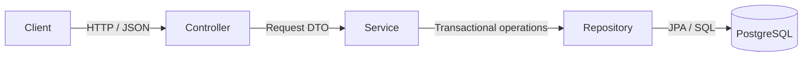
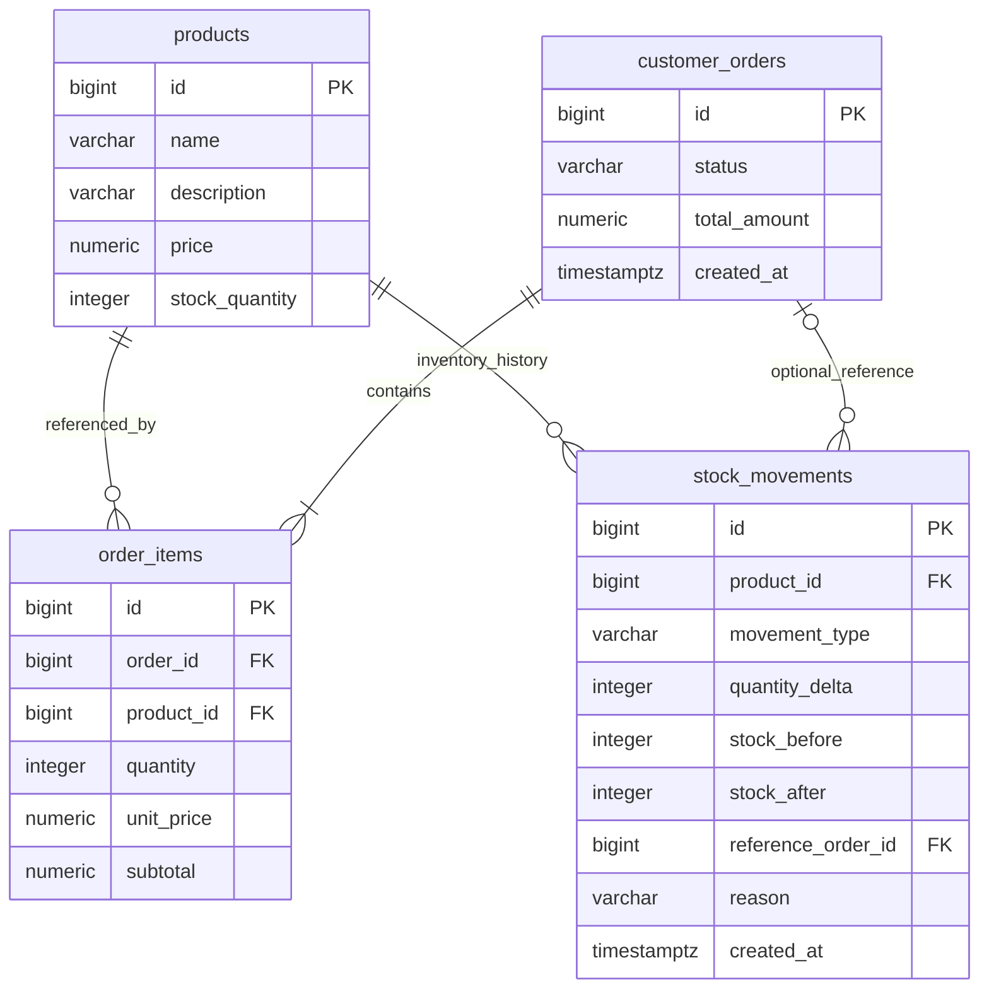
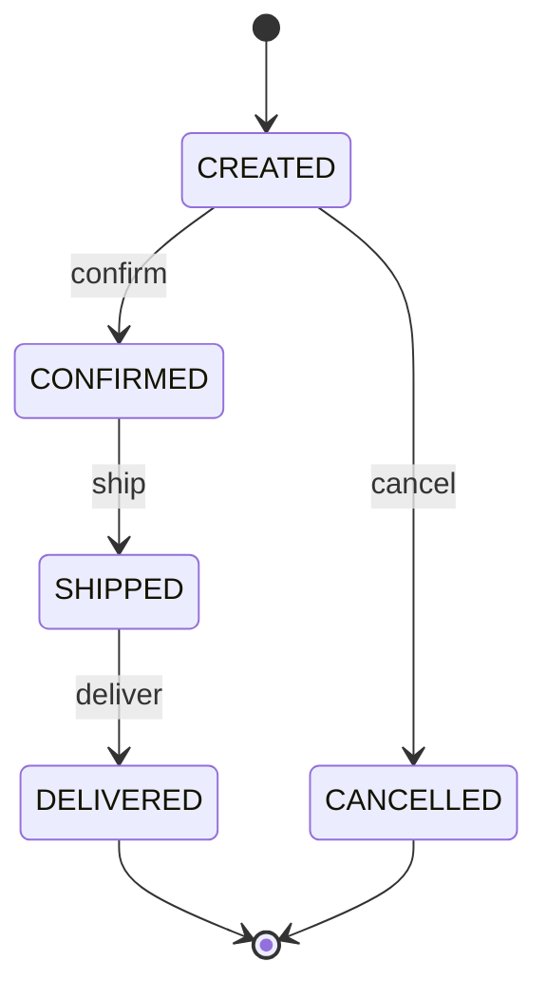

# Order Management API

A Java 21 and Spring Boot REST API for managing products, inventory, and orders. This portfolio project demonstrates layered backend development, database transactions, pessimistic locking, request validation, and automated testing with PostgreSQL.

[Project Overview](#project-overview) · [Tech Stack](#tech-stack) · [Features](#features) · [Architecture](#architecture) · [Database Schema](#database-schema-and-relationships) · [API Endpoints](#api-endpoints) · [How to Run](#how-to-run) · [Example Requests & Responses](#example-requests--responses) · [Testing](#testing) · [Design Decisions](#design-decisions)

## Project Overview

Clients can manage a product catalog, place orders containing multiple products, confirm/ship/deliver orders, and cancel newly created orders to restore inventory. The server calculates prices and totals, checks stock availability, and persists inventory changes together with each order in a single transaction.

The project focuses on a single Spring Boot application and PostgreSQL database. It has no frontend or authentication layer. It does not include payment processing, carrier integration, or customer accounts.

For a source-based walkthrough in Vietnamese, see [INTERVIEW_PREP.md](INTERVIEW_PREP.md). The engineering review and its recorded test evidence are in [REVIEW.md](REVIEW.md).

## Tech Stack

| Area | Technology |
| --- | --- |
| Language | Java 21 |
| Framework | Spring Boot 3.5.16 |
| HTTP API | Spring Web / Spring MVC |
| Persistence | Spring Data JPA / Hibernate |
| Database | PostgreSQL 17 |
| Schema migrations | Flyway |
| Validation | Jakarta Validation |
| Build | Maven 3.9.11 via Maven Wrapper |
| Testing | JUnit 5, Mockito, MockMvc, Testcontainers |
| Local infrastructure | Docker Compose |
| CI configuration | GitHub Actions |

Dependency versions are managed by Spring Boot unless explicitly pinned in [pom.xml](pom.xml).

## Features

- Create, read, and update products; delete legacy products only when no order or inventory history references them.
- Restock products with a reason and record inventory movements atomically with stock changes.
- Browse paginated stock history with initial stock, order deduction, cancellation, and manual restock entries.
- Search product names without case sensitivity, filter by price/stock, and paginate with validated sorting.
- Create an order with multiple distinct products.
- Reject unavailable stock and invalid quantities before changing inventory.
- Calculate money with `BigDecimal` and store each item's original unit price.
- Commit or roll back order creation and inventory changes together.
- Use `PESSIMISTIC_WRITE` locks to prevent concurrent orders from overselling inventory.
- Advance orders through confirmed, shipped, and delivered states without deducting stock again.
- Cancel orders only from CREATED and restore stock once, including during concurrent requests.
- Validate request DTOs and return consistent error responses.
- Preserve order history by preventing deletion of referenced products.

## Architecture



Controllers validate HTTP input and return response DTOs. Services own business rules, transaction boundaries, stock changes, and DTO mapping. Repositories provide persistence operations and locked queries. A shared `@RestControllerAdvice` maps exceptions to HTTP errors. Dependencies use constructor injection; entities are never returned directly by controllers.

```text
src/main/java/com/example/ordermanagement/
  common/       Error handling and pagination DTO
  product/      Product entity, DTOs, repository, service, controller
  inventory/    Immutable stock movement entity, DTOs, repository, history query
  order/        Order/item entities, DTOs, repositories, service, controller
src/main/resources/
  application.yml
  db/migration/V1__create_order_management_tables.sql
  db/migration/V2__index_products_price_id.sql
  db/migration/V3__extend_order_lifecycle_statuses.sql
  db/migration/V4__create_stock_movements.sql
src/test/java/com/example/ordermanagement/
  product/      Mockito service tests
  order/        Mockito business tests
  web/          MockMvc controller tests
  integration/  PostgreSQL persistence, rollback, locking, and API tests
scripts/
  load-env.ps1  Load local configuration into the current process environment
  run-local.ps1 Start PostgreSQL, wait for readiness, and run the API
```

## Database Schema and Relationships



- `CustomerOrder` has one or more `OrderItem` records. Each item references exactly one order and one product.
- `(order_id, product_id)` is unique, so a product appears once per order.
- Item `unit_price` and `subtotal` are snapshots; changing a product's price does not change existing orders.
- Prices use `NUMERIC(19,2)`; subtotals and order totals use `NUMERIC(25,2)`. `createdAt` is an `Instant` stored as a timestamp with time zone.
- Foreign keys and check constraints protect relationships, quantities, and monetary values. The order table is named `customer_orders` to avoid the SQL keyword `order`.

See [V1](src/main/resources/db/migration/V1__create_order_management_tables.sql) for the base schema, [V2](src/main/resources/db/migration/V2__index_products_price_id.sql) for the price index, and [V3](src/main/resources/db/migration/V3__extend_order_lifecycle_statuses.sql) for the five allowed order status values. V3 replaces the status CHECK constraint without rewriting existing order or inventory data. The original migrations remain unchanged. Flyway applies migrations at startup; Hibernate validates the mapping with `ddl-auto=validate`.

[V4](src/main/resources/db/migration/V4__create_stock_movements.sql) adds the inventory journal, restrictive product/order foreign keys, balance/type constraints, and indexes. It does not change existing product stock or backfill historical movements.

## API Endpoints

Default base URL: `http://localhost:8080`. Request and response bodies use JSON.

| Method | Endpoint | Description | Success |
| --- | --- | --- | --- |
| POST | `/api/products` | Create a product | 201 + `Location` |
| GET | `/api/products?page=0&size=20` | Search, filter, sort, and paginate products | 200 |
| GET | `/api/products/{id}` | Get a product | 200 |
| PUT | `/api/products/{id}` | Replace editable product fields | 200 |
| DELETE | `/api/products/{id}` | Delete a product without order references or inventory history | 204, empty body |
| POST | `/api/products/{id}/restock` | Add positive stock with a reason | 200 |
| GET | `/api/products/{id}/stock-movements` | Paginated inventory history, sorted by time | 200 |
| POST | `/api/orders` | Create an order | 201 + `Location` |
| GET | `/api/orders/{id}` | Get an order and its items | 200 |
| POST | `/api/orders/{id}/confirm` | Confirm a CREATED order | 200 |
| POST | `/api/orders/{id}/ship` | Mark a CONFIRMED order as handed to the carrier | 200 |
| POST | `/api/orders/{id}/deliver` | Mark a SHIPPED order as delivered | 200 |
| POST | `/api/orders/{id}/cancel` | Cancel a CREATED order and restore stock | 200 |

Pagination starts at page `0`; page size must be between `1` and `100`. Products are sorted by ID ascending unless `sort` is supplied. `PUT` requires `name`, `price`, and `stockQuantity`; `description` is optional. Since V4, PUT must keep stockQuantity equal to the locked current stock; a different value returns `409`. Use restock to add stock, rather than replacing an absolute stock value and bypassing the journal.

### Stock adjustment and inventory history

```http
POST /api/products/1/restock
Content-Type: application/json

{"quantity":5,"reason":"Supplier delivery"}
```

`quantity` is an integer from 1 to 2,147,483,647, and the resulting stock must remain within that range (zero remains valid as an existing stock value). `reason` is required, trimmed, nonblank, and at most 500 characters. Invalid input returns `400`, a missing product returns `404`, and stock overflow returns `409`. Success returns `200` with the updated ProductResponse. Retrying a successful restock adds stock again; no idempotency key is implemented.

```http
GET /api/products/1/stock-movements?page=0&size=20&sort=createdAt,desc
GET /api/products/1/stock-movements?page=1&size=10&sort=createdAt,asc
```

History uses the existing PageResponse shape. Defaults are page 0, size 20, latest first. Only `createdAt` sorting is supported, with `asc` or `desc`; omitted direction means `desc`. ID is appended in the same direction to resolve timestamp ties. Page/size/offset validation matches the product list. A missing product returns `404`; an existing legacy product with no movements returns `200` with empty content. Offset pages can shift when new movements arrive.

Each movement returns `id`, `productId`, `type`, signed `quantityDelta`, `stockBefore`, `stockAfter`, nullable `referenceOrderId`, nullable `reason`, and `createdAt`:

| Type | Delta | Order reference | Reason |
| --- | --- | --- | --- |
| INITIAL_STOCK | Initial stock, including zero; before is 0 | None | None |
| ORDER_DEDUCTION | Negative ordered quantity | Required | None |
| ORDER_CANCELLATION | Positive restored quantity | Required | None |
| MANUAL_RESTOCK | Positive added quantity | None | Required |

New products receive an opening entry in the same transaction as product creation, even when initial stock is zero. Create-order and cancel write one movement per product in their existing transactions; fulfillment actions do not write movements. Restock locks the product before reading its stock and writes both the increment and movement in one transaction. There is no separate transaction, asynchronous writer, message broker, or application compensation step: failure rolls back stock, journal, and any order changes together.

**History retention and compatibility:** movements have no update/delete API, no setters, immutable scalar snapshots, and Hibernate `@Immutable`. Product and order foreign keys use ON DELETE RESTRICT. Product DELETE returns `409` if any movement exists, including INITIAL_STOCK; therefore newly created products cannot be physically deleted. A pre-V4 product without order references or movements can still be deleted with `204`. PUT no longer changes stock directly. These intentional contract changes prevent unrecorded stock replacement and deletion of history. Direct SQL performed by a database administrator is outside the application's append-only contract; the journal is not a tamper-proof ledger.

**No historical backfill:** V4 starts with an empty journal and leaves all previous stock/order data unchanged. Existing products gain entries only when future stock operations occur; their first entry may be a deduction or cancellation with the actual current before/after stock. Cancelling an old CREATED order records its reversal without inventing a past deduction. Summing journal deltas alone does not reconstruct the stock of legacy products, and this feature does not claim a complete pre-V4 audit trail. createdAt records when the movement object was created after taking the stock lock, not the transaction's commit time.

### Product Search & Filtering

All query parameters on `GET /api/products` are optional. Existing calls without filters keep the same defaults and `PageResponse` JSON shape.

| Parameter | Behavior | Default |
| --- | --- | --- |
| `keyword` | Case-insensitive substring of **name**; surrounding whitespace is trimmed; blank means no search; at most 120 characters | No filter |
| `minPrice` | Inclusive lower price bound, `BigDecimal`, must be nonnegative | No lower bound |
| `maxPrice` | Inclusive upper price bound, `BigDecimal`, must be nonnegative and at least `minPrice` when both are set | No upper bound |
| `inStock` | `true`: stock > 0; `false`: stock = 0; omitted: either | No filter |
| `page` | Zero-based page number, must be nonnegative | `0` |
| `size` | Page size, from 1 to 100 | `20` |
| `sort` | One `field[,asc\|desc]`; allowed fields: `id`, `name`, `price`, `stockQuantity`; direction is case-insensitive and defaults to `asc` | `id,asc` |

Filters combine with **AND**. A non-ID sort appends `id,asc` to give equal-valued products a deterministic order. Name sorting follows the database collation. Concurrent catalog changes can still move records between offset-based pages.

The keyword is literal text: `%`, `_`, and `!` are escaped for SQL `LIKE`, and values are bound through JPA. URL-encode special characters (for example, use `keyword=50%25` to search for `50%`). Unsupported sort fields/directions, invalid types, negative prices, reversed ranges, or invalid page bounds return the existing `400` error shape. `page * size` must also fit JPA's maximum offset of `2,147,483,647`; larger offsets are rejected before executing a query.

```http
GET /api/products?keyword=KEYboard&minPrice=20&maxPrice=100&inStock=true&page=0&size=10&sort=price,asc
GET /api/products?maxPrice=30&sort=name,desc
GET /api/products?inStock=false
```

`totalElements` and `totalPages` describe the filtered result. Empty searches and pages beyond the last page return `200` with an empty `content` array. Bounds are compared exactly without rounding; `minPrice=19.990&maxPrice=19.99` is a valid equal-price range.

| Status | Meaning |
| --- | --- |
| 400 | Invalid JSON, validation failure, duplicate product IDs, or invalid pagination/IDs |
| 404 | Product or order not found |
| 409 | Invalid/repeated state transition, insufficient stock, referenced product deletion, lock/database conflict, or stock restoration overflow |
| 500 | Unexpected server error; internal exception details are not returned |

Product names must be nonblank and at most 120 characters; descriptions allow up to 2,000 characters. Prices must be at least `0.01`, with at most 12 integer digits and 2 decimal places. Stock is a nonnegative Java integer. An order accepts 1–100 distinct products, with integer quantities from 1 to 1,000,000. Unknown JSON properties and fractional values for integer fields are rejected.

### Order lifecycle and concurrency



| Current status | Action | New status | Inventory change |
| --- | --- | --- | --- |
| CREATED | `POST /api/orders/{id}/confirm` | CONFIRMED | None |
| CONFIRMED | `POST /api/orders/{id}/ship` | SHIPPED | None |
| SHIPPED | `POST /api/orders/{id}/deliver` | DELIVERED | None |
| CREATED | `POST /api/orders/{id}/cancel` | CANCELLED | Restore ordered quantities once |

These are the only allowed transitions. DELIVERED and CANCELLED are terminal states. Skipping a step, moving backwards, repeating an action, or cancelling after confirmation returns `409` without changing stock/status. The new action endpoints accept no request body and return the existing `OrderResponse` DTO with `200`; missing IDs return `404`, and invalid path IDs return `400`. Existing create/read/cancel endpoints keep their response shapes and behavior for CREATED/CANCELLED orders, including the repeated-cancellation message.

`OrderStatus.canTransitionTo` defines the transition rules, and `CustomerOrder` enforces them before mutation. Each public service action is a write `@Transactional` method and uses `OrderRepository.findByIdForUpdate` (`PESSIMISTIC_WRITE`) **before** checking status. Hibernate dirty checking persists the status before transaction completion; a runtime persistence failure rolls the transaction back.

Stock is deducted only during order creation. Confirm/ship/deliver do not acquire product write locks or modify stock, item prices, totals, or creation time. Cancellation locks the order first, checks CREATED, then locks products in ascending ID order before restoring stock. Creation locks existing products in ascending ID order and inserts a new order; it does not acquire an existing order lock after product locks. This keeps the existing lock order and reduces deadlock risk without claiming deadlocks are impossible.

At PostgreSQL's default READ COMMITTED isolation, a competing action waits for the order lock, then validates the committed status. If confirm commits first, cancel returns `409` and stock stays deducted. If cancel commits first, confirm returns `409` and stock is restored once. Duplicate confirm/ship/deliver requests have one success and one conflict. Adjacent actions can both succeed when their lock order produces a valid sequence, such as confirm then ship; a ship request that executes while the order is still CREATED fails. Locks last until commit/rollback, and the existing five-second lock timeout maps lock conflicts to `409`. See [PostgreSQL isolation](https://www.postgresql.org/docs/17/transaction-iso.html) and [locking](https://www.postgresql.org/docs/17/explicit-locking.html).

These endpoints record fulfillment state; no carrier integration, payment processing, delivery timestamps, or status history is implemented. The database CHECK validates status membership; transition legality is enforced by the application, so direct SQL can bypass lifecycle rules.

## How to Run

### Prerequisites

- JDK 21 for running the application locally.
- Docker Desktop / Docker Engine running, with Docker Compose v2.
- Internet access for the initial Maven dependency and container image downloads.

A separate Maven installation is not required. Run commands from the project root, where `pom.xml` is located.

Clone this repository using its GitHub **Code → HTTPS** URL, then open the cloned directory:

```powershell
git clone <repository-https-url>
Set-Location order-management-api
java -version
docker compose version
```

Replace `<repository-https-url>` with this repository's actual clone URL. Do not copy local `.env`, build output, or credentials from another machine; create your own configuration from the committed template.

### Windows: PostgreSQL in Docker, API on the host

1. Create local configuration:

   ```powershell
   Copy-Item .env.example .env
   ```

2. Open `.env` and set `POSTGRES_PASSWORD` to your own local database password. The template intentionally leaves it empty. If the password contains `$` or `#`, wrap the value in single quotes. Keep the other defaults for the first run.

3. Load the variables and start PostgreSQL:

   ```powershell
   .\scripts\load-env.ps1
   docker compose up -d
   docker compose ps
   ```

   Wait until PostgreSQL is reported as `healthy`. With no profile enabled, Compose starts only the database.

4. Start the API in the same PowerShell session:

   ```powershell
   .\mvnw.cmd spring-boot:run
   ```

   Once Spring Boot reports that the application has started, use `http://localhost:8080/api/products` or open [requests.http](requests.http). The root path `/` is not an API endpoint.

Spring Boot does not automatically load `.env` when launched by Maven. [load-env.ps1](scripts/load-env.ps1) reads values as data and sets process environment variables; it does not evaluate the file as PowerShell code. In Windows Command Prompt, the Maven command is `mvnw.cmd spring-boot:run`, after setting the equivalent environment variables in that session.

The existing convenience script performs configuration loading, database startup, readiness checking, and API startup in one command:

```powershell
.\scripts\run-local.ps1
```

If PowerShell policy blocks local scripts, use the Docker-only option below or set the environment variables in your shell before invoking Maven.

### Run both services in Docker

After configuring `.env`, Java does not need to be installed on the host:

```powershell
docker compose --profile app up -d --build --wait
docker compose logs -f api
```

Check the API startup log before sending requests; the API service has no HTTP healthcheck. Its image uses a multi-stage build and a non-root runtime user.

### Configuration and stopping services

| Variable | Default | Purpose |
| --- | --- | --- |
| `POSTGRES_PASSWORD` | Required; no default | Database password |
| `POSTGRES_DB` | `order_management` | Database name |
| `POSTGRES_USER` | `order_app` | Database user |
| `POSTGRES_PORT` | `5432` | Database port published on the host |
| `DB_HOST` | `localhost` | Database host when running Java locally |
| `DB_PORT` | `POSTGRES_PORT` | Database connection port when running Java locally |
| `SERVER_PORT` | `8080` | API port on the host |

Inside the API container, Compose sets `DB_HOST=postgres`, `DB_PORT=5432`, and the internal API port to `8080`. Host ports are bound to `127.0.0.1`. To use an existing PostgreSQL instance, set the local connection variables and run `scripts/run-local.ps1 -SkipDatabase`.

Stop Java with `Ctrl+C`. Stop Compose services while retaining database data:

```powershell
docker compose --profile app down
```

The `postgres_data` volume persists data. Updating a password in `.env` does not change the password in an already initialized database. If a default port is occupied, change the corresponding port in `.env` and reload the environment before restarting.

`.gitignore` excludes build output, local `.env` files, credentials, private keys, and IDE caches. `.env.example` remains versionable. Supply actual credentials through your local environment; the application has no hardcoded database password.

## Example Requests & Responses

The executable examples in [requests.http](requests.http) cover every endpoint and common error cases. Use the [VS Code REST Client](https://github.com/Huachao/vscode-restclient#request-variables) and run the numbered requests in order: named responses provide product/order IDs for later requests. They work with existing data and do not assume IDs start at 1. Re-running creation requests creates new records.

The responses below are illustrative. IDs, timestamps, and existing page contents depend on your database. The sequence assumes a new database where the two example products receive IDs `1` and `2`.

### Create Product

```http
POST http://localhost:8080/api/products
Content-Type: application/json

{
  "name": "Mechanical Keyboard",
  "description": "USB keyboard",
  "price": 59.90,
  "stockQuantity": 20
}
```

Response: `201 Created`, `Location: /api/products/1`.

```json
{
  "id": 1,
  "name": "Mechanical Keyboard",
  "description": "USB keyboard",
  "price": 59.90,
  "stockQuantity": 20
}
```

Create the second product before placing the example order:

```http
POST http://localhost:8080/api/products
Content-Type: application/json

{"name":"Mouse","description":"USB mouse","price":19.99,"stockQuantity":10}
```

This returns `201 Created` with the same product response shape and, in this example, `id: 2`.

### List Products

```http
GET http://localhost:8080/api/products?page=0&size=10
```

Response: `200 OK`.

```json
{
  "content": [
    {"id":1,"name":"Mechanical Keyboard","description":"USB keyboard","price":59.90,"stockQuantity":20},
    {"id":2,"name":"Mouse","description":"USB mouse","price":19.99,"stockQuantity":10}
  ],
  "page": 0,
  "size": 10,
  "totalElements": 2,
  "totalPages": 1,
  "last": true
}
```

### Create Order

```http
POST http://localhost:8080/api/orders
Content-Type: application/json

{
  "items": [
    {"productId":1,"quantity":2},
    {"productId":2,"quantity":1}
  ]
}
```

Response: `201 Created`, `Location: /api/orders/1`. Stock becomes `18` keyboards and `9` mice. The server computes `59.90 × 2 + 19.99 = 139.79`.

```json
{
  "id": 1,
  "status": "CREATED",
  "totalAmount": 139.79,
  "createdAt": "2026-11-12T05:00:00Z",
  "items": [
    {"id":1,"productId":1,"quantity":2,"unitPrice":59.90,"subtotal":119.80},
    {"id":2,"productId":2,"quantity":1,"unitPrice":19.99,"subtotal":19.99}
  ]
}
```

### Get Order

```http
GET http://localhost:8080/api/orders/1
```

Response: `200 OK`, with the same order response shown above. Prices and totals remain unchanged if a product's current price is later edited.

### Validation Error

```http
POST http://localhost:8080/api/orders
Content-Type: application/json

{"items":[{"productId":1,"quantity":0}]}
```

Response: `400 Bad Request`.

```json
{
  "timestamp": "2026-11-12T05:01:00Z",
  "status": 400,
  "error": "Bad Request",
  "message": "Request validation failed",
  "path": "/api/orders",
  "fieldErrors": [{"field":"items[0].quantity","message":"must be greater than 0"}]
}
```

### Insufficient Stock Error

After the successful order above, only 18 keyboards remain:

```http
POST http://localhost:8080/api/orders
Content-Type: application/json

{"items":[{"productId":1,"quantity":21}]}
```

Response: `409 Conflict`. No order is created and stock stays unchanged.

```json
{
  "timestamp": "2026-11-12T05:02:00Z",
  "status": 409,
  "error": "Conflict",
  "message": "Insufficient stock for product 1: requested 21, available 18",
  "path": "/api/orders",
  "fieldErrors": []
}
```

### Cancel Order

```http
POST http://localhost:8080/api/orders/1/cancel
```

Response: `200 OK`. Stock returns to `20` keyboards and `10` mice; the financial snapshot is retained.

```json
{
  "id": 1,
  "status": "CANCELLED",
  "totalAmount": 139.79,
  "createdAt": "2026-11-12T05:00:00Z",
  "items": [
    {"id":1,"productId":1,"quantity":2,"unitPrice":59.90,"subtotal":119.80},
    {"id":2,"productId":2,"quantity":1,"unitPrice":19.99,"subtotal":19.99}
  ]
}
```

Cancelling again returns `409 Conflict` with message `Order 1 is already cancelled`. Deleting either referenced product also returns `409`, including after cancellation. Since V4, even the separate unused product in requests.http has an INITIAL_STOCK entry, so deleting it returns `409` and reading it still returns `200`. Successful `204` deletion is limited to legacy products without order references or movement history.

### Confirm, Ship, and Deliver

Create a **separate** order for fulfillment; the order cancelled above cannot be confirmed. Replace `2` below with the ID returned by that new create request, then send the actions in order:

```http
POST http://localhost:8080/api/orders/2/confirm
```

This returns `200 OK` with the existing order response fields and `status: "CONFIRMED"`.

```http
POST http://localhost:8080/api/orders/2/ship
```

This returns `200 OK` with `status: "SHIPPED"`, meaning the order has been handed to the carrier.

```http
POST http://localhost:8080/api/orders/2/deliver
```

This returns `200 OK` with `status: "DELIVERED"`. None of these actions changes stock or monetary snapshots. Cancelling this delivered order returns `409` with message `Order 2 cannot transition from DELIVERED to CANCELLED`. Repeating delivery also returns `409`.

## Testing

Run service unit tests and controller tests without a database, Docker, or `.env`:

```powershell
.\mvnw.cmd test
```

Package the application and run the same tests:

```powershell
.\mvnw.cmd clean verify
```

With Docker running, include the PostgreSQL integration tests:

```powershell
.\mvnw.cmd verify -Pintegration
```

On Linux/macOS, replace `.\mvnw.cmd` with `sh mvnw`. Surefire runs `*Test`; Failsafe runs `*IT` under the `integration` profile. Testcontainers creates an isolated PostgreSQL database and cleans up its containers; it does not use the Compose database.

### Recorded verification

The inventory update was compiled and packaged successfully with `clean verify -Pintegration` on **2026-11-17**, using Java 21.0.6, Maven 3.9.11, Docker Engine 27.3.1, and PostgreSQL 17.11. The local Surefire/Failsafe XML reports record:

| Suite | Test boundary | Passed |
| --- | --- | ---: |
| `OrderServiceTest` | JUnit 5 + Mockito; mocked repositories | 33 |
| `OrderStatusTest` | JUnit 5; complete 25-pair transition matrix | 25 |
| `ProductServiceTest` | JUnit 5 + Mockito; mocked repositories | 16 |
| `StockMovementTest` | JUnit 5; movement snapshots, balance, and history query validation | 14 |
| `ProductSearchQueryTest` | JUnit 5; query validation and sort contract | 23 |
| `ApiControllerTest` | MockMvc controller slice; mocked services | 72 |
| `InventoryControllerTest` | MockMvc controller slice; mocked product service | 24 |
| `OrderManagementIT` | Spring context + real PostgreSQL/Testcontainers | 40 |
| `ProductSearchIT` | Real PostgreSQL/Testcontainers; HTTP search, generated SQL, and query plans | 17 |
| `InventoryManagementIT` | Real PostgreSQL/Testcontainers; inventory/journal atomicity, migration, constraints, and locking | 19 |
| **Total** | **0 failures, 0 errors, 0 skipped** | **283** |

Unit/controller tests cover business rules, invalid quantities, missing products, duplicates, repeated cancellation, HTTP status codes, and validation. The integration tests verify schema mapping, committed inventory changes, forced SQL failures and rollback during creation/cancellation, monetary round-trips, and concurrent inventory access. The overlap tests observe a blocked request in PostgreSQL before allowing the first transaction to commit. Mock-based tests alone do not prove database transaction behavior.

Lifecycle coverage includes all 25 enum source/target pairs, valid fulfillment actions with unchanged stock/financial snapshots, every invalid action/state combination through real HTTP/service/database integration, and rollback/retry for each new action after a forced SQL failure. Concurrency tests observe duplicate confirm/ship/deliver requests waiting on the order row, both confirm-versus-cancel winner cases, and adjacent actions that succeed in valid serial order. A separate test schema is migrated to V2, populated with CREATED/CANCELLED orders, then upgraded to V3 to verify existing data is preserved and the expanded constraint is applied. These are controlled scenarios, not a proof that every possible interleaving is deadlock-free.

Search tests cover case-insensitive name matching, combined/individual filters, exact inclusive decimal bounds, true/false/omitted stock filters, literal SQL metacharacters, default compatibility, every supported sort, deterministic ties, filtered totals, empty/out-of-range pages, and invalid inputs. `ProductSearchIT` verifies that generated JPA SQL contains filtering, ordering, database pagination, and a filtered count, and checks the new price index on a 20,000-row fixture.

Inventory tests verify all four movement types, references/reasons/snapshots, chronological pagination with timestamp ties, PUT/delete protections, SQL constraints, and V3→V4 migration without backfill. Forced movement INSERT failures cover product creation, order creation, cancellation, and restock; forced stock UPDATE failures verify journal inserts roll back too. Multi-product tests fail the second movement after the first was inserted. Overlap tests observe product lock waits for restock versus restock/order/cancel and an integer-overflow race; stock and movement chains remain consistent. Existing overselling and duplicate-cancellation tests now also assert that only one corresponding movement is committed. Mock tests do not establish these database guarantees.

These are recorded local results; check GitHub Actions separately for CI results. The [CI workflow](.github/workflows/ci.yml) is configured to run `verify -Pintegration` on push and pull requests. See [REVIEW.md](REVIEW.md) for the earlier review record from 2026-11-12 in Vietnamese. No throughput benchmark has been recorded. Compose configuration was validated in that review; the full Compose application stack and API image build were not executed as part of it.

Build output: `target/order-management-api-1.0.0.jar`. Test reports: `target/surefire-reports/` and `target/failsafe-reports/`. Build output is excluded from version control.

## Design Decisions

- **Transaction boundaries live in services.** Order creation locks products, validates all stock, deducts inventory, and saves the order/items in one transaction. Cancellation locks the order, validates its state, restores inventory, and changes the status together. Runtime failures roll back these changes.
- **Lifecycle rules live in the domain.** Only CREATED → CONFIRMED → SHIPPED → DELIVERED and CREATED → CANCELLED are supported. Each transition locks the order in a service transaction. Fulfillment actions preserve stock and financial snapshots; cancellation is the only transition that restores inventory.
- **Pessimistic locks protect inventory.** Product locks are acquired in ascending ID order to reduce deadlock risk. Product updates and deletion also use a write lock. Cancellation locks the order first so concurrent requests cannot restore the same stock twice. Connections use a five-second PostgreSQL lock timeout; lock conflicts return `409`.
- **Money uses exact decimal arithmetic.** `BigDecimal` calculations and `NUMERIC` columns avoid binary floating-point rounding. The request never supplies an order total or item price; the server reads current product prices and stores snapshots.
- **DTOs define the API boundary.** Request validation and explicit response mapping keep persistence details out of HTTP responses. `open-in-view=false` keeps entity access inside service transactions.
- **History survives catalog changes.** Referenced products cannot be deleted. Order items retain quantity, unit price, and subtotal after cancellation or later product price changes.
- **Duplicate products are rejected.** Requests must contain distinct product IDs; duplicate lines receive `400`. Clients should combine quantities before sending the order.
- **Schema changes are explicit.** Flyway migrations define tables, constraints, and indexes; Hibernate validates rather than silently changing the schema.
- **Search executes in PostgreSQL.** `ProductSearchQuery` validates input, `ProductSpecifications` builds optional predicates, and `JpaSpecificationExecutor.findAll(specification, pageable)` applies filtering, sorting, and pagination in SQL. DTO mapping happens only for the returned page. Spring Data executes a filtered count query when needed; it may infer the total for a partial page.
- **Inventory and its journal share the transaction.** Product creation, order creation, cancellation, and restock insert movements using the same datasource/transaction. A failure in either write rolls back the entire operation. Stock is locked first; cancellation retains order-then-ascending-product lock ordering.
- **The journal has targeted indexes and constraints.** `(product_id, created_at DESC, id DESC)` supports product history in either chronological direction and product-scoped counts. Partial unique indexes allow one opening entry per product and one deduction/cancellation per order/product/type. The latter starts with reference_order_id and also supports that foreign key's lookup; an extra redundant order-only index is not added. CHECK constraints validate signs, order/reason requirements, and before + delta = after, using BIGINT arithmetic to avoid INTEGER overflow during validation. The application and product constraint also reject negative stock.
- **Scope remains explicit.** There is no authentication or idempotency key. Repeating a successful create-order or restock request can apply it again. PUT permits metadata replacement only when the supplied stock matches current locked stock; it cannot silently overwrite inventory from a stale payload.

### Search query plans and indexes

Migration [V2](src/main/resources/db/migration/V2__index_products_price_id.sql) adds B-tree `idx_products_price_id` on `(price, id)`, supporting selective price ranges and ascending price/ID pagination. The existing primary-key index supports the default ID order. This does not imply that every filter combination or descending price order avoids a sort; PostgreSQL chooses its plan based on selectivity and statistics. See the [PostgreSQL B-tree documentation](https://www.postgresql.org/docs/17/indexes-types.html).

A plain index on `name` or `lower(name)` cannot efficiently serve an arbitrary leading-wildcard search such as `%keyboard%`. No such index is added. A GIN trigram index on `lower(name)` using [`pg_trgm`](https://www.postgresql.org/docs/17/pgtrgm.html) is a possible future optimization if realistic catalog sizes and measured keyword traffic justify the extension and index cost; it is not implemented here.

No separate stock index is added: stock predicates can match much of the catalog, and indexing `stock_quantity` (including a partial index depending on it) adds maintenance work to inventory updates. Measure selectivity before adding one. Count queries and deep offset pages still have costs that a small page size cannot eliminate.

`ProductSearchIT` loads 20,000 generated products in an isolated container, runs `ANALYZE`, captures the actual JPA page SQL, and runs `EXPLAIN (ANALYZE, BUFFERS)` for that price query and representative count/keyword/stock queries. It writes the plans to `target/product-search-explain.txt` and checks that the selective price page uses the migrated index. This fixture verifies query behavior and index use; it is not a throughput or production performance benchmark. Reproduce it with:

```powershell
.\mvnw.cmd verify -Pintegration '-Dit.test=ProductSearchIT'
```
