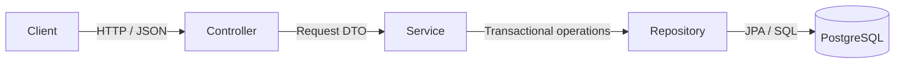
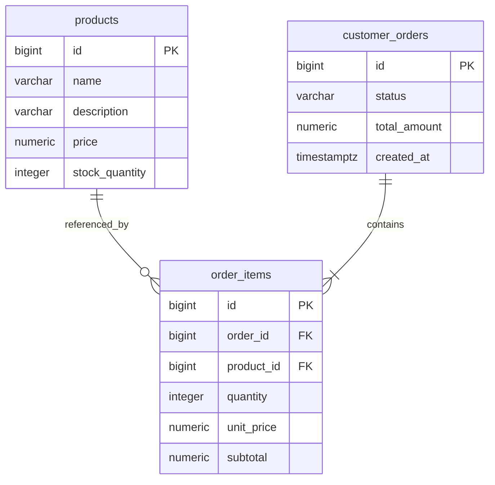

# Order Management API

A Java 21 and Spring Boot REST API for managing products, inventory, and orders. This portfolio project demonstrates layered backend development, database transactions, pessimistic locking, request validation, and automated testing with PostgreSQL.

[Project Overview](#project-overview) · [Tech Stack](#tech-stack) · [Features](#features) · [Architecture](#architecture) · [Database Schema](#database-schema-and-relationships) · [API Endpoints](#api-endpoints) · [How to Run](#how-to-run) · [Example Requests & Responses](#example-requests--responses) · [Testing](#testing) · [Design Decisions](#design-decisions)

## Project Overview

Clients can manage a product catalog, place orders containing multiple products, and cancel orders to restore inventory. The server calculates prices and totals, checks stock availability, and persists inventory changes together with each order in a single transaction.

The project focuses on a single Spring Boot application and PostgreSQL database. It has no frontend or authentication layer. It does not include payment processing, shipping, or customer accounts.

For a source-based walkthrough in Vietnamese, see [INTERVIEW_PREP.md](INTERVIEW_PREP.md). The engineering review and its recorded test evidence are in [REVIEW.md](REVIEW.md).

## Tech Stack

| Area | Technology |
| --- | --- |
| Language | Java 21 |
| Framework | Spring Boot 3.5.16 |
| HTTP API | Spring Web / Spring MVC |
| Persistence | Spring Data JPA / Hibernate |
| Database | PostgreSQL 17 |
| Schema migrations | Flyway |
| Validation | Jakarta Validation |
| Build | Maven 3.9.11 via Maven Wrapper |
| Testing | JUnit 5, Mockito, MockMvc, Testcontainers |
| Local infrastructure | Docker Compose |
| CI configuration | GitHub Actions |

Dependency versions are managed by Spring Boot unless explicitly pinned in [pom.xml](pom.xml).

## Features

- Create, read, update, and delete products.
- List products with pagination and a stable ascending ID order.
- Create an order with multiple distinct products.
- Reject unavailable stock and invalid quantities before changing inventory.
- Calculate money with `BigDecimal` and store each item's original unit price.
- Commit or roll back order creation and inventory changes together.
- Use `PESSIMISTIC_WRITE` locks to prevent concurrent orders from overselling inventory.
- Cancel orders and restore stock once, including during concurrent cancellation requests.
- Validate request DTOs and return consistent error responses.
- Preserve order history by preventing deletion of referenced products.

## Architecture



Controllers validate HTTP input and return response DTOs. Services own business rules, transaction boundaries, stock changes, and DTO mapping. Repositories provide persistence operations and locked queries. A shared `@RestControllerAdvice` maps exceptions to HTTP errors. Dependencies use constructor injection; entities are never returned directly by controllers.

```text
src/main/java/com/example/ordermanagement/
  common/       Error handling and pagination DTO
  product/      Product entity, DTOs, repository, service, controller
  order/        Order/item entities, DTOs, repositories, service, controller
src/main/resources/
  application.yml
  db/migration/V1__create_order_management_tables.sql
src/test/java/com/example/ordermanagement/
  product/      Mockito service tests
  order/        Mockito business tests
  web/          MockMvc controller tests
  integration/  PostgreSQL persistence, rollback, locking, and API tests
scripts/
  load-env.ps1  Load local configuration into the current process environment
  run-local.ps1 Start PostgreSQL, wait for readiness, and run the API
```

## Database Schema and Relationships



- `CustomerOrder` has one or more `OrderItem` records. Each item references exactly one order and one product.
- `(order_id, product_id)` is unique, so a product appears once per order.
- Item `unit_price` and `subtotal` are snapshots; changing a product's price does not change existing orders.
- Prices use `NUMERIC(19,2)`; subtotals and order totals use `NUMERIC(25,2)`. `createdAt` is an `Instant` stored as a timestamp with time zone.
- Foreign keys and check constraints protect relationships, quantities, and monetary values. The order table is named `customer_orders` to avoid the SQL keyword `order`.

See the [Flyway migration](src/main/resources/db/migration/V1__create_order_management_tables.sql) for the full schema. Flyway applies migrations at startup; Hibernate validates the mapping with `ddl-auto=validate`.

## API Endpoints

Default base URL: `http://localhost:8080`. Request and response bodies use JSON.

| Method | Endpoint | Description | Success |
| --- | --- | --- | --- |
| POST | `/api/products` | Create a product | 201 + `Location` |
| GET | `/api/products?page=0&size=20` | List products | 200 |
| GET | `/api/products/{id}` | Get a product | 200 |
| PUT | `/api/products/{id}` | Replace editable product fields | 200 |
| DELETE | `/api/products/{id}` | Delete an unreferenced product | 204, empty body |
| POST | `/api/orders` | Create an order | 201 + `Location` |
| GET | `/api/orders/{id}` | Get an order and its items | 200 |
| POST | `/api/orders/{id}/cancel` | Cancel an order and restore stock | 200 |

Pagination starts at page `0`; page size must be between `1` and `100`. Products are sorted by ID ascending. `PUT` requires `name`, `price`, and `stockQuantity`; `description` is optional. Stock updates set an absolute quantity.

| Status | Meaning |
| --- | --- |
| 400 | Invalid JSON, validation failure, duplicate product IDs, or invalid pagination/IDs |
| 404 | Product or order not found |
| 409 | Insufficient stock, repeated cancellation, referenced product deletion, lock/database conflict, or stock restoration overflow |
| 500 | Unexpected server error; internal exception details are not returned |

Product names must be nonblank and at most 120 characters; descriptions allow up to 2,000 characters. Prices must be at least `0.01`, with at most 12 integer digits and 2 decimal places. Stock is a nonnegative Java integer. An order accepts 1–100 distinct products, with integer quantities from 1 to 1,000,000. Unknown JSON properties and fractional values for integer fields are rejected.

## How to Run

### Prerequisites

- JDK 21 for running the application locally.
- Docker Desktop / Docker Engine running, with Docker Compose v2.
- Internet access for the initial Maven dependency and container image downloads.

A separate Maven installation is not required. Run commands from the project root, where `pom.xml` is located.

Clone this repository using its GitHub **Code → HTTPS** URL, then open the cloned directory:

```powershell
git clone <repository-https-url>
Set-Location order-management-api
java -version
docker compose version
```

Replace `<repository-https-url>` with this repository's actual clone URL. Do not copy local `.env`, build output, or credentials from another machine; create your own configuration from the committed template.

### Windows: PostgreSQL in Docker, API on the host

1. Create local configuration:

   ```powershell
   Copy-Item .env.example .env
   ```

2. Open `.env` and set `POSTGRES_PASSWORD` to your own local database password. The template intentionally leaves it empty. If the password contains `$` or `#`, wrap the value in single quotes. Keep the other defaults for the first run.

3. Load the variables and start PostgreSQL:

   ```powershell
   .\scripts\load-env.ps1
   docker compose up -d
   docker compose ps
   ```

   Wait until PostgreSQL is reported as `healthy`. With no profile enabled, Compose starts only the database.

4. Start the API in the same PowerShell session:

   ```powershell
   .\mvnw.cmd spring-boot:run
   ```

   Once Spring Boot reports that the application has started, use `http://localhost:8080/api/products` or open [requests.http](requests.http). The root path `/` is not an API endpoint.

Spring Boot does not automatically load `.env` when launched by Maven. [load-env.ps1](scripts/load-env.ps1) reads values as data and sets process environment variables; it does not evaluate the file as PowerShell code. In Windows Command Prompt, the Maven command is `mvnw.cmd spring-boot:run`, after setting the equivalent environment variables in that session.

The existing convenience script performs configuration loading, database startup, readiness checking, and API startup in one command:

```powershell
.\scripts\run-local.ps1
```

If PowerShell policy blocks local scripts, use the Docker-only option below or set the environment variables in your shell before invoking Maven.

### Run both services in Docker

After configuring `.env`, Java does not need to be installed on the host:

```powershell
docker compose --profile app up -d --build --wait
docker compose logs -f api
```

Check the API startup log before sending requests; the API service has no HTTP healthcheck. Its image uses a multi-stage build and a non-root runtime user.

### Configuration and stopping services

| Variable | Default | Purpose |
| --- | --- | --- |
| `POSTGRES_PASSWORD` | Required; no default | Database password |
| `POSTGRES_DB` | `order_management` | Database name |
| `POSTGRES_USER` | `order_app` | Database user |
| `POSTGRES_PORT` | `5432` | Database port published on the host |
| `DB_HOST` | `localhost` | Database host when running Java locally |
| `DB_PORT` | `POSTGRES_PORT` | Database connection port when running Java locally |
| `SERVER_PORT` | `8080` | API port on the host |

Inside the API container, Compose sets `DB_HOST=postgres`, `DB_PORT=5432`, and the internal API port to `8080`. Host ports are bound to `127.0.0.1`. To use an existing PostgreSQL instance, set the local connection variables and run `scripts/run-local.ps1 -SkipDatabase`.

Stop Java with `Ctrl+C`. Stop Compose services while retaining database data:

```powershell
docker compose --profile app down
```

The `postgres_data` volume persists data. Updating a password in `.env` does not change the password in an already initialized database. If a default port is occupied, change the corresponding port in `.env` and reload the environment before restarting.

`.gitignore` excludes build output, local `.env` files, credentials, private keys, and IDE caches. `.env.example` remains versionable. Supply actual credentials through your local environment; the application has no hardcoded database password.

## Example Requests & Responses

The executable examples in [requests.http](requests.http) cover every endpoint and common error cases. Use the [VS Code REST Client](https://github.com/Huachao/vscode-restclient#request-variables) and run the numbered requests in order: named responses provide product/order IDs for later requests. They work with existing data and do not assume IDs start at 1. Re-running creation requests creates new records.

The responses below are illustrative. IDs, timestamps, and existing page contents depend on your database. The sequence assumes a new database where the two example products receive IDs `1` and `2`.

### Create Product

```http
POST http://localhost:8080/api/products
Content-Type: application/json

{
  "name": "Mechanical Keyboard",
  "description": "USB keyboard",
  "price": 59.90,
  "stockQuantity": 20
}
```

Response: `201 Created`, `Location: /api/products/1`.

```json
{
  "id": 1,
  "name": "Mechanical Keyboard",
  "description": "USB keyboard",
  "price": 59.90,
  "stockQuantity": 20
}
```

Create the second product before placing the example order:

```http
POST http://localhost:8080/api/products
Content-Type: application/json

{"name":"Mouse","description":"USB mouse","price":19.99,"stockQuantity":10}
```

This returns `201 Created` with the same product response shape and, in this example, `id: 2`.

### List Products

```http
GET http://localhost:8080/api/products?page=0&size=10
```

Response: `200 OK`.

```json
{
  "content": [
    {"id":1,"name":"Mechanical Keyboard","description":"USB keyboard","price":59.90,"stockQuantity":20},
    {"id":2,"name":"Mouse","description":"USB mouse","price":19.99,"stockQuantity":10}
  ],
  "page": 0,
  "size": 10,
  "totalElements": 2,
  "totalPages": 1,
  "last": true
}
```

### Create Order

```http
POST http://localhost:8080/api/orders
Content-Type: application/json

{
  "items": [
    {"productId":1,"quantity":2},
    {"productId":2,"quantity":1}
  ]
}
```

Response: `201 Created`, `Location: /api/orders/1`. Stock becomes `18` keyboards and `9` mice. The server computes `59.90 × 2 + 19.99 = 139.79`.

```json
{
  "id": 1,
  "status": "CREATED",
  "totalAmount": 139.79,
  "createdAt": "2026-11-12T05:00:00Z",
  "items": [
    {"id":1,"productId":1,"quantity":2,"unitPrice":59.90,"subtotal":119.80},
    {"id":2,"productId":2,"quantity":1,"unitPrice":19.99,"subtotal":19.99}
  ]
}
```

### Get Order

```http
GET http://localhost:8080/api/orders/1
```

Response: `200 OK`, with the same order response shown above. Prices and totals remain unchanged if a product's current price is later edited.

### Validation Error

```http
POST http://localhost:8080/api/orders
Content-Type: application/json

{"items":[{"productId":1,"quantity":0}]}
```

Response: `400 Bad Request`.

```json
{
  "timestamp": "2026-11-12T05:01:00Z",
  "status": 400,
  "error": "Bad Request",
  "message": "Request validation failed",
  "path": "/api/orders",
  "fieldErrors": [{"field":"items[0].quantity","message":"must be greater than 0"}]
}
```

### Insufficient Stock Error

After the successful order above, only 18 keyboards remain:

```http
POST http://localhost:8080/api/orders
Content-Type: application/json

{"items":[{"productId":1,"quantity":21}]}
```

Response: `409 Conflict`. No order is created and stock stays unchanged.

```json
{
  "timestamp": "2026-11-12T05:02:00Z",
  "status": 409,
  "error": "Conflict",
  "message": "Insufficient stock for product 1: requested 21, available 18",
  "path": "/api/orders",
  "fieldErrors": []
}
```

### Cancel Order

```http
POST http://localhost:8080/api/orders/1/cancel
```

Response: `200 OK`. Stock returns to `20` keyboards and `10` mice; the financial snapshot is retained.

```json
{
  "id": 1,
  "status": "CANCELLED",
  "totalAmount": 139.79,
  "createdAt": "2026-11-12T05:00:00Z",
  "items": [
    {"id":1,"productId":1,"quantity":2,"unitPrice":59.90,"subtotal":119.80},
    {"id":2,"productId":2,"quantity":1,"unitPrice":19.99,"subtotal":19.99}
  ]
}
```

Cancelling again returns `409 Conflict` with message `Order 1 is already cancelled`. Deleting either referenced product also returns `409`, including after cancellation. The request file creates a separate unused product to demonstrate a successful `204` deletion.

## Testing

Run service unit tests and controller tests without a database, Docker, or `.env`:

```powershell
.\mvnw.cmd test
```

Package the application and run the same tests:

```powershell
.\mvnw.cmd clean verify
```

With Docker running, include the PostgreSQL integration tests:

```powershell
.\mvnw.cmd verify -Pintegration
```

On Linux/macOS, replace `.\mvnw.cmd` with `sh mvnw`. Surefire runs `*Test`; Failsafe runs `*IT` under the `integration` profile. Testcontainers creates an isolated PostgreSQL database and cleans up its containers; it does not use the Compose database.

### Recorded verification

The code was compiled and packaged successfully during the review on **2026-11-12**, using Java 21.0.6, Maven 3.9.11, Docker Engine 27.3.1, and PostgreSQL 17.11. The existing local XML reports record:

| Suite | Test boundary | Passed |
| --- | --- | ---: |
| `OrderServiceTest` | JUnit 5 + Mockito; mocked repositories | 15 |
| `ProductServiceTest` | JUnit 5 + Mockito; mocked repositories | 6 |
| `ApiControllerTest` | MockMvc controller slice; mocked services | 34 |
| `OrderManagementIT` | Spring context + real PostgreSQL/Testcontainers | 12 |
| **Total** | **0 failures, 0 errors, 0 skipped** | **67** |

Unit/controller tests cover business rules, invalid quantities, missing products, duplicates, repeated cancellation, HTTP status codes, and validation. The integration tests verify schema mapping, committed inventory changes, forced SQL failures and rollback during creation/cancellation, monetary round-trips, and concurrent inventory access. The locking tests observe a blocked request in PostgreSQL before allowing the first transaction to commit. Mock-based tests alone do not prove database transaction behavior.

This is a recorded local result, not a claim that GitHub CI has already run. The [CI workflow](.github/workflows/ci.yml) is configured to run `verify -Pintegration` on push and pull requests. See [REVIEW.md](REVIEW.md) for the review record in Vietnamese. No performance benchmark has been recorded. Compose configuration has been validated; the full Compose application stack and API image build have not been executed as part of that review.

Build output: `target/order-management-api-1.0.0.jar`. Test reports: `target/surefire-reports/` and `target/failsafe-reports/`. Build output is excluded from version control.

## Design Decisions

- **Transaction boundaries live in services.** Order creation locks products, validates all stock, deducts inventory, and saves the order/items in one transaction. Cancellation locks the order, validates its state, restores inventory, and changes the status together. Runtime failures roll back these changes.
- **Pessimistic locks protect inventory.** Product locks are acquired in ascending ID order to reduce deadlock risk. Product updates and deletion also use a write lock. Cancellation locks the order first so concurrent requests cannot restore the same stock twice. Connections use a five-second PostgreSQL lock timeout; lock conflicts return `409`.
- **Money uses exact decimal arithmetic.** `BigDecimal` calculations and `NUMERIC` columns avoid binary floating-point rounding. The request never supplies an order total or item price; the server reads current product prices and stores snapshots.
- **DTOs define the API boundary.** Request validation and explicit response mapping keep persistence details out of HTTP responses. `open-in-view=false` keeps entity access inside service transactions.
- **History survives catalog changes.** Referenced products cannot be deleted. Order items retain quantity, unit price, and subtotal after cancellation or later product price changes.
- **Duplicate products are rejected.** Requests must contain distinct product IDs; duplicate lines receive `400`. Clients should combine quantities before sending the order.
- **Schema changes are explicit.** Flyway migrations define tables, constraints, and indexes; Hibernate validates rather than silently changing the schema.
- **Scope remains explicit.** There is no authentication or idempotency key. A repeated successful create-order request can create a second order. Product `PUT` sets absolute stock, so clients must supply the intended inventory value rather than calculating updates from a stale read.
