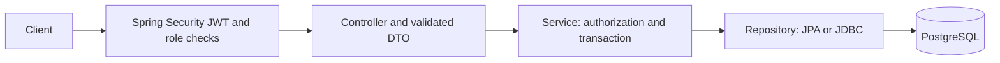
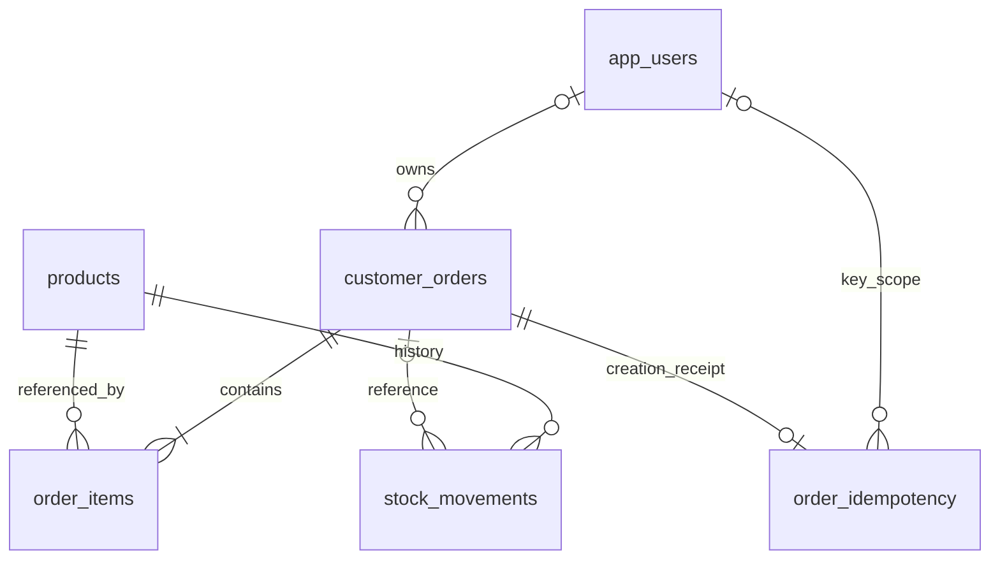

# Order Management API

A Java 21 / Spring Boot monolith demonstrating product search, transactional inventory, order lifecycle management, persistent idempotency, and user-based access control. It is a portfolio project for a Fresher Java Backend role.

[Overview](#project-overview) | [Stack](#tech-stack) | [Features](#features) | [Architecture](#architecture) | [Database](#database-schema-and-relationships) | [Endpoints](#api-endpoints) | [Run](#how-to-run) | [Examples](#example-requests--responses) | [Tests](#testing) | [Decisions](#design-decisions)

## Project Overview

Customers register, log in, browse products, and create/read their own orders. Administrators manage the catalog and inventory, inspect any order, and cancel or advance orders through fulfillment. Administrators may also create orders owned by themselves. Customer cancellation is not exposed: cancellation and all lifecycle actions require ADMIN.

Prices are read from the database and snapshotted when ordering. Order/items, stock changes, inventory movements, and any idempotency receipt commit or roll back together. The project remains one Spring Boot application and one PostgreSQL database. There is no frontend application, payment/carrier integration, microservice, Redis, Kafka, refresh-token flow, or user/role administration API.

[Swagger UI](http://localhost:8080/swagger-ui/index.html) is available after startup. [INTERVIEW_PREP.md](INTERVIEW_PREP.md) explains the source in Vietnamese. [REVIEW.md](REVIEW.md) records an earlier review; its old test counts and unauthenticated API behavior are historical.

## Tech Stack

| Area | Technology |
| --- | --- |
| Language / build | Java 21, Maven 3.9.11 via Maven Wrapper |
| Application | Spring Boot 3.5.16, Spring Web / MVC |
| Persistence | Spring Data JPA, Hibernate, Spring JDBC for key arbitration |
| Database / migrations | PostgreSQL 17, Flyway V1-V6 |
| Authentication | Spring Security 6.5.11, OAuth2 Resource Server / JOSE, Nimbus JWT |
| Password storage | Spring BCryptPasswordEncoder, cost 12 |
| Validation | Jakarta Validation and service guards |
| API documentation | OpenAPI 3.0, springdoc-openapi 2.10.0, Swagger UI |
| Health | Actuator with status-only health |
| Tests | JUnit 5, Mockito, MockMvc, Spring Security Test, PostgreSQL Testcontainers |
| Local / CI | Docker Compose, GitHub Actions |

Spring Boot manages security/Nimbus dependency versions in [pom.xml](pom.xml). springdoc is pinned using its [Boot 3.5 compatibility matrix](https://springdoc.org/v2/#what-is-the-compatibility-matrix-of-springdoc-openapi-with-spring-boot). JWT parsing, MAC verification, expiry checks, and password hashing use maintained libraries, not custom cryptographic implementations.

## Features

- Product CRUD with protected writes; case-insensitive name search, inclusive price filtering, stock filtering, sorting, and database pagination.
- Multi-product ordering, BigDecimal totals, original price snapshots, and stock checks under ascending product-ID write locks.
- CREATED -> CONFIRMED -> SHIPPED -> DELIVERED, or CREATED -> CANCELLED; repeated/invalid transitions return 409.
- Deduct stock at creation only; cancel restores stock once. Fulfillment does not deduct stock again.
- Manual restock and paginated inventory history with initial/deduction/cancellation/restock movements.
- Optional persistent Idempotency-Key scoped to the authenticated user, including concurrent retries and rollback recovery.
- CUSTOMER registration, BCrypt password hashes, short-lived JWT login, role authorization, and database ownership checks.
- Explicit operator-only admin bootstrap, structured errors, DTO-only responses, Swagger documentation, and an opt-in local demo.

## Architecture



Controllers define HTTP contracts. Services enforce method permissions and order ownership as well as business rules. Repositories execute SQL filtering/pagination and pessimistic locks. Constructor injection is used throughout; Lombok is not used. Entities and password hashes are never returned directly. `open-in-view=false` keeps lazy access inside service transactions.

JWT authentication uses Spring Security's bearer-token filter. [JwtConfig](src/main/java/com/example/ordermanagement/security/JwtConfig.java) pins HS256 and validates timestamps, issuer, audience, subject, and role. [SecurityConfig](src/main/java/com/example/ordermanagement/security/SecurityConfig.java) also verifies that the database user still exists and the role still matches the token. This adds a database read per authenticated HTTP request; there is no HTTP session or token cache.

Packages: `auth/` contains user persistence, DTOs, login/registration, and bootstrap; `security/` contains JWT and authorization configuration; `product/`, `order/`, and `inventory/` contain business code; `common/` contains errors and page DTOs; `config/` contains OpenAPI configuration.

## Database Schema and Relationships



| Table | Key fields and constraints |
| --- | --- |
| `app_users` | Identity ID, unique normalized email, 60-character BCrypt hash, CUSTOMER/ADMIN role, created_at |
| `products` | Name/description, NUMERIC(19,2) price, nonnegative INTEGER stock |
| `customer_orders` | Status CHECK, NUMERIC(25,2) total, created_at, nullable legacy user_id FK |
| `order_items` | Order/product FKs, positive quantity, price/subtotal snapshots; unique (order_id, product_id) |
| `stock_movements` | Signed delta, stock before/after, type, optional order/reason, timestamp; balance/type CHECKs |
| `order_idempotency` | Surrogate ID, user FK, client key, canonical payload, order FK, JSON response snapshot, timestamp |

Migration [V6](src/main/resources/db/migration/V6__users_order_ownership_and_scoped_idempotency.sql) adds users and ownership without changing old prices, statuses, stock, or journal entries. Existing orders retain `user_id = NULL` and are ADMIN-only; no owner or account is invented. New orders require an owner in the entity factory/service. The column remains nullable to preserve legacy data and allow legacy lifecycle updates; direct SQL is outside application authorization.

Old idempotency receipts are retained with NULL user_id and their exact payload/response text. They are archived outside authenticated users' replay scope. New calls use a partial unique index on `(user_id, idempotency_key)`; a separate partial unique index preserves legacy-key uniqueness. An old unscoped key does not recover an old order after this security upgrade. ADMIN can inspect that order by its ID. V1-V5 remain unchanged.

User/order foreign keys use RESTRICT, with no cascade deletion of users/history. A user_id index supports order FK checks; the scoped key index also covers receipt user FK lookups. Stock history uses `(product_id, created_at DESC, id DESC)`. The price/ID index supports selective price pages. No plain name index is claimed to accelerate `%keyword%`; pg_trgm is not installed. See [ProductSearchIT](src/test/java/com/example/ordermanagement/integration/ProductSearchIT.java) for generated SQL and measured query plans, not a throughput benchmark.

## API Endpoints

Base URL: `http://localhost:8080`. JSON bodies. Supply `Authorization: Bearer <access-token>` on protected endpoints.

| Method | Endpoint | Permission | Success |
| --- | --- | --- | --- |
| POST | `/api/auth/register` | Public; always creates CUSTOMER | 201 |
| POST | `/api/auth/login` | Public | 200, access token |
| GET | `/api/products` | Public | 200, page |
| GET | `/api/products/{id}` | Public | 200 |
| POST | `/api/products` | ADMIN | 201 + Location |
| PUT | `/api/products/{id}` | ADMIN; keep current stock unchanged | 200 |
| DELETE | `/api/products/{id}` | ADMIN; no order/movement references | 204, empty body |
| POST | `/api/products/{id}/restock` | ADMIN | 200 |
| GET | `/api/products/{id}/stock-movements` | ADMIN | 200, page |
| POST | `/api/orders` | CUSTOMER or ADMIN; owner from principal | 201, or 200 replay |
| GET | `/api/orders` | CUSTOMER: own orders; ADMIN: all, including legacy | 200, summary page |
| GET | `/api/orders/{id}` | CUSTOMER owner or ADMIN | 200 |
| POST | `/api/orders/{id}/confirm` | ADMIN; CREATED -> CONFIRMED | 200 |
| POST | `/api/orders/{id}/ship` | ADMIN; CONFIRMED -> SHIPPED | 200 |
| POST | `/api/orders/{id}/deliver` | ADMIN; SHIPPED -> DELIVERED | 200 |
| POST | `/api/orders/{id}/cancel` | ADMIN; CREATED -> CANCELLED | 200 |

Customer lookups use `findByIdAndUserId`; another customer's order and an absent order both return 404. ADMIN reads any order, including legacy unowned records. HTTP routes and service `@PreAuthorize` checks enforce roles. No client `role` or `userId` can override this: unknown JSON fields are rejected.

### Order listing, filtering, and pagination

`GET /api/orders` accepts optional `status`, `from`, `to`, `page`, and `size`. CUSTOMER scope always comes from the authenticated principal; ADMIN can list every owner and legacy orders with `user_id = NULL`. There is no client owner filter. Unrecognized query parameters (including `userId` and `sort`) are ignored and cannot change the server's scope or ordering.

| Parameter | Contract |
| --- | --- |
| status | Optional, case-sensitive enum: CREATED, CONFIRMED, SHIPPED, DELIVERED, CANCELLED |
| from / to | Optional inclusive createdAt bounds in ISO-8601 with `Z` or a numeric offset; encode `+` as `%2B` in a URL. Local dates/times without a timezone are rejected. `from` must not be after `to`. |
| page | Zero-based integer, default 0; nonnegative |
| size | Integer 1-100, default 20; `page * size` must not exceed 2147483647 |

Filters combine with AND **before** database pagination. Fixed sorting is `createdAt DESC, id DESC`; the ID breaks timestamp ties. Spring Data JPA Specification includes the ownership condition in both the result and count queries. The fluent DTO projection selects only `id`, `status`, `totalAmount`, `createdAt`; it does not load OrderItem or AppUser entities. This follows the [Spring Data DTO projection approach](https://docs.spring.io/spring-data/jpa/reference/3.5/repositories/projections.html). No schema change/migration is needed. The existing user_id index remains available for customer filtering; large result sets may still require database sorting, and no performance benchmark is claimed.

Success returns the existing `PageResponse` shape. `totalElements` counts only rows matching the caller's scope and filters. No matches or a page beyond the result set returns 200 with empty `content` and the correct totals. Invalid status/date/range/page/size/offset returns 400; no authentication returns 401. `GET /api/orders/{id}` still returns the unchanged detailed `OrderResponse` with items.

```http
GET /api/orders?status=CREATED&from=2026-11-01T00:00:00Z&to=2026-11-30T23:59:59Z&page=0&size=20
Authorization: Bearer <CUSTOMER_ACCESS_TOKEN>
```

Illustrative response for one matching order owned by the caller:

```json
{"content":[{"id":1,"status":"CREATED","totalAmount":119.80,"createdAt":"2026-11-21T06:01:00Z"}],"page":0,"size":20,"totalElements":1,"totalPages":1,"last":true}
```

### Validation, HTTP status, and errors

- Registration: normalized (trimmed/lowercased) email up to 254 characters; nonblank password 12-72 characters and at most 72 UTF-8 bytes. Passwords are never trimmed. Login validates email, nonblank password, and the same byte ceiling. Duplicate normalized emails return 409, including concurrent inserts.
- Product: nonblank name <=120, optional description <=2000, price >=0.01 with at most 12 integer/2 fractional digits, stock 0..2147483647. PUT cannot replace stock; changed stock returns 409.
- Order: 1-100 distinct non-null items, positive product IDs, integer quantity 1..1000000. Prices/totals are server-calculated. Missing products return 404; insufficient stock returns 409.
- Restock: quantity 1..2147483647, required trimmed reason <=500; resulting stock must fit INTEGER. Successful restock is not idempotent and adds stock again if repeated.
- Search: optional `keyword` (trimmed, <=120, literal case-insensitive substring), inclusive nonnegative `minPrice`/`maxPrice` with min <= max, `inStock=true` (>0), false (=0), or omitted. All filters combine with AND.
- Pages: page >=0, size 1..100, page*size <=2147483647. Product defaults: page=0,size=20,sort=id,asc; sort fields id/name/price/stockQuantity, optional asc/desc. Non-ID sorts add ID ascending. History permits only createdAt,asc or createdAt,desc (default desc), with ID in the same direction for ties.

Errors use ApiError: `timestamp`, `status`, `error`, `message`, `path`, `fieldErrors`. 400 means invalid input; 401 means missing/invalid/expired bearer token or invalid credentials; 403 means authenticated but lacking role permission; 404 means absent/not-owned resource; 409 means business/idempotency/locking conflict; 500 hides internal details. Protected routes authenticate before validating business input. Authentication database/backend failures return generic 500 rather than misclassifying an outage as invalid credentials. Invalid login credentials have the same generic message whether the email exists or not. Registration intentionally reports duplicate emails with 409. Successful login is `Cache-Control: no-store`; no session cookie is issued.

### Idempotent order creation

Optional `Idempotency-Key`: 1-128 case-sensitive ASCII letters/digits or `.`, `_`, `:`, `-`, exactly one value without spaces. Scope is the authenticated user. Without it, each successful request creates a new order. New key: 201 + Location + `Idempotency-Replayed: false`. Same user/key/equivalent payload: 200 + Location + `Idempotency-Replayed: true`, returning the original creation snapshot without another stock/journal write. A different valid payload for that user/key returns 409. Different users may reuse the same key independently.

Payload identity is the sorted set of `(productId,quantity)` pairs; JSON whitespace, property ordering, and item ordering are insignificant. Duplicates still return 400. Replays keep original prices and CREATED status even after cancellation/fulfillment; GET returns current state. Keys are retained indefinitely; deletion/expiry is not implemented. Restock does not support keys.

The coordinator claims `(user_id,key)` with `INSERT ... ON CONFLICT DO NOTHING` before product locks in READ COMMITTED. A competing insert waits for commit/rollback; a separate SELECT statement obtains the newly committed receipt. Rollback lets a waiting request claim and create. OrderService joins the coordinator's REQUIRED transaction; JDBC and Hibernate share it. A deferred database trigger rejects incomplete reservations at commit. Failures are not cached; a five-second lock timeout returns retryable 409 (Spring's PostgreSQL SQLSTATE translator handles 55P03). An indefinitely stalled live owner still needs database timeout/operator intervention; no lease takeover is implemented. These guarantees apply to retained receipts in this database, not exactly-once in all conditions. See [PostgreSQL unique checks](https://www.postgresql.org/docs/17/index-unique-checks.html) and [READ COMMITTED](https://www.postgresql.org/docs/17/transaction-iso.html).

### Stock adjustment and inventory history

INITIAL_STOCK records opening stock, including zero; ORDER_DEDUCTION is negative with an order reference; ORDER_CANCELLATION is positive with an order reference; MANUAL_RESTOCK is positive with a reason. Every movement stores before/after snapshots and createdAt. No prior history is backfilled for legacy products. History is immutable through the API, not a tamper-proof audit system against database operators. Referenced products cannot be deleted, so new products with opening history return 409 on deletion; only unused legacy products can return 204.

## How to Run

Requirements: JDK 21 for host execution; Docker Desktop in Linux-container mode with Compose v2/BuildKit; internet for first dependencies/images. No separate Maven installation is needed. Clone `https://github.com/22127433/order-management-api.git` and run commands from its root.

### Windows: initialize secrets and provision the first admin

```powershell
.\scripts\init-local.ps1
notepad .env
```

The initializer copies `.env.example` if necessary and generates a cryptographically random 32-byte Base64 JWT key only if missing/empty. It preserves an existing key and does not print it. In your ignored `.env`, set POSTGRES_PASSWORD. To provision an admin on first startup, set BOOTSTRAP_ADMIN_ENABLED=true and provide your own BOOTSTRAP_ADMIN_EMAIL and BOOTSTRAP_ADMIN_PASSWORD (same validation as registration). There are no default credentials. Quote values containing `$` or `#` with single quotes. Never commit `.env`, JWTs, or actual credentials.

Bootstrap is disabled by default. When explicitly enabled, it creates ADMIN with BCrypt. It refuses to promote an existing CUSTOMER and never resets an existing admin password silently. After the first successful startup, set BOOTSTRAP_ADMIN_ENABLED=false and clear BOOTSTRAP_ADMIN_PASSWORD in `.env`; restart/recreate the API. Existing admin credentials keep working. No role-changing or password-reset endpoint is implemented.

### Windows: PostgreSQL in Docker, API on the host

```powershell
.\scripts\load-env.ps1
docker compose up -d --wait postgres
.\mvnw.cmd spring-boot:run
```

Or use `.\scripts\run-local.ps1`. Spring Boot launched through Maven does not automatically load `.env`; the loader safely reads values as data into this process environment. Reload after editing it. Database-only `docker compose up -d` keeps working without JWT configuration. For an existing database, set DB_HOST/DB_PORT and use `run-local.ps1 -SkipDatabase`.

### Windows: both API and PostgreSQL in Docker

After configuring `.env`, no host JDK is required:

```powershell
docker compose --profile app up -d --build --wait
docker compose logs -f api
```

Default Compose without the app profile starts only PostgreSQL. The app profile waits for database health, then checks API `/actuator/health`. Dockerfile uses Maven 3.9.11/Java 21, a BuildKit Maven cache, unit/MVC tests during packaging, and a non-root Java 21 runtime. PostgreSQL integration tests run separately. Host ports bind to 127.0.0.1.

After changing bootstrap flags/password in `.env`, recreate the API with `docker compose --profile app up -d --wait api`. Stop containers while retaining data with `docker compose --profile app down`. The postgres_data volume persists data; changing POSTGRES_PASSWORD in `.env` does not change an initialized database's password. If ports are busy, adjust POSTGRES_PORT/SERVER_PORT before startup. Stop host Java with Ctrl+C.

### Swagger UI and health

- [Swagger UI](http://localhost:8080/swagger-ui/index.html): run register/login, then click **Authorize** and paste only the returned accessToken (Swagger adds Bearer). Use CUSTOMER or ADMIN credentials for the operation's permission.
- [OpenAPI JSON](http://localhost:8080/v3/api-docs), [YAML](http://localhost:8080/v3/api-docs.yaml): 16 documented business operations with DTOs, errors, and security requirements.
- [Health](http://localhost:8080/actuator/health): status only, 200 UP / 503 DOWN. Other management endpoints are not exposed and security denies their requests (401 without authentication, 403 when authenticated). Environment/configprops/heapdump are not public. JMX endpoints and probes are disabled.

Set API_DOCS_ENABLED=false to disable both Swagger and the spec. Authorization is not persisted by Swagger across reloads. Public endpoints can still return 401 if an invalid bearer token is explicitly supplied. The root `/` is not an API endpoint.

### Windows: guided local demo

With the API running, open another PowerShell terminal:

```powershell
.\scripts\demo.ps1
```

It prompts for the local ADMIN credential, logs in, registers a fresh CUSTOMER, and uses that customer for ordering/retries. ADMIN performs catalog, inventory, and lifecycle actions. It accepts loopback HTTP(S) URLs only; use `-BaseUrl http://localhost:8081` for a different port. It does not print passwords or JWTs. Each run intentionally adds one CUSTOMER, two products, and two orders; final keyboard stock is 24 with five movements. IDs and the non-secret idempotency key are printed for inspection as ADMIN in Swagger. These records remain; no startup product/order seed or automatic history deletion occurs.

### Configuration

| Variable | Default | Purpose |
| --- | --- | --- |
| POSTGRES_PASSWORD | Required | Database password |
| POSTGRES_DB / POSTGRES_USER | order_management / order_app | Database name/user |
| POSTGRES_PORT / SERVER_PORT | 5432 / 8080 | Published host ports |
| DB_HOST / DB_PORT | localhost / POSTGRES_PORT | Host Java database overrides |
| JWT_SECRET_BASE64 | Required for API; no fallback | At least 32 random bytes, Base64-encoded |
| BOOTSTRAP_ADMIN_ENABLED | false | Explicit one-time operator action |
| BOOTSTRAP_ADMIN_EMAIL / BOOTSTRAP_ADMIN_PASSWORD | Empty | Operator-supplied bootstrap credentials |
| API_DOCS_ENABLED | true | Swagger/spec toggle |

Compose sets internal database host=postgres, port=5432, and API port=8080. JWT issuer/audience are order-management-api; TTL is 15m in application.yml. Configuration validates TTL from 1 minute to 1 hour. Invalid/missing signing keys fail startup. .gitignore and .dockerignore exclude real env files, credentials, private keys, caches, and build output.

## Example Requests & Responses

[requests.http](requests.http) uses VS Code REST Client prompts for credentials so secrets need not be written into the tracked file. Register a CUSTOMER and run CUSTOMER/ADMIN login requests first, then numbered examples. Named responses supply actual IDs and tokens. Login again after access-token expiry. Swagger example IDs are illustrative, not existing records. The placeholders below must be replaced locally; do not commit real tokens/passwords.

Register and log in:

```http
POST /api/auth/register
Content-Type: application/json

{"email":"customer@example.com","password":"<YOUR_LOCAL_CUSTOMER_PASSWORD>"}
```

201 returns only id, email, role=CUSTOMER, createdAt. POST `/api/auth/login` with the same fields returns 200:

```json
{"accessToken":"<ACCESS_TOKEN>","tokenType":"Bearer","expiresIn":900,"user":{"id":2,"email":"customer@example.com","role":"CUSTOMER","createdAt":"2026-11-18T06:00:00Z"}}
```

Create Product (ADMIN):

```http
POST /api/products
Authorization: Bearer <ADMIN_ACCESS_TOKEN>
Content-Type: application/json

{"name":"Keyboard","description":"USB","price":59.90,"stockQuantity":20}
```

201 + Location returns `{ "id":1,"name":"Keyboard","description":"USB","price":59.90,"stockQuantity":20 }`.

List Products (public):

```http
GET /api/products?keyword=KEYboard&minPrice=10&maxPrice=100&inStock=true&page=0&size=10&sort=price,asc
```

200 returns `content`, zero-based `page`, `size`, filtered `totalElements`, `totalPages`, `last`.

Create Order (CUSTOMER or ADMIN):

```http
POST /api/orders
Authorization: Bearer <CUSTOMER_ACCESS_TOKEN>
Idempotency-Key: checkout-example-1
Content-Type: application/json

{"items":[{"productId":1,"quantity":2}]}
```

Illustrative 201 response (assuming authenticated user ID 2):

```json
{"id":1,"status":"CREATED","totalAmount":119.80,"createdAt":"2026-11-18T06:01:00Z","items":[{"id":1,"productId":1,"quantity":2,"unitPrice":59.90,"subtotal":119.80}],"userId":2}
```

Get Order: `GET /api/orders/1` with its owner's token or an ADMIN token -> 200. A different CUSTOMER token -> 404. Cancel Order: `POST /api/orders/1/cancel` with ADMIN -> 200 CANCELLED, stock restored once; repeat -> 409. CUSTOMER cancellation -> 403. For a separate order, ADMIN calls confirm -> ship -> deliver; stock is unchanged by these actions.

Validation Error: creating an order with quantity=0 returns 400 after authentication:

```json
{"timestamp":"2026-11-18T06:02:00Z","status":400,"error":"Bad Request","message":"Request validation failed","path":"/api/orders","fieldErrors":[{"field":"items[0].quantity","message":"must be greater than 0"}]}
```

Insufficient Stock Error: with 18 keyboards remaining, quantity=21 returns 409 with message `Insufficient stock for product 1: requested 21, available 18`; stock/order/receipt/journal changes roll back. Invalid token returns 401 with WWW-Authenticate: Bearer; valid CUSTOMER attempting restock returns 403. Every error retains the shared ApiError shape.

## Testing

No database, Docker, .env, or production signing secret is required for unit/MVC tests:

```powershell
.\mvnw.cmd test
```

With Docker running, compile/package and run all PostgreSQL integration tests:

```powershell
.\mvnw.cmd clean verify -Pintegration
```

Linux/macOS: `sh mvnw ...`. Surefire runs *Test; Failsafe runs *IT under the integration profile. Testcontainers creates isolated PostgreSQL databases. Test keys/passwords are generated at runtime; no production credentials are used. Unit mocks cannot prove SQL transactions, JWT signature verification, or ownership enforcement across real HTTP requests.

Pre-feature baseline verification on **18 November 2026**: `clean verify -Pintegration` completed with **BUILD SUCCESS**, **430 tests passed**, zero failures/errors/skips across 19 classes:

| Group | Passed | Evidence |
| --- | ---: | --- |
| Unit | 164 | Mockito service/domain tests and real Nimbus encoder/decoder tests; no database |
| MVC slice | 133 | MockMvc with security filters; business services/repositories mocked |
| PostgreSQL integration | 133 | Testcontainers, real transactions/locks, and HTTP authentication/ownership tests |

XML reports are in target/surefire-reports and target/failsafe-reports (excluded from Git). A separate Docker smoke check built the API, bootstrapped an operator-supplied ADMIN, ran the authenticated CUSTOMER/ADMIN demo (stock 24, five movements), rendered 15 Swagger operations with Authorize in headless Chrome, and verified login plus an existing token after restart with bootstrap disabled/password removed. PostgreSQL-only Compose also ran without JWT settings. Smoke checks are not included in the JUnit count.

Security tests cover DTO validation, BCrypt byte limits/salts, JWT claims/signature/algorithm, 401/403, forbidden registration role, owner spoofing, other-user access, ADMIN operations, method security, per-user idempotency, concurrent registration/creation, stale/deleted identities, and V5-to-V6 data preservation. Existing stock, lifecycle, rollback, price, pagination, and key-lock tests remain enabled with explicit test identities. Controlled concurrency tests observe actual PostgreSQL lock waits; they are not exhaustive stress tests.

The [CI workflow](.github/workflows/ci.yml) runs verify -Pintegration on push/PR with a 20-minute timeout. Local results do not imply CI success; inspect GitHub Actions separately. No production throughput/coverage benchmark is claimed.

## Design Decisions

- **Password storage:** BCrypt cost 12 with a fresh salt; no reversible password encryption. Validate 72 UTF-8 bytes before hashing so long Unicode passwords cannot be silently truncated. Normalize emails, never passwords. Hashing/verification uses Spring's PasswordEncoder and DaoAuthenticationProvider. See [Spring password storage](https://docs.spring.io/spring-security/reference/features/authentication/password-storage.html).
- **JWT:** HS256 is sufficient for one issuing/verifying monolith. A random environment-provided key is mandatory. Spring/Nimbus verifies signatures with the pinned algorithm, issuer/audience, required numeric subject/role/iat/exp, timestamps, and 30-second clock leeway. JWTs are signed, not encrypted; they contain no password/hash/email. Replacing the secret invalidates existing tokens. See [Spring Resource Server JWT](https://docs.spring.io/spring-security/reference/servlet/oauth2/resource-server/jwt.html).
- **Identity freshness:** Each JWT request rechecks the database account and role. Deleted accounts or changed roles invalidate old tokens. No HTTP session, refresh token, logout endpoint, individual token denylist, password reset, or role-change API is implemented. Access tokens otherwise remain usable until expiry; production deployment would need HTTPS and an appropriate abuse/rate-limit policy.
- **Authorization:** Request matchers and method security check roles; repository ownership predicates protect Order reads. A role alone is not ownership. ADMIN-only cancellation preserves existing lifecycle/stock rules. User IDs/roles cannot be assigned through registration/order request DTOs.
- **CSRF/CORS:** CSRF is disabled because authentication uses explicit bearer headers with no cookie/basic/form session. This choice must be revisited if cookie authentication is introduced. No permissive cross-origin policy is added.
- **Transactions/locking:** Order creation, cancellation, restock and movements retain their write transactions and pessimistic product locks. Products are locked in ascending ID order; lifecycle/cancel lock the order first. Idempotency claims precede product locks. Authorization does not replace database concurrency controls.
- **Migration compatibility:** Keep legacy owners/receipts NULL and ADMIN-only/archived rather than guessing user ownership. New application-created orders always have an owner. Schema nullability is an explicit compatibility limitation, not a claim that raw SQL obeys authorization. Existing API URLs/body shapes remain, with additive response userId; protected endpoints intentionally require authentication now.
- **Scope:** One application/database, constructor injection, DTO boundaries, explicit Flyway migrations, and targeted indexes. No extra infrastructure is needed for these portfolio features.

Feature verification on 21 November 2026: Maven Wrapper verify -Pintegration completed with BUILD SUCCESS; 469 cases passed (174 unit, 151 MVC, 144 PostgreSQL integration), with zero failures/errors/skips.
